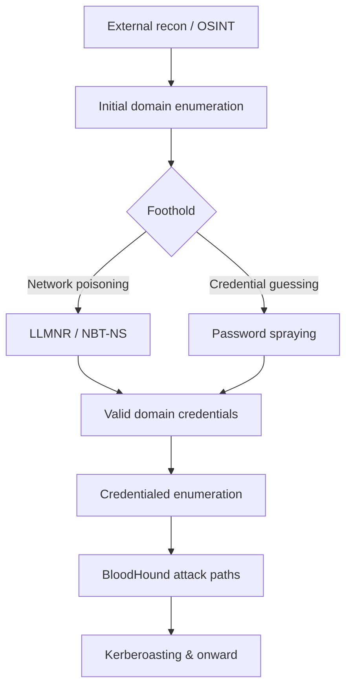

# Active Directory

**Active Directory (AD)** is Microsoft's directory service for Windows networks. It stores every user, computer, group, and policy in the environment in one place and handles authentication and authorization for all of them. Because almost every medium-to-large organisation runs on it, AD is the single most important thing to understand for internal network testing: compromise the directory and you effectively own the network.

This section rebuilds the **Active Directory Enumeration & Attacks** workflow as a clean, repeatable methodology. It follows the path a real internal assessment takes — map the outside, get a first foothold, turn that foothold into credentials, and use those credentials to find the shortest path to a privileged account — authored from field notes and kept to authorised, educational use.

!!! note "What this section covers"
    The focus is **enumeration and the initial-attack phase**: external recon, getting a foothold through poisoning or spraying, then enumerating the domain with credentials, mapping it in BloodHound, and extracting service-account hashes with Kerberoasting. Post-foothold topics (ADCS, lateral movement, domain dominance) are kept as separate reference pages.

## The directory in plain terms

A few building blocks appear on every page, so it helps to name them once.

- **Domain** — a logical boundary of objects (users, computers, groups) that share a database and policy, e.g. `INLANEFREIGHT.LOCAL`. Domains can be nested into a **forest**, and forests can **trust** each other.
- **Domain Controller (DC)** — a server that hosts the AD database and answers authentication requests. Find the DC and you have found the heart of the domain. A DC typically exposes DNS (53), Kerberos (88), LDAP (389/636), SMB (445), and the Global Catalog (3268/3269).
- **Object and principal** — anything stored in the directory is an object; a user, computer, or group that can hold permissions is a **security principal**, identified by a **SID**.
- **OU (Organisational Unit)** — a container used to organise objects and apply Group Policy.
- **GPO (Group Policy Object)** — a bundle of settings pushed to users and computers; GPOs frequently leak credentials and misconfigurations.

### The protocols you will attack

AD authentication runs on a handful of protocols. You do not need to implement them, but you must recognise them.

| Protocol | What it is | Why it matters |
| :--- | :--- | :--- |
| **LDAP** | Lightweight Directory Access Protocol — the query language/API for reading and writing directory objects | Almost all enumeration (users, groups, ACLs, SPNs) is an LDAP query underneath |
| **Kerberos** | The default AD authentication protocol — a ticket system where a DC (the KDC) issues a TGT, which is exchanged for service tickets (TGS) | AS-REP Roasting and Kerberoasting both abuse how these tickets are issued and encrypted |
| **NTLM / NetNTLM** | A legacy challenge-response authentication scheme still enabled almost everywhere | Captured NetNTLMv2 hashes can be cracked offline or relayed to other hosts |
| **SMB** | File and resource sharing over the network | Null sessions, share hunting, and remote execution all ride on SMB |
| **DNS** | Name resolution; AD is DNS-dependent | A failed DNS lookup is exactly what triggers the LLMNR/NBT-NS fallback we poison |

## The assessment flow

The pages in this section are ordered the way the work actually happens.

Two things run in parallel at the foothold stage: **network poisoning** (listen for and spoof name-resolution traffic to capture hashes) and **password spraying** (try one common password against many accounts). Either one can hand you the first valid credential, and a single low-privilege domain user is enough to start mapping the whole domain.

## The engagement scenario

The commands throughout use a running example: an internal test of **Inlanefreight** (`INLANEFREIGHT.LOCAL`) on the `172.16.5.0/23` subnet, starting from an **anonymous position with no credentials** and working toward Domain Admin. Substitute your own authorised targets for the placeholders:

- `<DC_IP>` — the Domain Controller's IP (example: `172.16.5.5`)
- `<DOMAIN>` — the target domain (example: `INLANEFREIGHT.LOCAL`)
- `<TARGET_IP>` — any other in-scope host

!!! danger "Authorisation first — every time"
    Everything here is for **authorised, educational engagements only**. Before you touch a host: confirm it is explicitly in the scope document, confirm the method is authorised in writing, and confirm whether the test is evasive or non-evasive. Noisy tools (Nmap, Responder, spraying) trip SOC alerts, and a careless spray can lock out every account in the business. When in doubt, ask the client — do not assume.

## Pages in this section

**Foundations**

- **[Tools of the Trade](tools-of-the-trade.md)** — the standard AD toolkit, grouped by phase.
- **[External Recon & Enumeration Principles](external-recon.md)** — OSINT, breach data, and building a username list before you go internal.

**Getting a foothold**

- **[Initial Domain Enumeration](initial-domain-enumeration.md)** — passive listening, host discovery, Nmap, and Kerbrute user enumeration.
- **[LLMNR & NBT-NS Poisoning](llmnr-nbtns-poisoning.md)** — capturing NetNTLMv2 hashes with Responder (Linux) and Inveigh (Windows).
- **[Password Spraying & Password Policies](password-spraying.md)** — reading the lockout policy, building a user list, and spraying safely from Linux and Windows.

**Enumeration with a foothold**

- **[Enumerating Security Controls](security-controls.md)** — spotting Defender, AppLocker, CLM, and LAPS before you run loud tools.
- **[Credentialed Enumeration](credentialed-enumeration.md)** — digging into the domain with a valid account, from Linux and Windows.
- **[BloodHound](bloodhound.md)** — collecting directory data and finding the shortest path to Domain Admins.
- **[Living Off the Land](living-off-the-land.md)** — enumerating with native Windows tooling only.

**Credential attacks**

- **[Kerberoasting](kerberoasting.md)** — requesting service tickets and cracking service-account passwords offline.
