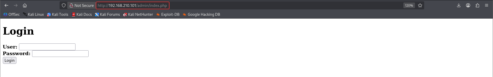

# Potato

**Box info:** Difficulty: Easy · OS: Linux (Ubuntu 20.04) · Focus: Anonymous FTP file leakage, password cracking (`john`), sudo scoped-path-traversal privilege escalation.

Anonymous FTP access leaks a backed-up source file that reveals the web login flow's logic. The real path in, though, is a leaked `/etc/passwd`-style hash for a second account, cracked offline; a narrowly-scoped sudo rule on `/bin/nice` is then widened with a relative path trick to reach a root shell.

---

## 1. Reconnaissance (nmap)

```bash
nmap -p- -T4 -Pn -sC -sV --min-rate=1000 -oA nmap_full_scan 192.168.210.101
```

```text
PORT     STATE SERVICE VERSION
22/tcp   open  ssh     OpenSSH 8.2p1 Ubuntu 4ubuntu0.1 (Ubuntu Linux; protocol 2.0)
80/tcp   open  http    Apache httpd 2.4.41 ((Ubuntu))
|_http-title: Potato company
2112/tcp open  ftp     ProFTPD
| ftp-anon: Anonymous FTP login allowed (FTP code 230)
| -rw-r--r--   1 ftp      ftp           901 Aug  2  2020 index.php.bak
|_-rw-r--r--   1 ftp      ftp            54 Aug  2  2020 welcome.msg
```

Nmap's own FTP script already flags anonymous access **and** a readable `index.php.bak` sitting in the FTP root — a backup of the web app's login page.

## 2. Enumeration

### Anonymous FTP

```bash
ftp 192.168.210.101 -p 2112
Name: anonymous
mget *
```

```php
<?php
$pass= "potato"; //note Change this password regularly

if($_GET['login']==="1"){
  if (strcmp($_POST['username'], "admin") == 0  && strcmp($_POST['password'], $pass) == 0) {
    echo "Welcome! </br> Go to the <a href=\"dashboard.php\">dashboard</a>";
    ...
```

!!! info "Why anonymous FTP is a finding on its own"
    FTP has an optional, decades-old convention where the server accepts the literal username `anonymous` with no real password (traditionally an email address is typed as a courtesy, but it's never verified). This is intended only for public file-distribution servers where every file in the FTP root is meant to be handed out to strangers. When it's enabled on a server that also happens to host application source, backups, configuration, or credential material, it becomes a completely unauthenticated file-read primitive — anyone on the network can connect with `ftp <host> -p <port>`, log in as `anonymous`, and `mget *` every file ProFTPD is serving, no password guessing or exploit required. That's exactly what happens here: the `.bak` extension on `index.php.bak` is the giveaway of a developer's backup-before-editing habit that was never cleaned up, and it is served to literally anyone who asks.

The login check uses `strcmp()` directly on user-controlled input and is theoretically vulnerable to **PHP type juggling** (passing an array instead of a string makes `strcmp()` return `NULL`, which loosely equals `0`), and various brute-force/fuzzing attempts against this form were tried — none succeeded, so this path was a dead end rather than the real foothold.

### Content discovery

```bash
ffuf -u "http://192.168.210.101/FUZZ" -w /usr/share/wordlists/seclists/Discovery/Web-Content/big.txt -r
```

```text
admin                   [Status: 200]
```



Further poking around the admin panel and application eventually surfaces a leaked system file containing the full user list and a password hash:

```text
root:x:0:0:root:/root:/bin/bash
...
florianges:x:1000:1000:florianges:/home/florianges:/bin/bash
webadmin:$1$webadmin$3sXBxGUtDGIFAcnNTNhi6/:1001:1001:webadmin,,,:/home/webadmin:/bin/bash
```

The `webadmin` account's `$1$` (md5crypt) hash is extracted and cracked offline:

```bash
john hash.txt --wordlist=/usr/share/wordlists/rockyou.txt
```

```text
dragon           (?)
1g 0:00:00:00 DONE
```

### How the hash leak and cracking works

!!! note "Reading a password hash, and why `dragon` fell instantly"
    A normal `/etc/passwd` entry has an `x` in the second field, meaning "the real password hash lives elsewhere, in `/etc/shadow`, which only root can read." Seeing an *actual hash string* inline in a `passwd`-formatted file — `webadmin:$1$webadmin$3sXBxGUtDGIFAcnNTNhi6/:1001:...` — means this box is either exposing a legacy-style combined file, a backup, or some other misconfigured leak that hands out what should be root-only material to anyone who finds it in the web app.

    The hash format itself, `$1$webadmin$3sXBxGUtDGIFAcnNTNhi6/`, follows the standard Unix crypt() scheme: fields are separated by `$`, the first field (`1`) identifies the **algorithm** — `1` means **md5crypt**, a deliberately salted, iterated variant of MD5 designed for password storage (as opposed to raw MD5, which is fast and unsalted and should never be used for passwords). The second field (`webadmin`) is the **salt**, a per-account random value mixed into the hash so that two users with the same password don't produce the same hash, and so precomputed rainbow tables can't be reused across accounts. The third field is the actual hash output.

    Despite being salted, md5crypt is still crackable offline when the underlying password is weak, because cracking doesn't need to reverse the hash — it just needs to *hash every candidate password with the same salt and algorithm, and compare*. `john hash.txt --wordlist=/usr/share/wordlists/rockyou.txt` does exactly that: for every line in `rockyou.txt`, it recomputes `md5crypt(candidate, "webadmin")` and checks it against the target hash. `dragon` is a common dictionary word that appears early in `rockyou.txt`, so the match came back essentially instantly (`john` reports `0:00:00:00` — under a second). A long, random, non-dictionary password would have made this computationally infeasible even with the hash in hand; the weakness here is entirely in the password choice, not in md5crypt being "broken."

## 3. Foothold — SSH with cracked credentials

```bash
ssh webadmin@192.168.210.101
# password: dragon
```

```text
webadmin@serv:~$ ls /home
florianges  webadmin
```

### User flag

```bash
cat /home/webadmin/local.txt
```

```text
<LOCAL_REDACTED>
```

## 4. Privilege escalation

```bash
sudo -l
```

```text
User webadmin may run the following commands on serv:
    (ALL : ALL) /bin/nice /notes/*
```

`webadmin` can run `/bin/nice` as root, but only against targets under `/notes/`. `nice` simply execs whatever is passed to it, so if the wildcard argument can be made to resolve to a path *outside* `/notes/` via `..` traversal while still textually starting with `/notes/`, the restriction is bypassed:

```bash
echo "/bin/bash -i" > /home/webadmin/root.sh
chmod +x /home/webadmin/root.sh
sudo /bin/nice /notes/../home/webadmin/root.sh
```

The first attempt (`/notes/../../../../home/webadmin/root.sh`) was rejected as `Permission denied` by sudo's path matching; relaxing it to a single `/notes/../home/webadmin/root.sh` resolves correctly and passes the wildcard check while landing exactly on the attacker-controlled script.

### How the sudo relative-path traversal works

!!! info "Why `/notes/*` doesn't mean what the administrator thinks it means"
    A `sudoers` entry like:

    ```text
    (ALL : ALL) /bin/nice /notes/*
    ```

    tells `sudo` to allow `webadmin` to run `/bin/nice` as root, but only when its argument **matches the glob pattern `/notes/*`** — the intent being "anything *inside the `/notes` directory*." The critical detail is *how* sudo checks that match: it is a **string/glob comparison against the literal argument text supplied on the command line**, not a check against the real, canonicalized filesystem path the argument resolves to after traversal. `sudo` does not resolve `..` components before matching the wildcard — it only checks whether the text you typed matches the pattern.

    `..` in a path means "go up one directory level" and is resolved by the operating system (and by `nice`/`open()` underneath it) at the point the file is actually accessed, not before. So the string `/notes/../home/webadmin/root.sh`:

    - **Textually starts with `/notes/`** — satisfying the glob `/notes/*` as far as sudo's pattern matcher is concerned, since glob matching here is essentially "does the string begin with this prefix, with anything after the `*`."
    - **Resolves, once the OS actually walks the path, to `/home/webadmin/root.sh`** — a file entirely outside `/notes`, fully writable and executable by `webadmin` themselves.

    So the sudo rule's author scoped the *text pattern* to `/notes/`, assuming that would scope the real files reachable — but a path string containing `..` can satisfy almost any directory-prefix glob while landing anywhere on disk that the traversal math works out to. (The first attempt with four `../../../../` components actually walked past the filesystem root and got rejected with `Permission denied` — not because the *technique* failed, but because that particular depth of traversal didn't land on a path `nice` could execute given other permission checks; a single `..` landed exactly on `/home/webadmin`, which is where `root.sh` actually was, and it worked.)

    From there, `/bin/nice` is just a process-priority wrapper — its entire job is to `exec()` whatever program is handed to it, after adjusting scheduling niceness. Since `sudo` has already approved running `/bin/nice <attacker path>` as root, and `nice` happily execs `root.sh` (a one-line script invoking `/bin/bash -i`, an interactive shell), the final `exec()` hands over a fully interactive **root** shell. The fix is to either scope the sudoers rule with a trailing anchor that `sudo` itself resolves safely, restrict write access to the parent directories involved, or avoid wildcard path rules against `sudo`-permitted commands entirely in favor of a fixed, non-writable script path.

## 5. Root / proof.txt

```text
root@serv:/home/webadmin# whoami
root
root@serv:/home/webadmin# cat /root/proof.txt
```

```text
<PROOF_REDACTED>
```

---

## Takeaway

A `sudoers` wildcard scoped to a directory (`/notes/*`) is not the same as scoping to that directory's *contents* — relative path traversal inside the matched string (`/notes/../home/webadmin/root.sh`) still satisfies the glob while resolving anywhere on disk. Anonymous FTP and a leaked password hash got a foothold; sudo path-matching sloppiness is what turned it into root.
