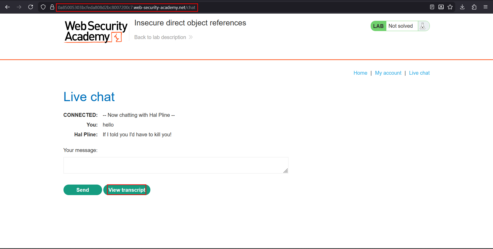
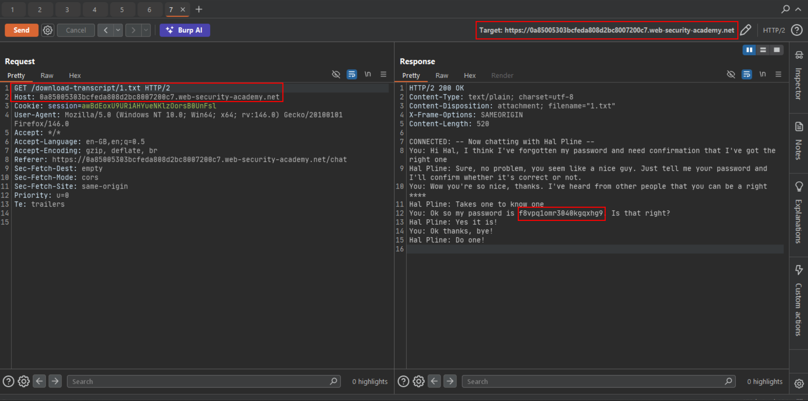
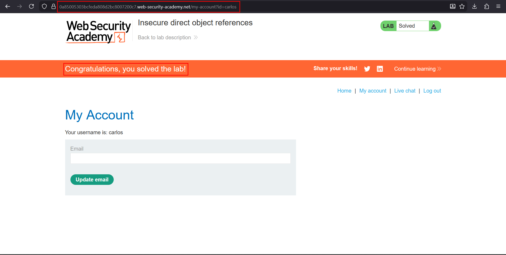

# Insecure direct object references (IDOR)

**Lab:** PortSwigger Web Security Academy — *Insecure direct object references* (Apprentice).

> This lab stores user chat logs directly on the server's file system and retrieves them using static URLs. Solve the lab by finding the password for the user `carlos` and logging into their account.

IDOR is not limited to database IDs in a query string. Here the "object" is a **file**: chat transcripts are saved as numbered text files and served from a predictable path. Anyone who can request a filename can read it.

## 1. Find the transcript feature

Open **Live chat**, send a message, then click **View transcript**. The browser downloads a file from a static URL:



## 2. Notice the numbered filename

Intercept the download. The transcript is requested by an incrementing number:

```http
GET /download-transcript/1.txt HTTP/2
Host: YOUR-LAB-ID.web-security-academy.net
```

The filename is just a counter, so transcripts saved by other users sit at neighbouring numbers. Your own transcript does not need to be the one you read.

## 3. Request another user's file

Send the request to Repeater and request a different number (the lowest, `1.txt`, is a good start). The response is somebody else's conversation, and in it the user tells the support agent their password:



## 4. Log in as carlos

Use the leaked password with the username `carlos` on the login page. The My Account page for carlos confirms access and solves the lab.



## Why the attack works

The files are directly reachable by name, the names are sequential, and the download handler never checks that the requesting session owns the transcript. Sensitive content (a password) had also been written into the chat log in plain text.

## Remediation

Do not serve user-generated files by predictable names. Look transcripts up by an identifier tied to the authenticated session and verify ownership on every request. Never store credentials in chat logs.
