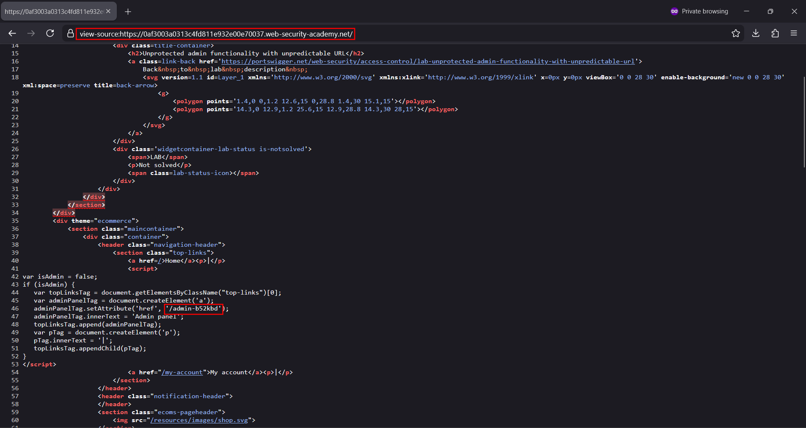
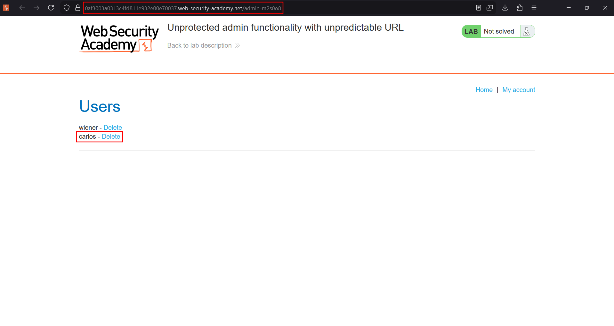
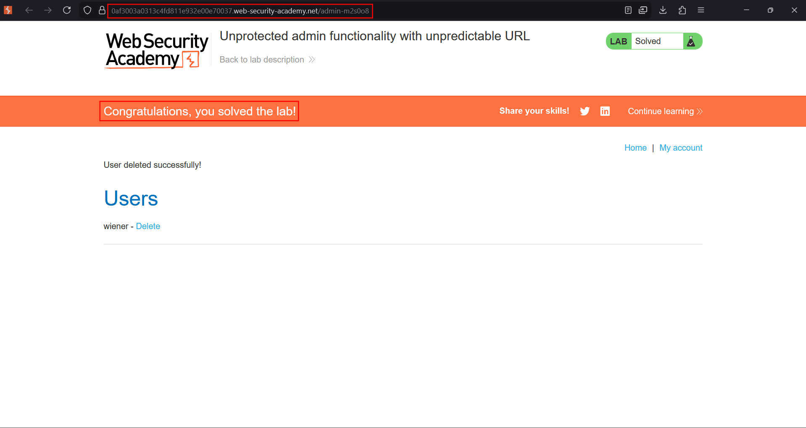

# Unprotected admin functionality with unpredictable URL

**Lab:** PortSwigger Web Security Academy — *Unprotected admin functionality with unpredictable URL* (Apprentice).

> This lab has an unprotected admin panel. It's located at an unpredictable location, but the location is disclosed somewhere in the application. Solve the lab by accessing the admin panel, and using it to delete the user `carlos`.

Like the previous lab, the admin panel has no access control — but this time the URL is randomised, so it cannot simply be guessed. The twist is that the **client-side code still needs to know where the panel is** in order to show the admin link to real admins, so the location leaks in the page source.

## 1. View the page source

Open the home page and view its source (`view-source:` or right-click → *View Page Source*). Applications often render an admin link conditionally in JavaScript — and to do that, the script has to contain the admin URL even when the link is not displayed:

```javascript
var isAdmin = false;
if (isAdmin) {
   var topLinksTag = document.getElementsByClassName("top-links")[0];
   var adminPanelTag = document.createElement('a');
   adminPanelTag.setAttribute('href', '/admin-b52kbd');
   adminPanelTag.innerText = 'Admin panel';
   topLinksTag.append(adminPanelTag);
}
```

The unpredictable path — here `/admin-b52kbd` — is hard-coded in the script even though `isAdmin` is `false`.



## 2. Browse to the disclosed path

Navigate directly to the leaked URL:

```text
https://YOUR-LAB-ID.web-security-academy.net/admin-b52kbd
```

The admin panel loads with no authentication required. Click **Delete** next to `carlos`.



## 3. Confirm the solve

The user is deleted and the lab is marked solved.



## Why the attack works

An unpredictable URL is **security through obscurity**, not access control. Because the panel itself performs no role check, anyone who learns the path can use it — and the path is disclosed by client-side JavaScript that must reference it to build the admin link. Hiding the link in a `false` branch does not hide it from anyone who reads the source.

## Remediation

Enforce server-side authorization on the admin panel and its actions. Never rely on an unguessable URL as the control, and do not ship admin URLs to clients that are not administrators — decide server-side whether to render privileged links.
