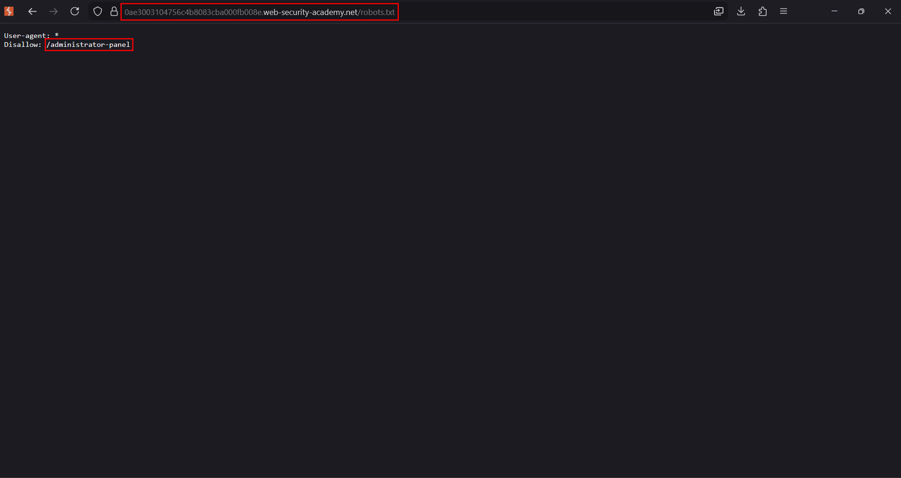
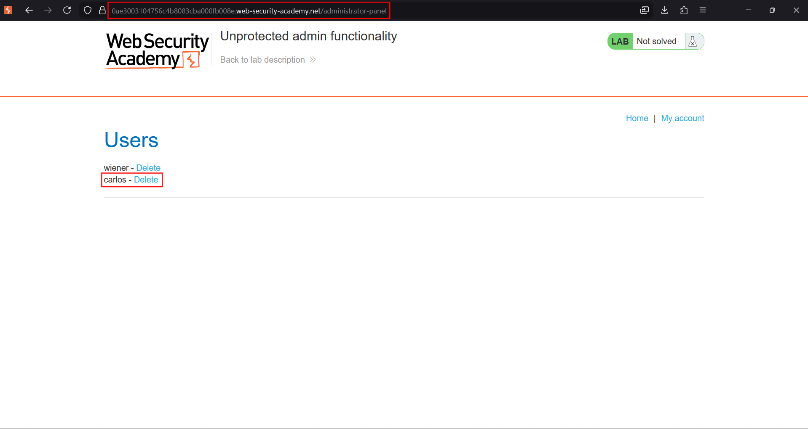

# Unprotected admin functionality

**Lab:** PortSwigger Web Security Academy — *Unprotected admin functionality* (Apprentice).

> This lab has an unprotected admin panel. Solve the lab by deleting the user `carlos`.

This is the simplest form of broken **vertical** access control. The admin panel exists and performs real, privileged actions, but the application protects it only by not linking to it — there is **no role check at all**. Anyone who learns the URL can use it.

## 1. Look for the admin path

When a sensitive path is "hidden", it is often still referenced somewhere the application never meant an attacker to read — commonly `robots.txt`, which lists paths the site asks crawlers to avoid, or it is simply guessable with content discovery.

Running a content-discovery scan against the site surfaces the usual endpoints and, importantly, `robots.txt`:

```text
$ ffuf -u https://YOUR-LAB-ID.web-security-academy.net/FUZZ -w /usr/share/wordlists/dirb/common.txt

login                   [Status: 200, ...]
my-account              [Status: 302, ...]
robots.txt              [Status: 200, Size: 45, ...]
```

## 2. Read robots.txt

Browse to `/robots.txt`. It discloses the admin path in its `Disallow` directive:

```text
User-agent: *
Disallow: /administrator-panel
```



!!! warning "robots.txt is a disclosure, not a control"
    `Disallow` only asks well-behaved crawlers to stay away. It advertises the path to everyone else and enforces nothing.

## 3. Use the admin panel

Navigate directly to the disclosed path:

```text
https://YOUR-LAB-ID.web-security-academy.net/administrator-panel
```

The admin panel loads with no authentication or role check. Click **Delete** next to `carlos`.



The user is removed and the lab is solved.

## Why the attack works

The application assumes that because the admin panel is not linked from the normal UI, ordinary users will never reach it. But the back-end performs **no authorization check** on the panel or its delete function. Requesting the URL directly is enough. Disclosing that URL in `robots.txt` removes even the need to guess it.

## Remediation

Enforce an explicit server-side role check on the admin panel and every action it exposes, so that any request from a non-administrator is rejected regardless of how the URL was obtained. Do not rely on secrecy of the path, and never advertise sensitive paths in `robots.txt`.
