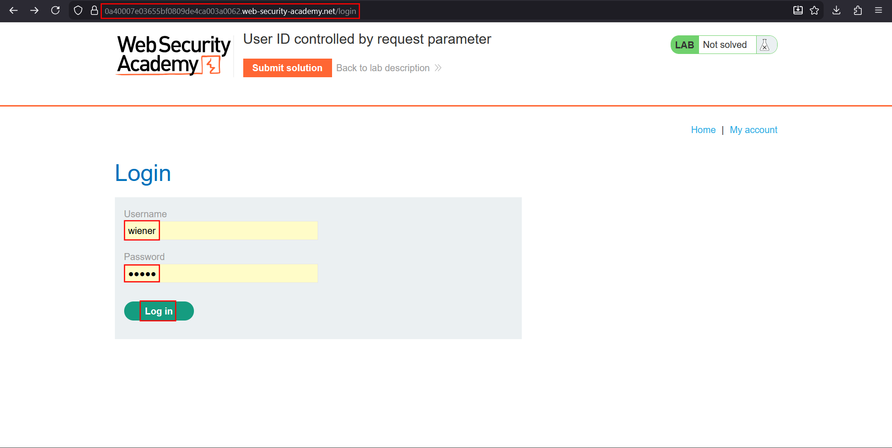
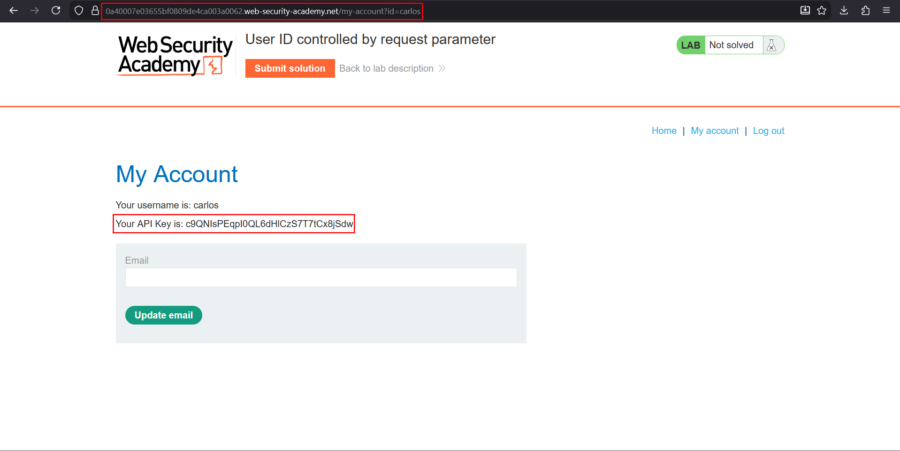

# User ID controlled by request parameter

**Lab:** PortSwigger Web Security Academy — *User ID controlled by request parameter* (Apprentice).

> This lab has a horizontal privilege escalation vulnerability on the user account page. To solve the lab, obtain the API key for the user `carlos` and submit it as the solution. Credentials: `wiener:peter`.

This is the textbook **horizontal** access-control bug. The account page decides *whose* data to show from a value in the URL (`id`) instead of from the logged-in session. Because the parameter is a plain, guessable username, changing it is all it takes to read another user's account.

## 1. Log in and find the identifier

Log in as `wiener:peter`.



Open **My account**. The URL carries the account identifier in a query parameter, and the page shows the user's API key:

```text
/my-account?id=wiener
```


## 2. Change the identifier

The `id` value is simply the username. Replace it with the victim:

```text
/my-account?id=carlos
```

## 3. Read the victim's API key

The server returns Carlos's account page, including his API key, even though the session still belongs to `wiener`.



Copy the key and submit it to solve the lab.

## Why the attack works

The server uses the client-supplied `id` to decide which record to load, and never compares it with the identity stored in the session. Authentication succeeded ("you are wiener"), but **authorization** ("is wiener allowed to see carlos?") was never evaluated.

## Remediation

Derive the account from the server-side session (`/my-account` with no id at all), or if an identifier must be accepted, verify that it matches the authenticated user before returning data. Non-admin users should receive `403` for any other value.
