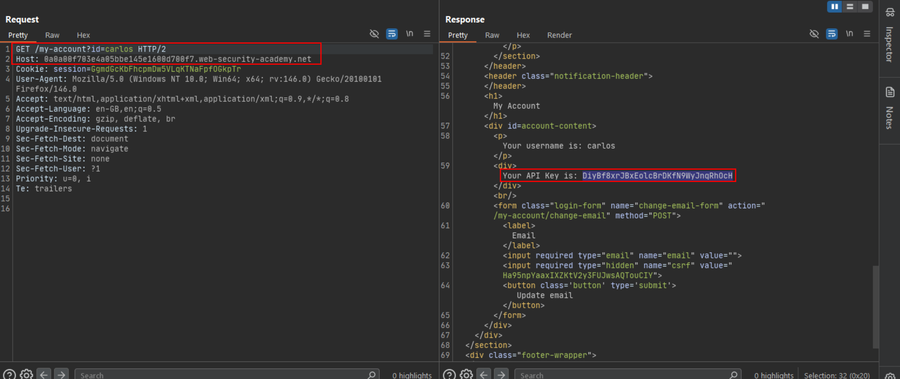

# User ID controlled by request parameter with data leakage in redirect

**Lab:** PortSwigger Web Security Academy — *User ID controlled by request parameter with data leakage in redirect* (Apprentice).

> This lab contains an access control vulnerability where sensitive information is leaked in the body of a redirect response. To solve the lab, obtain the API key for the user `carlos` and submit it as the solution. Credentials: `wiener:peter`.

In the browser this lab appears to be **secure**: asking for Carlos's account sends you away to the login page. The flaw is only visible in the raw HTTP traffic. The application *detects* the unauthorized access and issues a redirect, but it builds the full page first and leaves it in the body of the `302` response. Browsers follow the `Location` header and discard the body; a proxy shows it.

## 1. Request another user's account in a proxy

Log in as `wiener`, open **My account**, and send the request to Burp Repeater. Change the `id` parameter:

```http
GET /my-account?id=carlos HTTP/2
Host: YOUR-LAB-ID.web-security-academy.net
Cookie: session=YOUR-SESSION
```

## 2. Read the redirect body

The response is a redirect, but its body contains Carlos's account page, including the API key:



Copy the API key and submit it to solve the lab.

## Why the attack works

The access check runs *after* the sensitive response has already been generated, and the redirect is attached to a response that still carries the protected content. The authorization decision changed the status code but not the data.

!!! tip "Always inspect redirects in a proxy"
    Browsers hide the body of `3xx` responses. When an endpoint "blocks" you with a redirect, look at the redirect response itself in Burp.

## Remediation

Make the authorization check happen *before* any protected data is read, and return an empty body (or an error page) with the redirect or a `403`. Never rely on the client following a redirect to protect content.
