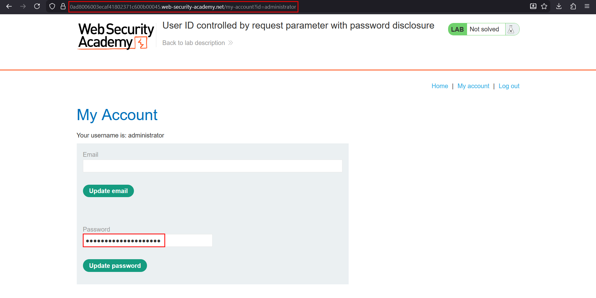
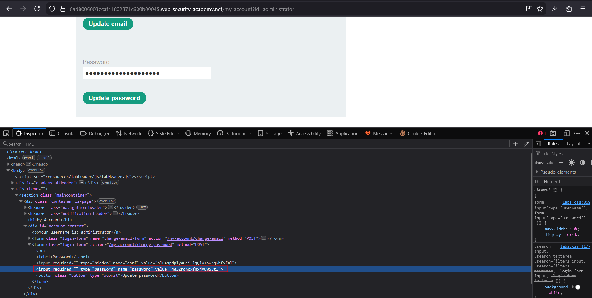
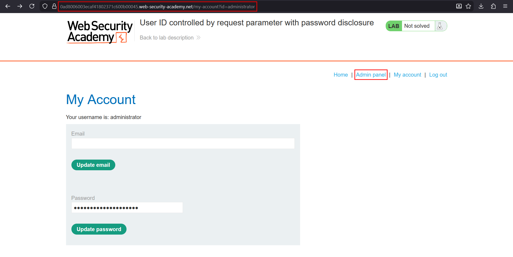
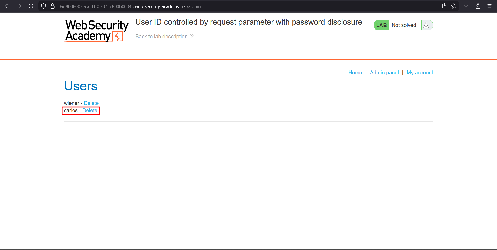

# User ID controlled by request parameter with password disclosure

**Lab:** PortSwigger Web Security Academy — *User ID controlled by request parameter with password disclosure* (Apprentice).

> This lab has a user account page that contains the current user's existing password, prefilled in a masked input. To solve the lab, retrieve the administrator's password, then use it to delete the user `carlos`. Credentials: `wiener:peter`.

This lab chains two weaknesses: an IDOR that lets a normal user load the administrator's account page, and a page that places the real password in the HTML. A masked `type="password"` input hides the characters on screen but the value is still in the page source.

## 1. Load the administrator's account

Log in as `wiener`. The account URL uses the username as the identifier. Change it to the administrator:

```text
/my-account?id=administrator
```

The page loads the administrator's settings, with the password field filled in as dots:



## 2. Recover the password from the HTML

Masked inputs still carry their value in the DOM. Open the browser developer tools, inspect the password field, and read its `value` attribute:

```html
<input required type="password" name="password" value="ADMIN-PASSWORD-HERE">
```



## 3. Log in as the administrator

Log out, then sign in as `administrator` with the recovered password. An **Admin panel** link now appears in the navigation.



## 4. Delete carlos

Open the admin panel and delete `carlos` to solve the lab.



## Why the attack works

Two independent mistakes combine into account takeover:

1. The account endpoint trusts the `id` parameter instead of the session (horizontal and, here, **vertical** escalation, because the target is an admin).
2. The application echoes a secret back to the client. Passwords should never be sent to the browser after they are set.

## Remediation

Enforce that the requested account matches the logged-in user. Never prefill password fields: store only a salted hash, and have the change-password form ask for the current and new password rather than displaying the stored one.
