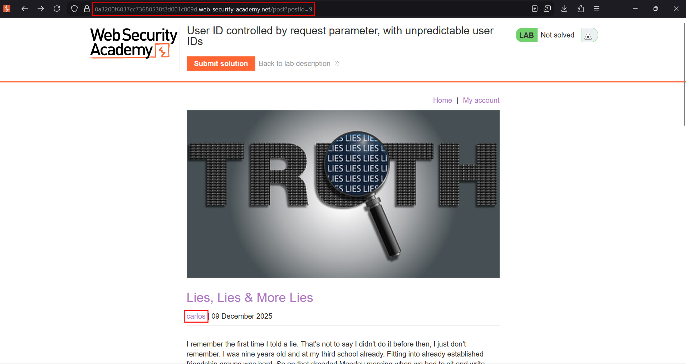
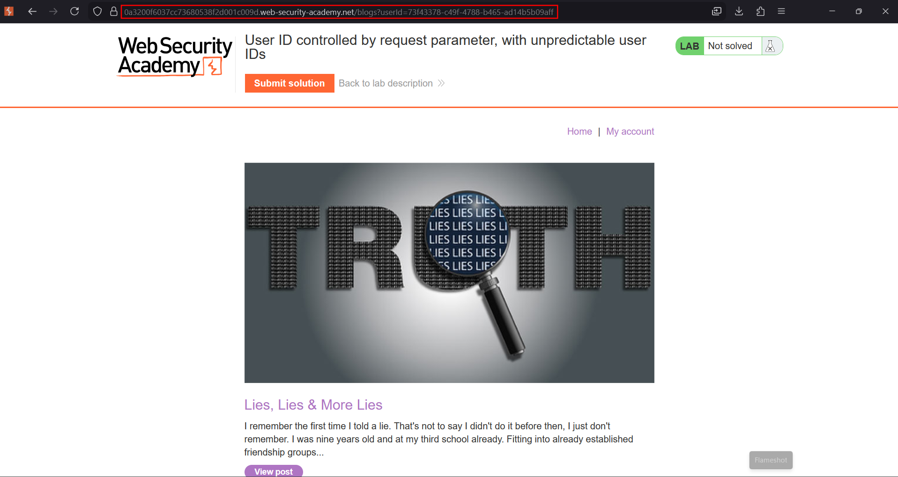
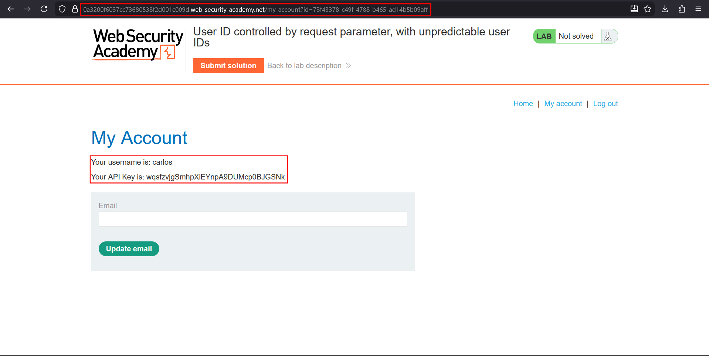

# User ID controlled by request parameter, with unpredictable user IDs

**Lab:** PortSwigger Web Security Academy — *User ID controlled by request parameter, with unpredictable user IDs* (Apprentice).

> This lab has a horizontal privilege escalation vulnerability on the user account page, but identifies users with GUIDs. To solve the lab, find the GUID for `carlos`, then submit his API key. Credentials: `wiener:peter`.

Replacing sequential IDs or usernames with GUIDs stops *guessing*, but it does not fix access control. If a GUID can be **discovered** somewhere else in the application and the account page still performs no ownership check, it is the same IDOR.

## 1. Look for places GUIDs are leaked

The account page uses a GUID in the `id` parameter, so it cannot be brute-forced. Instead, look for features that expose *other* users' GUIDs. In this lab, every blog post links its author to a page that lists the author's posts. Open a post written by `carlos`:



## 2. Harvest carlos's GUID

Clicking the author name goes to a URL that contains the author's identifier:

```text
/blogs?userId=73f43378-c49f-4788-b465-ad14b5b09aff
```



## 3. Use the GUID on the account page

Log in as `wiener`, then request the account page with Carlos's GUID in place of your own:

```text
/my-account?id=73f43378-c49f-4788-b465-ad14b5b09aff
```

The response is Carlos's account, with his API key.



Submit the key to solve the lab.

## Why the attack works

Unpredictable identifiers are *obscurity*, not authorization. The application leaks the GUID in a public page and then accepts any valid GUID on the sensitive endpoint without checking that it belongs to the logged-in user.

## Remediation

Enforce ownership on every request, regardless of how hard the identifier is to guess. Avoid exposing internal user GUIDs in public pages and use a separate public handle (display name, slug) for linking.
