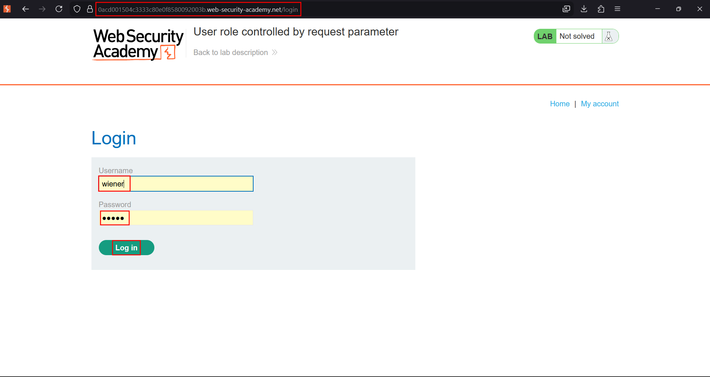
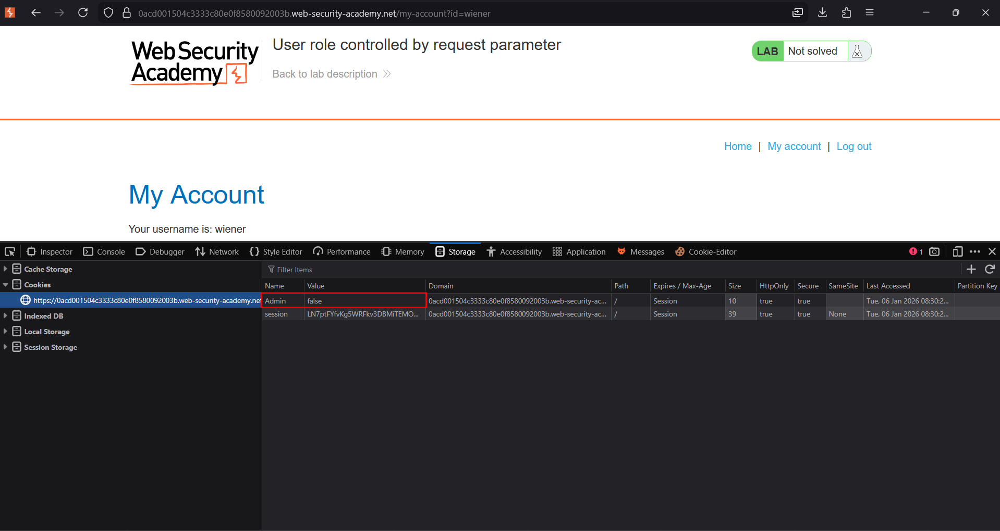
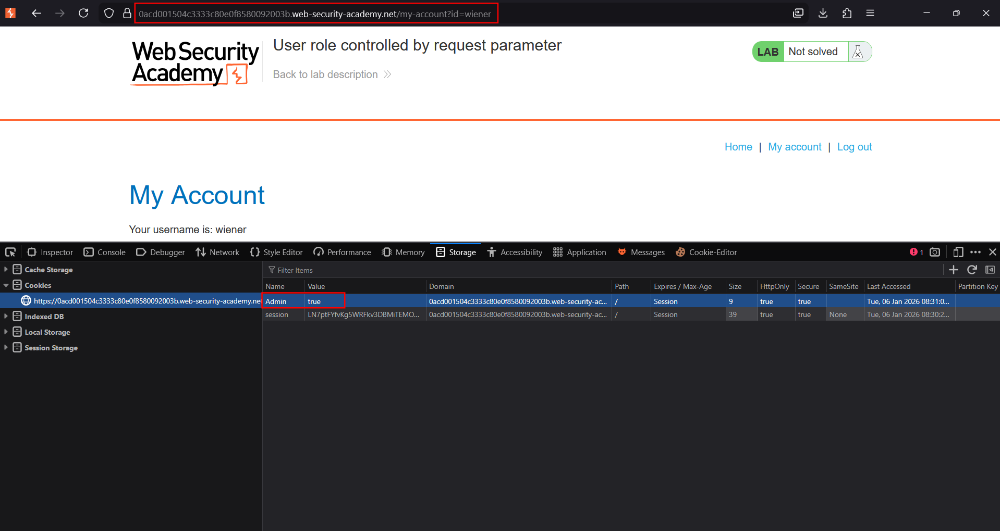
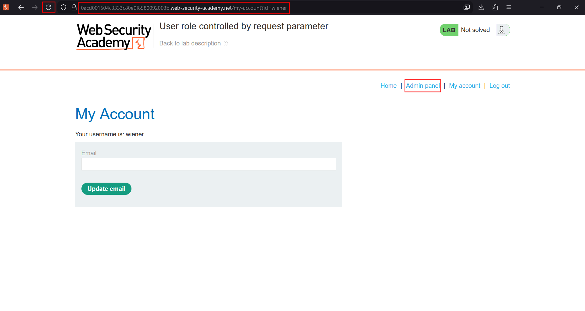
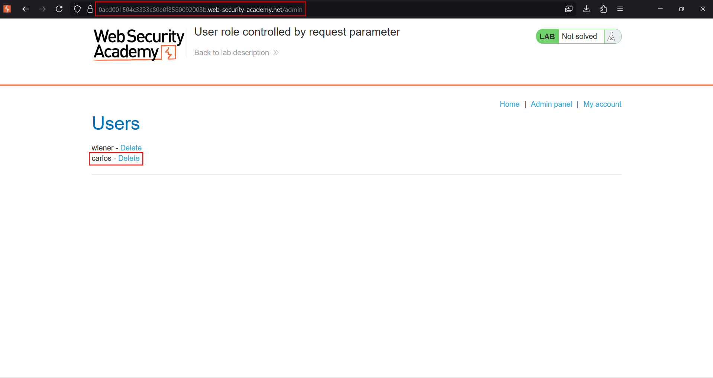

# User role controlled by request parameter

**Lab:** PortSwigger Web Security Academy — *User role controlled by request parameter* (Apprentice).

> This lab has an admin panel at `/admin`, which identifies administrators using a forgeable cookie. Solve the lab by accessing the admin panel and using it to delete the user `carlos`. Credentials: `wiener:peter`.

This is a **vertical** privilege-escalation flaw caused by trusting a client-controlled value for the access decision. The application reads an `Admin` cookie to decide whether you are an administrator — but the browser (and therefore the user) can set that cookie to anything.

## 1. Log in and inspect your cookies

Log in as `wiener:peter`, then open your browser's developer tools and look at the cookies for the site. Alongside the `session` cookie there is an `Admin` cookie set to `false`:

## 2. Forge the Admin cookie

Edit the `Admin` cookie value from `false` to `true` (any cookie editor, Burp, or the dev-tools storage panel works):

## 3. Reload and open the admin panel

Reload the account page. Because the application now reads `Admin=true`, it renders the **Admin panel** link:

## 4. Delete carlos

Open the admin panel at `/admin` and click **Delete** next to `carlos`:

The lab is solved.

## Why the attack works

The application makes its authorization decision from the `Admin` cookie, which is **supplied by the client**. Cookies are fully under the user's control, so claiming `Admin=true` is trivial. Identity and role must be derived from trusted server-side session state, not echoed back to the client in an editable value.

## Remediation

Store the user's role server-side, keyed to the authenticated session, and look it up on each request. Never make an access decision based on a cookie or any other value the client can modify.
