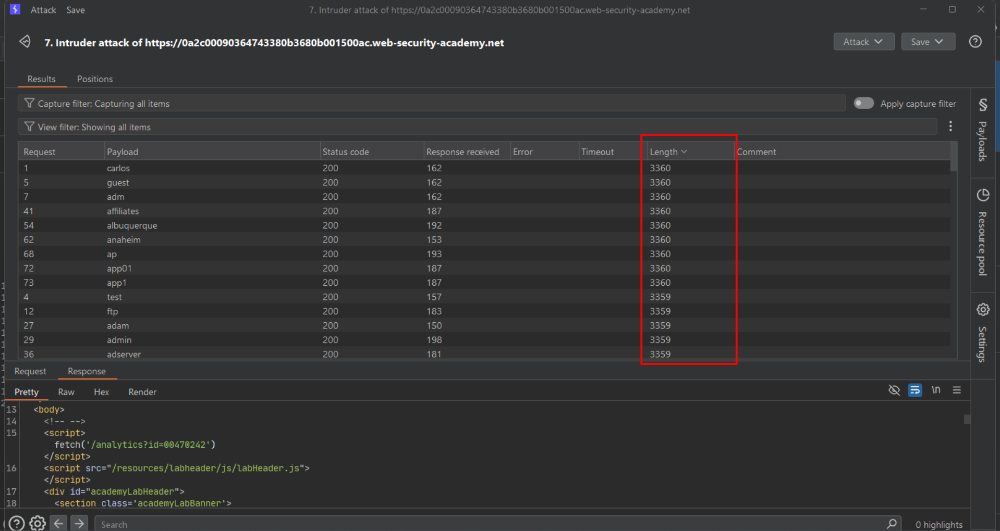
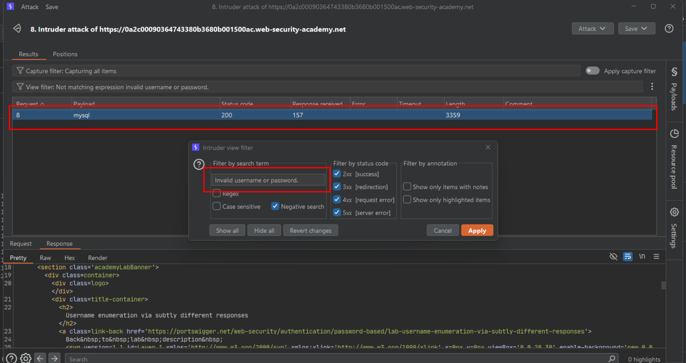
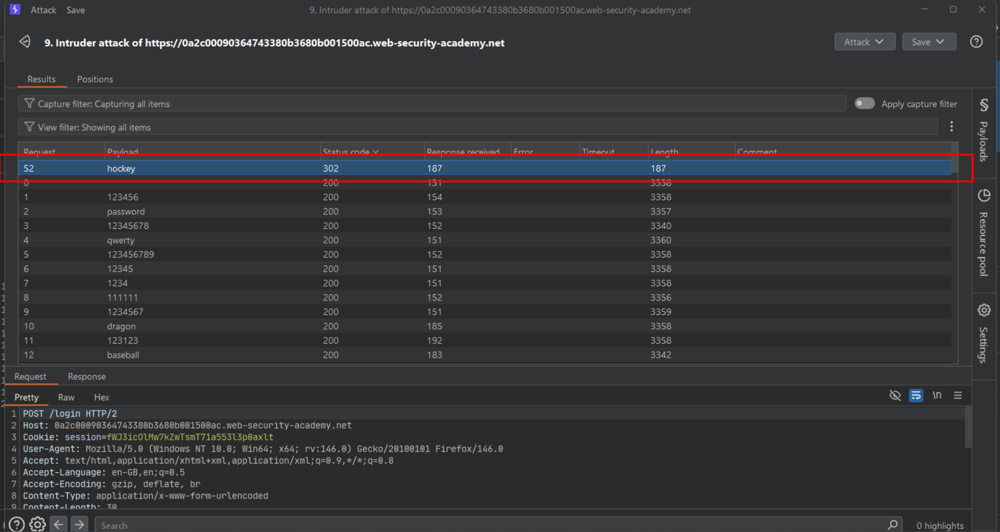
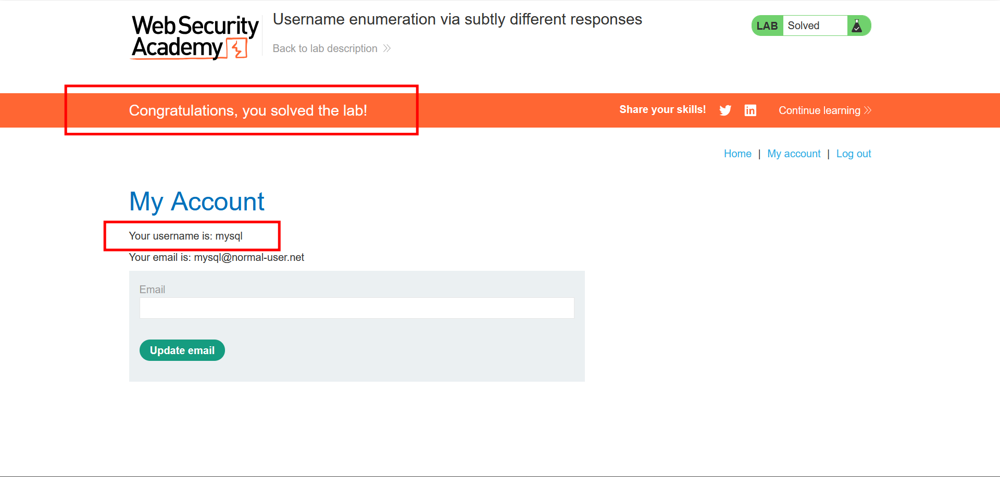

# Username enumeration via subtly different responses

**Lab:** PortSwigger Web Security Academy — *Username enumeration via subtly different responses* (Practitioner).

> This lab is subtly vulnerable to username enumeration and password brute-force attacks. It has an account with a predictable username and password, found in the candidate wordlists. To solve the lab, enumerate a valid username, brute-force that user's password, then access their account page.

## BASICS: when the difference is nearly invisible

The previous [username enumeration via different responses](username-enumeration-different-responses.md) lab had an obvious tell: a visibly different message or status code. Real applications are often "fixed" just enough to remove the obvious difference while leaving a subtler one behind — a missing full stop, an extra space, a reordered word. Scanning hundreds of responses by eye for a one-character difference is impractical; the fix is to let Burp do the comparison.

## 1. Run the username brute-force

Capture a failed login, send it to Intruder, set the payload position on `username`, and attack with the candidate-username list while leaving the password fixed.

## 2. Filter out the common error text

With hundreds of same-looking `200` responses, use Intruder's **view filter** to do a **negative search**: filter for responses that do *not* contain the generic error text (for example `Invalid username or password.`), with **Negative search** enabled.

Only the response(s) whose body text differs even slightly from that exact string remain visible — in this lab, one entry has a subtly different message (such as a different trailing character or capitalization), revealing the valid username.

## 3. Brute-force the password

Fix the `username` parameter to the discovered value, move the payload position to `password`, and run a new Sniper attack with the candidate-password list.

## 4. Identify the successful login

Sort by status code or length; the correct password produces a redirect instead of another login-page response.

## 5. Log in and solve the lab

Submit the recovered credentials through the login form and open the account page.

## Why it works

Removing an *obvious* behavioral difference does not guarantee the responses are byte-for-byte identical. Template whitespace, punctuation, capitalization, or ordering differences are easy to introduce by accident when two near-identical error paths are maintained separately in code, and Burp's response-diffing and filtering make even a single differing character trivial to isolate across a large result set.

## Remediation

- Generate the failure response from a **single code path** for every invalid-login reason, so there is no second template to drift out of sync.
- Diff your own application's valid vs. invalid responses byte-for-byte during testing — do not rely on a visual read-through.
- Combine this with rate limiting and account lockout, since removing the enumeration oracle does not by itself stop brute-forcing once a username is otherwise known.
