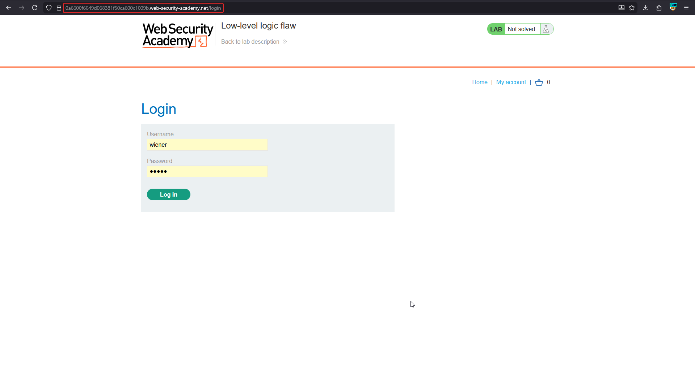

# Low-level logic flaw

**Lab:** PortSwigger Web Security Academy — *Low-level logic flaw* (Practitioner).

> This lab doesn't adequately validate user input. You can exploit a logic flaw in its purchasing workflow to buy items for an unintended price. To solve the lab, buy a "Lightweight l33t leather jacket". Credentials: `wiener:peter`.

Unlike the high-level lab, the logic here is *correct* (negative quantities are rejected). The flaw is in the **implementation**: the cart total is stored in a signed integer that has a maximum value. When the total grows past it, the number **wraps around** to a large negative one. By buying a huge quantity you can drive the total negative, and then bring it back up to a small positive amount.

!!! info "Integer overflow"
    A signed 32-bit integer tops out at 2,147,483,647. Adding 1 more produces -2,147,483,648. Prices are often kept in cents, so a $1337.00 jacket is `133700`, and enough of them overflow the total.

## 1. Log in and capture the add-to-cart request

Log in as `wiener:peter` and add the jacket to the cart, sending the `POST /cart` request to Burp.

The server limits the quantity per request (to two digits, so at most 99) but does not limit how many times you can add the same item.

## 2. Make the total overflow

Send the add-to-cart request to **Intruder**, set quantity to `99`, and use a *Null payloads* attack with continuous (many, around 300+) repeats with a single thread. Each request adds 99 jackets to the cart. Watch the cart total grow, hit the 32-bit limit, and wrap to a negative number.

## 3. Tune the total to a small positive number

Once the total is negative, add a calculated number of the jacket (or another item) so the total climbs back toward zero. Aim for a positive total that is **below your store credit** ($100.00). A small adjustment with a cheaper item makes it precise.

## 4. Place the order

Place the order with the total below the store credit. The purchase is accepted, and the lab is solved.

!!! note "About this walkthrough"
    The source notes for this lab only contain the lab login screen. The exploitation steps above follow the lab's intended solution rather than recorded screenshots; the exact request counts depend on the product prices in your lab instance.

## Why the attack works

The application checks that each quantity is positive and small, but never checks the *running total* for overflow. Arithmetic that silently wraps turns a very large order into a very cheap one.

## Remediation

Use a data type that cannot overflow for money (a wide integer or decimal) and validate the total against a reasonable maximum before saving. Cap the total quantity per item and per order, not only per request.
