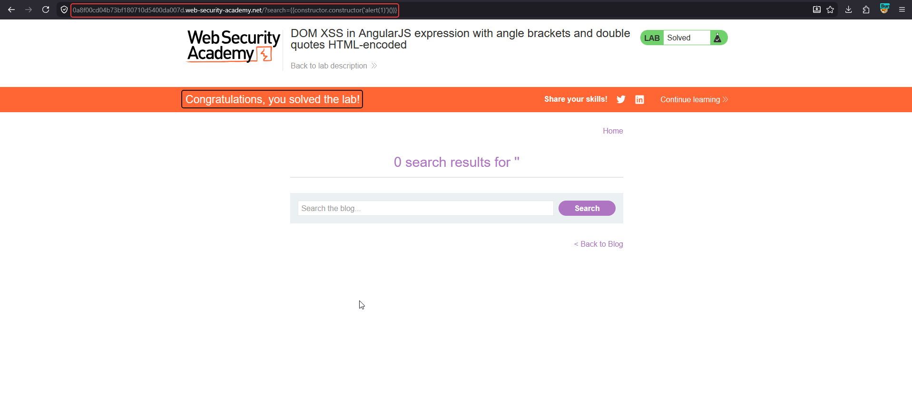

# DOM XSS in AngularJS expression with angle brackets HTML-encoded

**Lab:** PortSwigger Web Security Academy — *DOM XSS in AngularJS expression with angle brackets and double quotes HTML-encoded* (Apprentice).

> The lab contains a DOM-based XSS vulnerability in a AngularJS expression within the search functionality. The goal is to perform an XSS attack that executes an AngularJS expression and calls the `alert` function.

AngularJS scans any element marked with the `ng-app` directive and **evaluates expressions inside double curly braces** `{{ ... }}`. If user input is reflected inside such an element, you can inject an AngularJS expression instead of HTML — which is exactly what you need when angle brackets and quotes are encoded, because the expression needs neither.

## Why this is different

- The page uses AngularJS: an `ng-app` directive is present on a container that includes the reflected value.
- Angle brackets (`<`, `>`) and double quotes are HTML-encoded, so classic tag or attribute injection is blocked.
- But `{{` and `}}` are **not** special to HTML, so they pass through — and AngularJS will evaluate whatever expression they contain. This is **client-side template injection**.

## The payload

Modern AngularJS has an expression sandbox, so a bare `{{alert(1)}}` is blocked. The standard escape reaches the native `Function` constructor via an object's constructor chain and builds a function that calls `alert`:

```text
{{constructor.constructor('alert(1)')()}}
```

- `constructor.constructor` resolves to the `Function` constructor.
- `Function('alert(1)')` creates a new function whose body is `alert(1)`.
- The trailing `()` invokes it immediately.

## 1. Deliver the expression

Submit the payload through the search field, or place it directly in the URL:

```text
/?search={{constructor.constructor('alert(1)')()}}
```

AngularJS evaluates the expression inside the `ng-app` scope and `alert` fires:



The lab is solved as soon as the expression executes.

## Why the attack works

AngularJS treats text inside `{{ }}` within an `ng-app` region as a template expression and evaluates it. HTML-encoding of angle brackets and quotes is irrelevant because the injection is an **expression**, not markup. Reaching `constructor.constructor` lets the payload break out of the AngularJS expression sandbox and call native JavaScript.

!!! note "Client-side template injection"
    This is the client-side cousin of server-side template injection (SSTI). Any framework that interpolates user input into its own expression language — AngularJS, Vue, Handlebars-style templates — can be abused this way if raw input reaches a template context.

## Remediation

Do not place untrusted input inside a region governed by a client-side template framework. Keep user data out of `ng-app` scopes, render it with bindings that treat it as text, and prefer modern Angular (2+), which does not evaluate `{{ }}` expressions from arbitrary interpolated strings the way AngularJS 1.x does.
