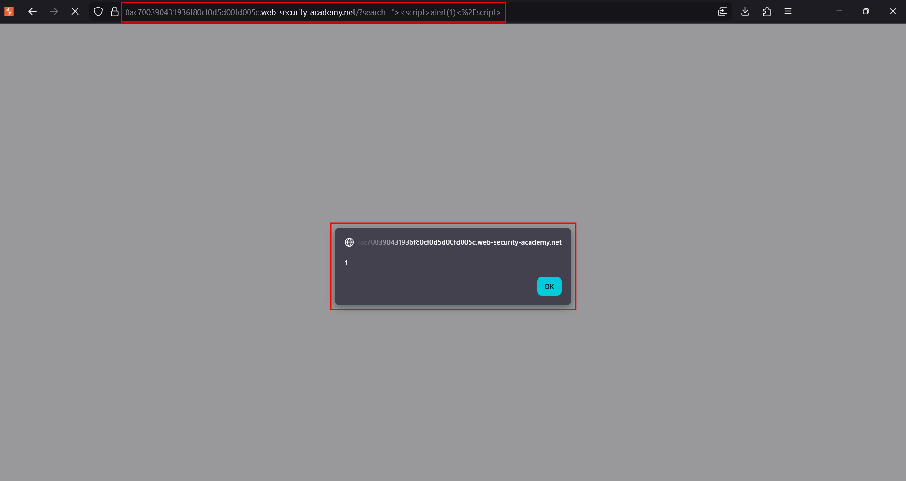
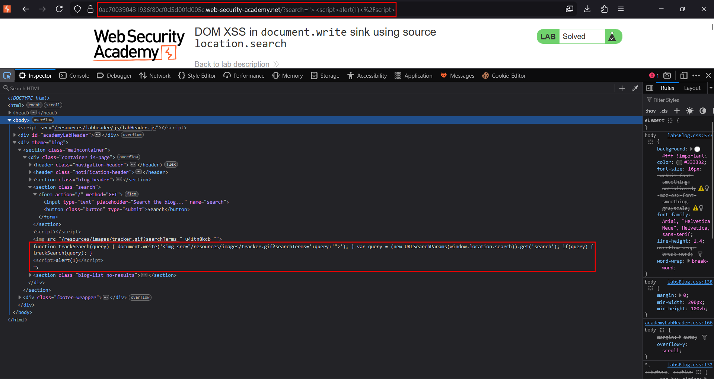

# DOM XSS in `document.write` sink using `location.search`

**Lab:** PortSwigger Web Security Academy — *DOM XSS in `document.write` sink using source `location.search`* (Apprentice).

> The lab contains a DOM-based XSS vulnerability in the search query tracking functionality. It uses `document.write`, which writes data to the page. The `document.write` function is called with data from `location.search`, which can be controlled via the website URL. The goal is to call the `alert` function.

`document.write()` writes a string straight into the HTML stream as the page parses, so whatever markup it receives becomes part of the document. This is a classic **source → sink** DOM flow with the server never seeing the payload in a meaningful way.

## Source and sink

- **Source** — `location.search`, the URL query string, fully attacker-controlled.
- **Sink** — `document.write()`, which parses its argument as HTML.

The vulnerable client-side code builds an `` tag from the search term and writes it:

```js
function trackSearch(query) {
    document.write('');
}
var query = (new URLSearchParams(window.location.search)).get('search');
if (query) {
    trackSearch(query);   // location.search -> document.write sink
}
```

Your value lands inside the `src="..."` attribute of that image.

## 1. Visit the page

Open the lab and use the blog search. The term is reflected into the tracker image's `src` by `document.write`.


## 2. Break out of the src attribute

Close the `src` attribute and the `` tag with `">`, then inject your own element. Because this sink parses fresh HTML, a straightforward tag works:

```text
"><script>alert(1)</script>
```

A `<svg onload=alert(1)>` payload is an equally reliable alternative.




## 3. The sink executes

`document.write` emits:

```html
<script>alert(1)</script>">
```

The browser parses the new `<script>` node as the document streams and `alert` runs:



## Why the attack works

`document.write` injects its argument into the page as it is being parsed, so attacker markup becomes live document structure. The value came from `location.search` and was concatenated into HTML with no encoding — a textbook unsafe source-to-sink flow.

!!! tip "document.write vs innerHTML"
    Unlike `innerHTML`, markup written by `document.write` during initial parsing **can** run a plain `<script>` tag, because it is injected into the live parser stream rather than assigned to an already-parsed element.

## Remediation

Avoid `document.write` with untrusted data. Build the URL safely (e.g. set `img.src` via the DOM API with an encoded parameter) or use `encodeURIComponent()` on the value before placing it in a URL. Treat every URL-derived value as attacker-controlled.
