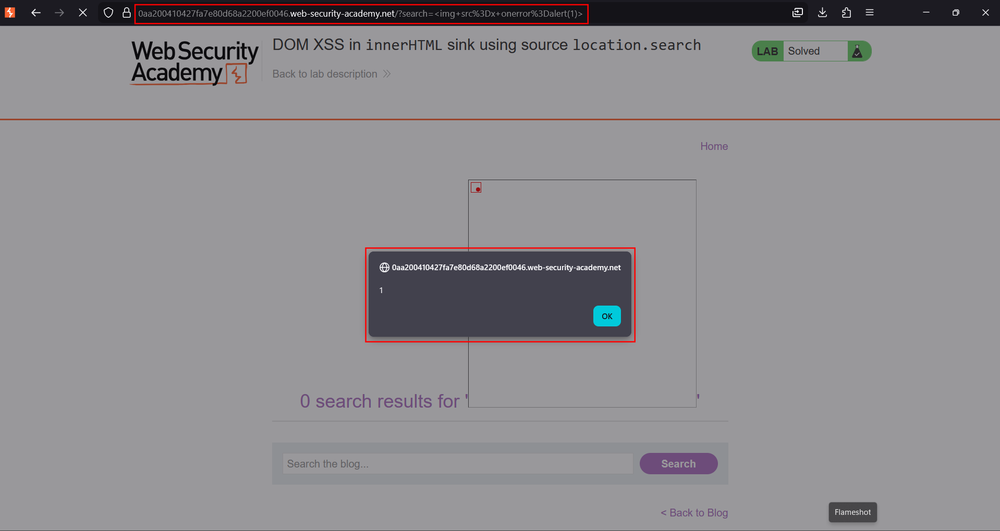
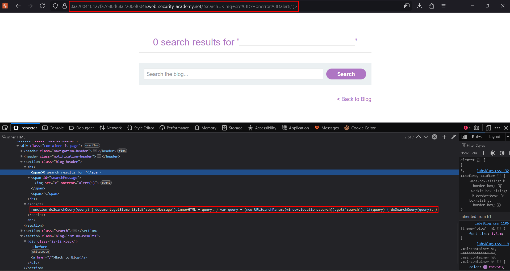

# DOM XSS in `innerHTML` sink using `location.search`

**Lab:** PortSwigger Web Security Academy — *DOM XSS in `innerHTML` sink using source `location.search`* (Apprentice).

> The lab has a DOM-based cross-site scripting vulnerability in the search blog functionality. It uses an `innerHTML` assignment that changes the HTML contents of a `div` using data from `location.search`. The goal is to call the `alert` function.

This lab is a clean example of a **source → sink** flow happening entirely in the browser. The server is not involved in the injection; the page's own JavaScript is.

## Source and sink in JavaScript

- **Source** — any place attacker-influenced data originates. Here it is `location.search` (the URL query string), which is fully user-controlled.
- **Sink** — any place data is written in a way that can execute. Here it is `innerHTML`, which *parses its input as HTML*.

Common sources and sinks to recognise:

```js
// sources (untrusted input)
location.search         // URL query string
location.hash           // URL fragment
document.cookie         // cookies
localStorage.getItem()  // browser storage

// sinks (dangerous if fed untrusted data)
element.innerHTML = x;  // parses HTML
document.write(x);      // writes markup
eval(x);                // executes JS
```

## The vulnerable code

The lab's client-side script reads the `search` parameter and assigns it straight into `innerHTML`:

```js
function doSearchQuery(query) {
    document.getElementById('searchMessage').innerHTML = query;  // sink
}

var query = (new URLSearchParams(window.location.search)).get('search'); // source

if (query) {
    doSearchQuery(query);
}
/*
  location.search (source)
        ↓
  URLSearchParams.get('search')
        ↓
  doSearchQuery(query)
        ↓
  innerHTML (sink)
*/
```

The value is never validated or encoded, so whatever HTML is in the `search` parameter is parsed into the page.

## 1. Visit the page and locate the search field

Open the lab and use the blog search. The term you type is written into the `searchMessage` element by the script above.


## 2. Choose a payload that fires without `<script>`

A plain `<script>` tag inserted via `innerHTML` **does not execute** — the HTML spec says script elements added this way do not run. So we use an element with an event handler that the browser fires on its own:

```html

```

The browser tries to load the image `1`, fails, and runs the `onerror` handler.


## 3. Trigger the sink

Submit the search (or load the URL with `?search=`). The script copies the payload into `innerHTML`, the broken image fires `onerror`, and `alert` runs:





## Why the attack works

The page trusts a value it reads from the URL and writes it into an HTML-parsing sink. Because `innerHTML` interprets markup, an attacker-chosen element and event handler become live code — all without the server ever processing the payload.

!!! tip "Why not `<script>`?"
    When you assign a string containing `<script>` to `innerHTML`, the script node is created but **not executed** per the HTML standard. Event-handler payloads (`onerror`, `onload`, `onmouseover`) are the standard way around this for `innerHTML` sinks.

## Remediation

Do not write untrusted data into `innerHTML`. Use `textContent` (which never parses HTML) for display, or sanitise with a trusted library before insertion. Treat every URL-derived value as attacker-controlled.
