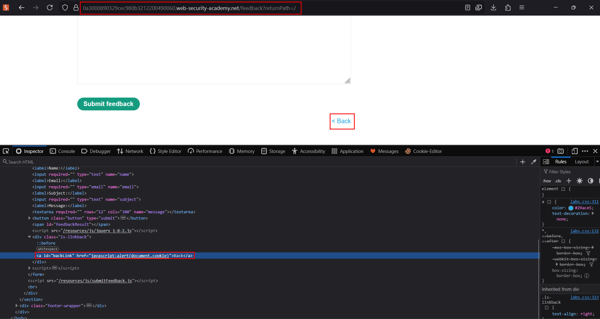
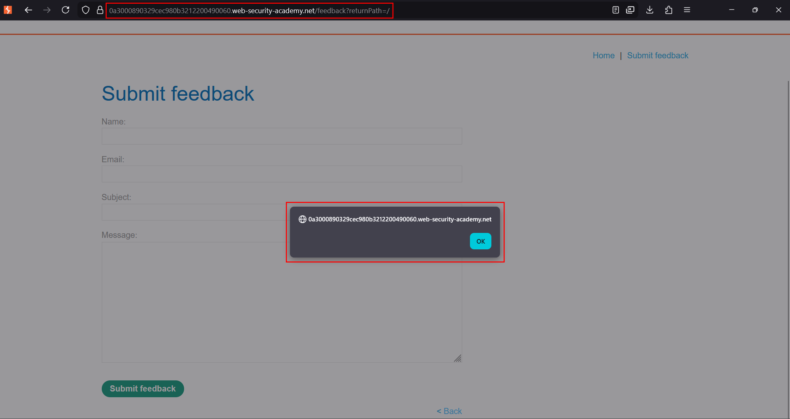
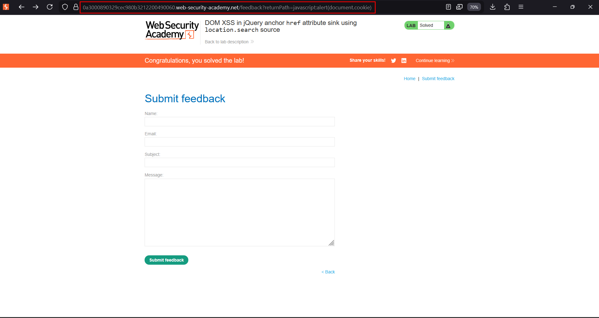

# DOM XSS in jQuery anchor `href` attribute sink using `location.search`

**Lab:** PortSwigger Web Security Academy — *DOM XSS in jQuery anchor `href` attribute sink using `location.search` source* (Apprentice).

> The lab contains a DOM-based XSS vulnerability in the submit-feedback page. It uses the jQuery library's `$` selector function to find an anchor element, and changes its `href` attribute using data from `location.search`. The goal is to make the "back" link call `alert(document.cookie)`.

jQuery's `.attr('href', value)` is a DOM sink when the value is attacker-controlled: writing a `javascript:` URI into an `href` makes the link execute code when it is activated.

## Source and sink

- **Source** — `location.search`, read via a `returnPath` (or similar) query parameter.
- **Sink** — `$(selector).attr('href', value)`, which sets the anchor's `href`.

The vulnerable code reads the parameter and assigns it to the "back" link:

```js
$(function() {
    $('#backLink').attr('href', (new URLSearchParams(window.location.search)).get('returnPath'));
});
```

Whatever is in `returnPath` becomes the `href` of the back link.

## 1. Visit the feedback page

Open the lab's **Submit feedback** page and note the **Back** link, whose `href` is driven by the `returnPath` parameter.


## 2. Put a javascript: URI in the parameter

Change the URL so `returnPath` is a `javascript:` URI that reads the cookie:

```text
/feedback?returnPath=javascript:alert(document.cookie)
```

jQuery writes this straight into the link's `href`.





## 3. Click the back link

Activating the link navigates the `javascript:` URI and runs the payload:



The lab is solved once clicking **Back** triggers the alert.

## Why the attack works

The application trusts a value from the URL and writes it into an `href` with no scheme validation. An `href` is a URL, and the `javascript:` scheme executes its body in the page's origin — so a crafted link turns a benign navigation control into a code-execution sink. jQuery's `.attr()` performs no sanitisation of its own.

## Remediation

Never place untrusted data into an `href` without validating the URL scheme — allow only `http:`/`https:` (and relative paths). Avoid driving navigation targets from the query string; if you must, resolve them against an allowlist of known paths rather than reflecting the raw value.
