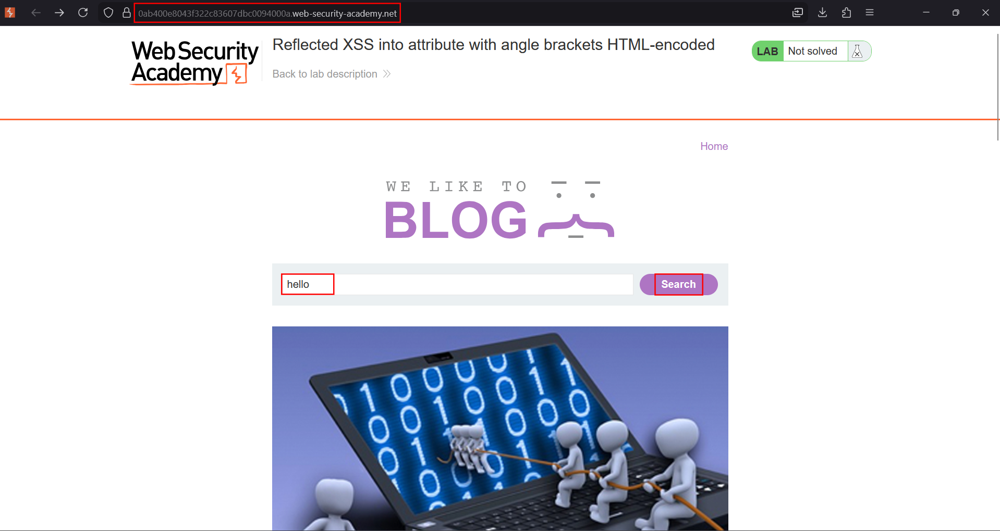
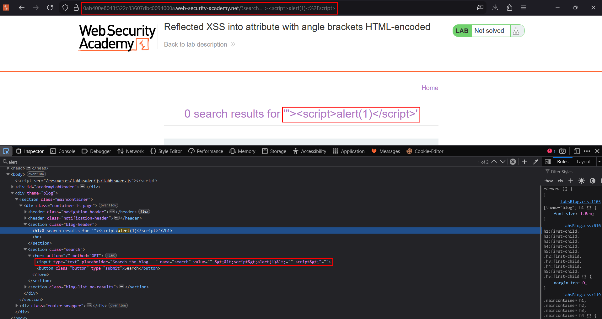
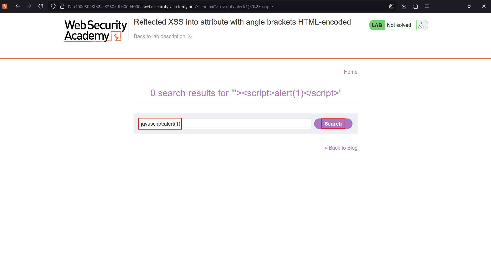
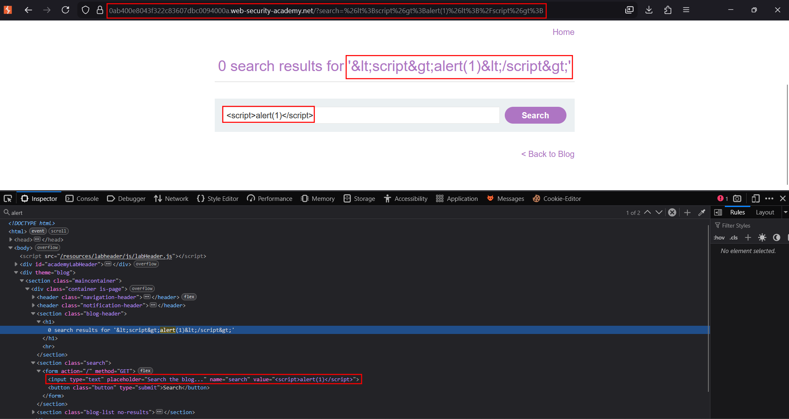
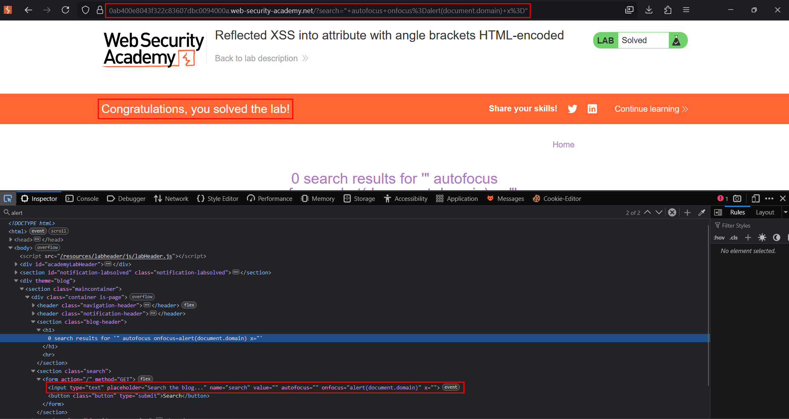

# Reflected XSS into attribute with angle brackets HTML-encoded

**Lab:** PortSwigger Web Security Academy — *Reflected XSS into HTML context with angle brackets HTML-encoded* (Apprentice).

> The lab has a reflected XSS vulnerability in the search blog functionality where angle brackets are HTML-encoded. The goal is to perform a cross-site scripting attack that injects an attribute and calls the `alert` function.

This lab introduces the idea that **encoding is context-specific**. The application encodes `<` and `>` (to `&lt;` and `&gt;`), so you cannot inject a new tag like `<script>`. But the value is reflected **inside an existing HTML attribute**, and the quote that delimits that attribute is *not* encoded — so you can still break out of the attribute value and add your own attributes.

## Where the value lands

The search term is reflected into an attribute, something like:

```html
<input type="text" placeholder="Search the blog..." name="search" value="REFLECTED-HERE">
```

Because angle brackets are encoded, a `<script>` payload is rendered inert. The attribute context, however, is still fully controllable: a `"` closes the `value` attribute, after which anything you type becomes new markup *attributes* on the same `<input>` tag.

## 1. Find the reflection and confirm encoding

Search for a unique marker and inspect the response. You will see your marker inside the `value` attribute, and if you try `<test>` you will see `&lt;test&gt;` — angle brackets are encoded.





## 2. Break out of the attribute

Since tags are blocked but the quote is not, close the `value` attribute with `"` and add an event-handler attribute. `autofocus` makes the browser move focus to the element automatically, which fires `onfocus` without any user interaction:

```text
" autofocus onfocus=alert(document.domain) x="
```

The trailing `x="` re-opens a dummy attribute so the surrounding quote in the original markup stays balanced.





## 3. The handler fires

The resulting element becomes:

```html
<input ... value="" autofocus onfocus=alert(document.domain) x="">
```

The browser auto-focuses the input and runs the `onfocus` handler, so `alert` fires on page load:



## Why the attack works

Encoding angle brackets only stops **new tags**. The injection point is an attribute value, and the quote character that delimits it was left unencoded. With one `"` you escape the value and begin writing attributes of your own — and event handlers (`onfocus`, `onmouseover`, `onclick`) are JavaScript. `autofocus` turns a handler that normally needs interaction into one that runs by itself.

!!! note "Match the quote"
    Check whether the attribute uses double or single quotes and break out with the same character. If the value is inside `value='...'`, use `'` instead of `"`.

## Remediation

Encoding must be **context-aware**. Inside an HTML attribute, also encode the quote characters (`"` → `&quot;`, `'` → `&#39;`) so the value cannot escape the attribute. Prefer frameworks that apply attribute-context encoding automatically, and validate input where a known format is expected.
